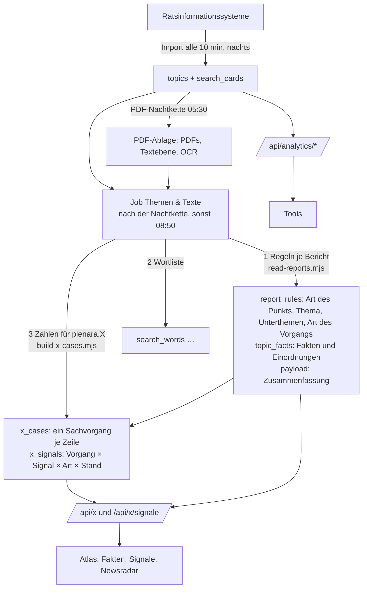

# plenara.X im Überblick

Stand 15.10.2026. Wie plenara.X aufgebaut ist, woher die Zahlen kommen, wer was nutzt und was davon gebraucht wird. Kein Konzept für Neues, sondern die Landkarte dessen, was da ist. Einzelheiten stehen in den verlinkten Dateien.

## Wofür und für wen

plenara.X ist der Analyse-Teil von Plenara (Tarif Enterprise; frei sind nur die Übersichten `/analytics/ueber` und `/analytics/tools`). Grundlage sind dieselben Ratsunterlagen wie in der Suche. plenara.X liest aus ihnen nach festen Regeln Themen, Ereignisse und Werte und zählt sie über alle Kommunen. Es gibt kein KI-Modell im Ablauf, und jede Zahl führt zurück zu den Vorgängen und Originalquellen.

| Zielgruppe | Frage | Seite |
|---|---|---|
| Branchen: Bau, Ingenieurbüros, Energie, Projektentwicklung, Telekommunikation, Mobilität | Wo entsteht gerade etwas, das für uns ein Auftrag werden kann? | **Signale** |
| Verbände, Kämmereien, Wirtschaftsförderung, Presse, Beratung | Was kostet es wo, wo steigt es? (Steuern, Gebühren, Haushalt, Preise) | **Fakten** |
| Verbände, Stiftungen, Presse, Forschung, Politik | Worüber wird wo beraten, wie viel, wie verbreitet? | **Atlas** |
| Politik, Presse, Verwaltung | Wer beantragt was, wie entscheiden Gremien, was ist berichtenswert? | **Tools** |

## Die Seiten

| Seite | Adresse | Was sie zeigt | Abfrage | Liest |
|---|---|---|---|---|
| Start | `/analytics/ueber` | Übersicht und Einstieg | – | – |
| **Signale** | `/analytics/signale` | 11 Kategorien von Ereignissen (Vergaben, Wohnbau, Gewerbe, Wind, Solar, Wärme, Schulen, Straßen, Wasser, Breitband, Mobilität) mit Art (Filter) und Stand; Liste, ausklappbare Karte. Keine Kennzahlen, Zahlen gehören zu Fakten | `/api/x/signale` (`plenara-x-signals.mjs`) | `x_signals`, `x_cases`, `topic_facts` |
| **Fakten** | `/analytics/fakten` | Werte je Gemeinde auf der Karte, rot bis grün: jüngster Wert oder Veränderung, Kreis- und Landesmedian, Abdeckung, Vorgänge hinter jedem Wert | `/api/x?view=fakten` (`plenara-x-query.mjs`) | `x_cases`, `topic_facts` |
| **Atlas** | `/analytics/atlas` | die 10 Themen der Suche: Unterthemen, Verlauf, Orte, Ort im Vergleich, jüngste Vorgänge | `/api/x?view=atlas` | `x_cases`, `report_rules` |
| Tools: Ausbreitung | `/analytics/diffusion` | wie sich ein Begriff über Orte und Zeit ausbreitet | `/api/analytics/diffusion` | `x_cases` (Titel aus der Karte) |
| Tools: Themennetz | `/analytics/graph` | welche Begriffe zusammen vorkommen | `/api/analytics/graph` | `x_cases`, `search_words` |
| Tools: Trends | `/analytics/trends` | Begriffe, die zu- oder abnehmen | `/api/analytics/trends` | `x_cases` (Titel aus `search_cards`) |
| Tools: Ortsvergleich | `/analytics/vergleich` | Orte nebeneinander | `/api/analytics/compare` | `x_cases` (Titel aus der Karte) |
| Tools: Beschlüsse | `/analytics/beschluesse` | Beschlussquote, Vertagungen, Dauer | `/api/analytics/decisions` | `x_cases`, Karten der Vorgänge, `topics` |
| Tools: Beratungswege | `/analytics/gremien` | Weg der Vorgänge durch die Gremien | `/api/analytics/network` | `x_cases` (Titel aus der Karte) |
| Tools: Fraktionsprofil | `/analytics/fraktionen` | Anträge je Fraktion und was aus ihnen wird | `/api/analytics/fraktionen` | `x_cases`, `report_rules`, `topic_facts` (`faction`, `faction_advice`) |
| Tools: Newsradar | `/analytics/news` | berichtenswerte Vorgänge als Meldung mit Zitat | `/api/analytics/news` | `x_cases`, `report_rules`, `topic_facts` |

Signale, Fakten und Atlas laufen über die vorberechneten Tabellen. Auch die Tools sind schnell (Server 15.10.2026: 0,1 bis 0,3 s mit einem seltenen Begriff, bis 3 s mit „Haushalt“; Newsradar und Fraktionsprofil 1 bis 3 s).

Entfernt (14./15.10.2026): Themenradare, Kita-, Bauleitplanungs- und Förderseiten, plenara.X Score, Lena, „Was geschieht“ im Atlas.

## Datenfluss

In Worten:

1. **Import:** Berichte, Sitzungen und Dokumentlisten kommen aus den Ratsinformationssystemen in `topics` und als Suchkarten in `search_cards`.
2. **PDF-Ablage:** Hauptdokumente (und übrige PDFs) werden geladen, ihre Textebene gelesen, Scans per OCR. Nur auf dem Server; der Server erzeugt alles aus seinen eigenen PDFs.
3. **Regeln je Bericht** (`read-reports.mjs`, `report-rules.mjs`): ein Durchlauf je Bericht, jede Regel liest nur Quellen (Titel, Beschlussvorschlag, Text des Hauptdokuments, passende Anlagen), nie das Ergebnis einer anderen Regel. Ergebnis: Art des Punkts (Sachpunkt oder Formalie), Thema und Unterthemen, Art des Vorgangs, Regel-Zusammenfassung und die Fakten (`topic_facts`). Neue Regelfassung → `FACTS_VERSION` bzw. Version der Regel erhöhen, dann „Alle neu erstellen“ (Server: etwa 40 Minuten für 1,5 Mio. Berichte).
4. **Zahlen für plenara.X** (`x-cases.mjs`): `x_cases` fasst gleiche Titel je Gebiet zu einem Vorgang zusammen (nur Sachvorgänge), `x_signals` ordnet jeden Vorgang den Signalen zu. Alle plenara.X-Seiten zählen hier, nicht in den 14 GB `search_cards`.
5. **Abfragen:** `/api/x` (Atlas, Fakten, Listen hinter jeder Zahl) und `/api/x/signale`. Mit Suchbegriff sucht zuerst die normale Suche, gezählt werden deren Vorgänge. Zwischengespeichert je Bau.

## Ein Weg für alles

Jede Auswertung in plenara.X geht denselben Weg, ohne eigenes Datenmodell je Seite:

1. **Auswahl** über die normale Suche (`source()` in `plenara-x-query.mjs`: Filter, Wortliste, Volltext), dieselbe Logik wie auf der Startseite.
2. **Zählen** in `x_cases`: Vorgänge, keine Suchkarten; Formalien nie; derselbe Titel in mehreren Gremien eines Gebiets einmal.
3. **Anreichern** aus `report_rules` (Thema, Art des Vorgangs) und `topic_facts` (Werte, Einordnungen); Signale zusätzlich über `x_signals`, das aus beiden gebaut wird.

So arbeiten seit 15.10.2026 alle Seiten: Atlas, Signale, Fakten, Newsradar und alle Tools. Besonderheiten: Die Ausbreitung nimmt je Vorgang die erste Sitzung (`FIRST_DATE`, aus den Karten des Vorgangs), Ortsvergleich und Beschlüsse werten alle Karten eines Vorgangs aus (Ausschuss und Rat, je Vorgang und Status einmal), die Beratungswege die Stationen der jüngsten Karte. Fraktionsprofil und Newsradar nehmen die Fakten aller Karten eines Vorgangs. Begriffe je Vorgang (`terms`) und private Bauanträge (`private_build`) legt der Bau ab; Themennetz, Ortsvergleich, Trends, Fraktionsprofil und Newsradar zählen private Bauanträge nicht. `x_cases` enthält auch künftige Vorgänge (nur angesetzt, wie in der Suche); ohne Zeitraum gilt überall „bis heute“, nur der Newsradar sieht 10 Tage voraus. Der größte Teil der Zeit mit einem häufigen Begriff ist die Suche selbst und damit für alle Seiten gleich.

## Bausteine und wer sie nutzt

Alles regelbasiert; Messung und Freigabe stehen im Admin „Themen & Texte“ (`shared/rule-quality.json`).

| Baustein | Woher | Genutzt von |
|---|---|---|
| Art des Punkts (Sachpunkt, Formalie, Sammelpunkt) | Titel | allen Seiten (Formalien zählen nie), Suche „ohne Formalien“ |
| Thema, Unterthemen | Titel, Betreff, Beschlussvorschlag | Suche, Atlas |
| Mitgliedsgemeinde im Verband | Gremium, Titel | Atlas, Signale, Fakten, Listen, Ausbreitung, Newsradar |
| Art des Vorgangs (Antrag, Planung, Vergabe, Bau, Abgaben …) | Titel | Stand bei Signale Solar, Schulen, Mobilität; Newsradar |
| Signal-Regeln (Vergabe, Straße, Wasser, Breitband, Solar …) | meist Titel | Signale |
| Bausteine der Signale (Verfahrensschritt Bebauungsplan, Nutzung, Wärmeplanung, Hausform, Vorhaben) | Titel, Beschlussvorschlag, Text | Signale (Stand, Art) |
| Werte (Hebesätze, Gebühren, Haushalt, Jahresergebnis, Preise …) | Text des Hauptdokuments und Anlagen | Fakten |
| Fraktion, Empfehlung „ablehnen“ | Titel, Beschlussvorschlag | Fraktionsprofil |
| Ausgang der Sitzung | Ergebnis im Ratsinformationssystem | Newsradar |
| Eignung für Social Media | Titel, Vorgang | Admin „Social Media“ |

## Qualität und Freigabe

- Gemessen wird nur an ungesehenen Stichproben vom Server; eingetragen wird die ehrliche Zahl vor einer Korrektur.
- **Signale:** „offen“ erst, wenn Qualität, Art und Stand je ab 90 % und die Trefferquote ab 80 % liegen. Qualität ist wichtiger als Trefferquote.
- **Fakten:** ein Wert kommt erst ab 90 % Qualität auf die Karte. Welche es sind, steht an einer Stelle: `shared/map-facts.mjs` (Server und Admin lesen dieselbe Liste).
- Stand heute auf der Karte: Hebesätze (911 Gebiete), Jahresergebnis (1.377), Wasser- und Abwassergebühren (551), Haushalt je Einwohner (310), Gewerbegrundstückspreise (36).
- Vorbereitet, aber gesperrt (unter 90 % oder ungemessen): Zuschüsse, Kita-Gebühren, Bauplatzpreise, Hundesteuer, Zweitwohnungsteuer, Vergnügungssteuer, Abfallgebühr, Wohneinheiten, Leistung Wind/Solar, Plangebietsgröße, Windanlagen, Straßenbaukosten.

## Was gebraucht wird, was nicht

**Gebraucht (Kern):** Import, PDF-Ablage mit Text und OCR, Job „Themen & Texte“ mit seinen drei Schritten, `report_rules`, `topic_facts`, `x_cases`, `x_signals`, die beiden Abfragen `/api/x` und `/api/x/signale`, Signale, Fakten, Atlas, Admin „Themen & Texte“.

**Gebraucht:** die Tools. Sie zählen über denselben Weg (Suche → `x_cases`); Fraktionsprofil und Newsradar nutzen zusätzlich einzelne Regeln. Ihre Ergebnisse sind Zählungen und brauchen keine eigene Messung.

**Nicht mehr gebraucht oder nur Rückfall:**
- `scripts/pdf-store/summaries.mjs` und `facts.mjs`: alter Weg vor `read-reports.mjs`, nur noch Rückfall.
- `scripts/ai-job.mjs`: nur für vorbereitete Altaufträge.
- „Kosten im Straßenbau“ (`road`): keine Seite zeigt den Wert (Signale ohne Kennzahlen, Karte gesperrt); die Kategorie Straßen zählt über eigene Regeln (`street`).
- Gliederung `stage` in `/api/x`: der Atlas fragt sie nicht mehr ab, die Abfrage kann sie noch (Listen, Ort im Vergleich).

**Offen:**
- Gewerbegrundstückspreise haben nur 36 Gebiete: ausblenden oder Abdeckung verbessern.
- Messwerkzeug zeigt bei Steuersätzen nicht sicher den gelesenen Satz; vor weiteren Messungen verbessern.
- Werte knapp unter 90 % nachbessern (Zuschüsse, Kita, Bauplätze), ungemessene messen.
- „Steigt oder fällt“ gibt es bisher nur je Gemeinde (jüngster gegen vorigen Wert), noch keine Zeitreihe.

## Betrieb

- Job „Themen & Texte“ (`rule-texts`): täglich nach der PDF-Nachtkette, sonst 08:50; im Admin „Jetzt erstellen“ oder „Alle neu erstellen“ (nach Regeländerungen).
- Ausrollen: laufende Jobs prüfen, Release-Ordner laufender Jobs anfassen, Migration, `bash deploy/node/deploy.sh main` (rollt den lokalen Zweig `main` aus, vorher nachziehen), Import-Timer wieder an. Nach neuer Regelfassung „Alle neu erstellen“.
- Weitere Dateien: Signale `docs/produkt/plenara-x-signale.md` und `…-signale-konzept.md`, Regeln `requirements/regel-schritt-plan.md`, Server `docs/betrieb/node-server.md`, Messbelege `docs/qualitaet/plenara-x/`.
