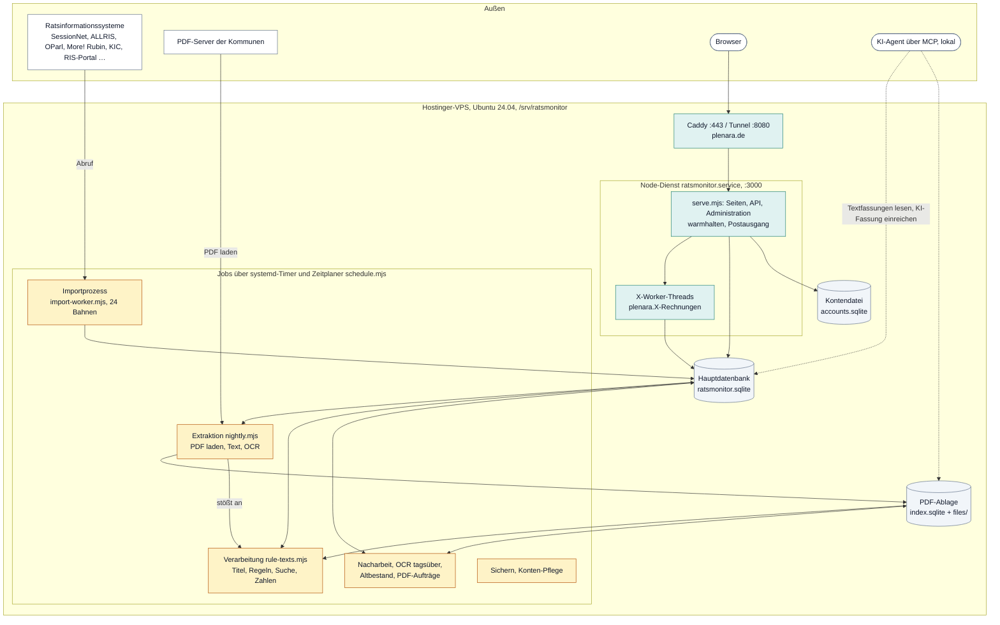
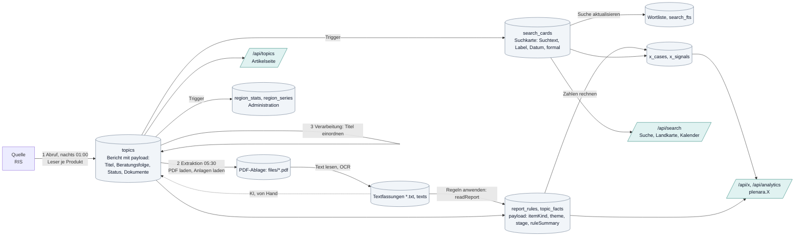

# Technische Dokumentation Plenara (Ratsmonitor)

Stand: 17. Oktober 2026, gelesen am Code des Branchs `nachtlauf-fixes`. Die Dokumentation beschreibt, was der Code tut; wo Konzepte,
Kommentare oder Betriebsdokumente etwas anderes sagen, steht das in den Abschnitten „Befunde“ der Kapitel. Alle Diagramme sind
Mermaid-Blöcke und werden auf GitHub, in VS Code und in den meisten Markdown-Ansichten gezeichnet.

## Kapitel

| Kapitel | Frage |
|---|---|
| [Glossar](glossar.md) | Welches Wort meint was? Bericht, Suchkarte, Vorgang, Gebiet, Quelle, Stufe … mit Code- und Tabellennamen und den mehrdeutigen Wörtern |
| [Abruf](abruf.md) | Wie kommen Berichte aus den Ratsinformationssystemen in die Datenbank? Quellen, Leser, Abrufauftrag, Identität, Schutz |
| [Pipeline](pipeline.md) | Was passiert jede Nacht und tagsüber? Tagespipeline, Extraktion (PDF-Ablage), Verarbeitung (Regeln), Nacharbeit, Altbestand, Fehlerspeicher, Zeitplaner |
| [Suche](suche.md) | Wie findet die Suche? Suchkarten, Wortliste, Volltextindex, Entscheidungsbaum, Labels |
| [Auswertungen](auswertungen.md) | Woher kommen die Zahlen von plenara.X? `x_cases`, `x_signals`, `/api/x`, Tools, Vorberechnung der Administration |
| [Datenmodell](datenmodell.md) | Welche Tabellen gibt es, wer schreibt, wer liest, welche Trigger und Stände? Payload, `system_state`, Kontendatei, PDF-Ablage |
| [Zugang und Oberfläche](zugang-und-oberflaeche.md) | Wer darf was? Konten, Stufen, Admin, API-Routen, Seiten, Admin-Reiter, KI-Weg, Tests |

Betrieb und Einrichtung (Befehle, Migrationen, Umstellungen): `docs/betrieb/node-server.md`. Hinweise für die Arbeit am Code:
`CLAUDE.md`. Frontend-Karte: `components/ratsmonitor/FRONTEND.md`. Produktvorteile und Slogan: `docs/produkt/`.

## 1. Was Plenara ist

Plenara liest öffentliche Ratsinformationssysteme deutscher Kommunen (Gemeinden, Städte, Kreise, Gemeindeverbände: 5.324 Gebiete im
Katalog, 4.041 mit angebundener Quelle), speichert je Vorlage oder Tagesordnungspunkt einen **Bericht** mit Beratungsfolge, Status
und Dokumenten, lädt die PDFs, liest ihren Text, leitet mit festen Regeln Art des Punkts, Thema, Zusammenfassung und Werte ab und
bietet darauf eine Suche mit Landkarte, Artikelseiten, Kalender und den Analyse-Teil **plenara.X**. Ein KI-Agent kann Berichte
zusätzlich zusammenfassen, startet aber nie von selbst.

## 2. Gesamtbild



**Ein Node-Prozess** liefert Oberfläche, API und Administration (`dist/standalone/serve.mjs`, hinter Caddy). Daneben laufen als
eigene Prozesse der **Importprozess** und die **Jobs**, alle auf derselben SQLite-Datei. Die Kontendatei sehen nur Webdienst und
Kontojob. Der KI-Agent läuft nicht auf dem Server, sondern lokal über STDIO gegen eine Kopie oder die Datei.

## 3. Datenfluss auf einer Seite



In Worten: Der Abruf schreibt je Bericht eine Zeile in `topics`; Trigger leiten daraus die Suchkarte ab. Die Extraktion holt die
PDFs der neuen Berichte und liest ihren Text. Die Verarbeitung ordnet Titel ein, wendet die Regeln je Bericht an (Art des Punkts,
Thema, Regel-Zusammenfassung, Fakten), führt die Wortliste nach und baut die Vorgänge für plenara.X. Suche und Landkarte lesen nur
Suchkarten, die Artikelseite den Bericht, plenara.X die Vorgänge. Alles, was scheitert, kommt in den Fehlerspeicher und wird
tagsüber nachgearbeitet ([Pipeline](pipeline.md)).

## 4. Aufbau des Codes

| Ordner | Inhalt |
|---|---|
| `app/` | Next-App (vinext): `(monitor)/` Seiten der Oberfläche (Stubs, gerendert vom Client), `api/` alle Routen (78 `route.ts`), `admin/` die Administration, CSS-Dateien |
| `components/ratsmonitor/` | die eigentliche Oberfläche: `App.tsx`, `components/`, `pages/` (auch `analytics/`), `info/`, `lib/`, `state/`, `menu/`; Karte `FRONTEND.md`, Index `INDEX.md` |
| `components/admin-*.tsx` | Reiter und Bausteine der Administration; `components/ui/` shadcn |
| `server/services/` | Kernlogik: `sync.ts` (Abruf je Gebiet), `session.ts` (Zugang), `admin-http.ts`, `calendar-ics.ts`, `read-cache.mjs` |
| `server/integrations/` | fachliche Module (ca. 150 Dateien): Leser je Ratsinformationsprodukt (`sessionnet.mjs`, `oparl*.mjs`, `allris*.mjs` …, Registry `readers.mjs`, Auswahl `collect-region.mjs`), Quellenkataloge (`*-sources.json`), Abrufauftrag (`pipeline-jobs.mjs`, `pipeline-worker.mjs`), Suche (`monitor-search.mjs`, `search-words.mjs`), Regeln (`report-rules.mjs`, `rule-summary.mjs`), plenara.X (`plenara-x-*.mjs`, `x-cases.mjs`, `analytics-*.mjs`), Administration (`admin-*.mjs`, `region-facts.mjs`), Betrieb (`schedules.mjs`, `work-failures.mjs`, `pdf-store-admin.mjs`, `altbestand-admin.mjs`), KI (`ai-local-work.mjs`, `ai-jobs.mjs`) |
| `server/node/` | Node-Laufzeit: `serve.mjs` (Einstieg), `d1-sqlite.mjs` (D1-Adapter), `cloudflare-workers.mjs` (Ersatzmodul), `import-worker.mjs`, `x-worker.mjs`, `pdf-store.mjs`, `mcp-runtime.mjs`, `ai-local-*.mjs` |
| `server/accounts/` | Konten: Anmeldung, Anmeldesitzungen, Zugang, Mail, TOTP |
| `server/repositories/`, `server/mappers/` | Lesezugriffe auf `topics`, Gebiete, Analysen; `seed.ts` Erstbefüllung |
| `server/mcp/` | MCP-Dienst (intern und Kunde) |
| `shared/` | Code für Server und Browser: Typen (`types.ts`), Gebietskatalog (`catalog.mjs`, `regions.ts`, `*-regions.json`, `*-population.json`), Regeln (`item-kind.mjs`, `themes.mjs`, `labels.mjs`, `stage.mjs`, `topic-facts.mjs`, `document-type.mjs`, `pdf-rank.mjs`), Begriffe (`pipeline-terms.mjs`), Stufen (`plans.mjs`), Qualität (`rule-quality.json`), Identität und Versionen (`topic-identity.mjs`, `article-record.mjs`, `article-version.mjs`) |
| `drizzle/`, `drizzle-accounts/` | Migrationen der Hauptdatenbank (0000 bis 0045) und der Kontendatei (0001, 0002); rohes SQL |
| `scripts/` | Skripte: Jobs (`schedule.mjs`, `rule-texts.mjs`, `nacharbeit.mjs`, `altbestand.mjs`, `startseite-trends.mjs`), PDF-Ablage (`pdf-store/`), plenara.X (`plenara-x/`), Konten (`accounts/`), Bau (`build-node.mjs`, `run-framework.mjs`, `node-migrate.mjs`), Katalogbau (`build-de.mjs`, `build-nds.mjs`, `build-nrw.py`, `source-discovery/`), Messungen (`*-study/`), KI (`ai-local.mjs`, `mcp-*.mjs`, `ai-batch/`), Wartung (`refresh-search-words.mjs`, `refresh-admin.mjs`, `reclassify-rules.mjs`) |
| `deploy/node/` | Server: `deploy.sh`, `ratsmonitor.service`, je Job `.service`/`.timer`/`.path`, Stopp-Einheiten, `Caddyfile` und `caddy/*.caddy` (Stufen), `backup.sh`, `accounts-*.sh`, `*.env.example` |
| `build/` | Vite-Plugins für Dev (`todo-dev-plugin.mjs`, `ai-local-dev-plugin.mjs`), `worker-build.mjs` (bündelt Importprozess und X-Worker) |
| `tests/` | 175 Tests (`node --test tests/*.test.mjs`), Hilfen `tests/helpers/`, Fixtures |
| `data/`, `public/` | mitgelieferte Startdaten (NRW-Bestand, Münster, Billerbeck); statische Dateien, Geodaten, Schriften, `startseite-trends.json`, `sw.js` |
| `docs/`, `requirements/` | Betrieb, Produkt, Qualität, Konzepte und Pläne (Konzepte beschreiben teils ältere Stände) |
| `config/mcp/` | Startvorlagen des MCP-Diensts |

## 5. Laufzeiten, Build, Deploy

### Lokal (`npm run dev`)

`scripts/run-framework.mjs dev` startet vinext (Vite) mit dem Cloudflare-Plugin (Miniflare, D1-Bindung `DB` auf die Datei unter
`.wrangler/state/v3/d1/`) auf Port 5173 und daneben: Wortliste nachführen (`RM_SKIP_SEARCH_WORDS=1` schaltet ab), Admin-Werte
nachführen (`RM_SKIP_ADMIN_REFRESH=1`), `scripts/dev-jobs.mjs` (prüft alle 15 s, ob ein Job angefordert ist; geplante Zeiten laufen
lokal nicht; `RM_SKIP_DEV_JOBS=1`), Konten einrichten (`scripts/accounts/dev-setup.mjs`, `RM_SKIP_ACCOUNTS=1`). Die Administration ist
im Dev ohne Anmeldung offen. Für plenara.X mit häufigen Begriffen lokal besser `node scripts/node-local.mjs` (baut und startet den
Node-Server auf der lokalen Datei, Port 3000).

### Server (Node)

`npm run build:node` (`scripts/build-node.mjs`): `vinext build` mit `RM_TARGET=node` (ohne Cloudflare-Plugin, `output: standalone`,
`cloudflare:workers` zeigt auf `server/node/cloudflare-workers.mjs`), kopiert `serve.mjs` nach `dist/standalone/`, bündelt mit Vite
`dist/standalone/worker/import-worker.mjs` und `worker/x-worker.mjs`, prüft, dass kein `cloudflare:workers` im Server-Paket und kein
`node:sqlite` im Browser-Paket steckt. Der MCP-Dienst wird nicht gebaut, er läuft aus dem Quelltext.

| Teil | Datei | Aufgabe |
|---|---|---|
| Einstieg | `server/node/serve.mjs` | Startprüfung (Datenbank mit `topics`, `search_cards`, `system_state`, `d1_migrations`; `RM_ACCESS`; mit `invite` Kontendatei, `ACCOUNTS_SECRET`, `SITE_URL`, `VINEXT_TRUST_PROXY`), Port 3000 nur Loopback, Node ≥ 22.16, X-Worker (`RM_X_WORKER`, `RM_X_WORKERS` 2), Warmhalten alle 10 min, Postausgang jede Minute, sauberes Beenden (20 s) |
| D1-Adapter | `server/node/d1-sqlite.mjs` | `prepare`, `bind` (ganze Zahlen als INTEGER, Booleans 1/0), `first`, `all`, `run`, `raw`, `batch` (eine Transaktion, `BEGIN IMMEDIATE`), `exec`; vor jeder Abfrage `setImmediate`; Langsam-Log ab `DATABASE_SLOW_MS`; WAL, `synchronous=NORMAL` |
| Ersatzmodul | `server/node/cloudflare-workers.mjs` | `env` als Proxy: `DB` (`DATABASE_FILE`), `ACCOUNTS` (`ACCOUNTS_FILE`), `AI_LOCAL_SOURCES` (`RM_PDF_STORE`), alles andere aus `process.env` |

**Deploy** (`deploy/node/deploy.sh main`, nur `main` wird ausgerollt): `git archive` des Commits per SSH nach
`/srv/ratsmonitor/app/releases/<sha>.build` → Werte aus `ratsmonitor.env` und `accounts.env` → `pnpm install --frozen-lockfile` →
`build-node.mjs` → Migrationen der Hauptdatenbank nur prüfen (`node-migrate.mjs --check`; fehlen welche, bricht das Skript ab,
eingespielt wird von Hand mit angehaltenem Importprozess) → Kontendatei sichern (age) und migrieren → Symlink `current` umstellen →
`systemctl restart ratsmonitor` (laufende Importprozesse behalten ihren Stand) → Prüfung (`/`, `/api/search?level=city`,
`/api/internal/health`) → `current` und die zwei neuesten anderen Stände bleiben. systemd-Einheiten installiert das Skript nicht;
das steht in `docs/betrieb/node-server.md`.

### Cloudflare

`npm run build` baut weiter mit dem Cloudflare-Plugin (`wrangler.local.json` nur lokal); der Code hält Kompatibilitätsstellen vor
(`requestTier` ohne Kontendatei, `cf-connecting-ip`, `ADMIN_LEGACY_HEADER`). Produktiv läuft nur Node; eine Produktions-Konfiguration
für Cloudflare gibt es im Repo nicht.

## 6. Infrastruktur auf dem Server

```
Browser ─▶ Caddy (plenara.de :443 mit Let's Encrypt, HSTS, noindex; Tunnel 127.0.0.1:8080) ─▶ Node 127.0.0.1:3000 ─▶ SQLite
```

| Pfad | Inhalt |
|---|---|
| `/srv/ratsmonitor/app/releases/<sha>`, `app/current` | Programmstände, Symlink auf den laufenden |
| `/srv/ratsmonitor/ratsmonitor.env` | Umgebung (600), Vorlage `deploy/node/ratsmonitor.env.example` |
| `/etc/ratsmonitor/accounts.env` | `ACCOUNTS_FILE`, `ACCOUNTS_SECRET`, `MAIL_API_KEY`, `ACCOUNTS_AGE_RECIPIENT` (root, 600); nur Webdienst und Kontojob laden sie |
| `/srv/ratsmonitor/data/ratsmonitor.sqlite` | Hauptdatenbank |
| `/srv/ratsmonitor/data/pdf-store/` | PDF-Ablage (`RM_PDF_STORE`) |
| `/srv/ratsmonitor/data/trigger/<job>`, `stop-<job>` | Auslöser-Dateien der `.path`-Einheiten |
| `/srv/ratsmonitor/data/ocr-cache/`, `/srv/ratsmonitor/ocr-tools/` | OCR-Sprachdaten, tesseract.js und `@napi-rs/canvas` außerhalb des Programmstands |
| `/srv/ratsmonitor/backups/` | Sicherungen der Datenbank (zstd, 2 Stände), Index und Texte der Ablage, Protokolle |
| `/srv/ratsmonitor/accounts/` | Kontendatei, verschlüsselte Sicherungen (7 Stände), `deleted.log`; Rechte 700, für alle anderen Einheiten `InaccessiblePaths` |
| `/etc/caddy/Caddyfile`, `/etc/default/caddy` | Caddy (Fassungen in `deploy/node/caddy/`: Schritt 0 Tunnel mit alter Kennung und sslip mit Basic-Auth, Schritt 2 ohne Kennung, Schritt 3 Domain ohne Basic-Auth); die aktive Fassung mit `plenara.de` liegt nur auf dem Server |

**Umgebungsvariablen** (`ratsmonitor.env.example`): `DATABASE_FILE`, `DATABASE_READONLY`, `DATABASE_BUSY_TIMEOUT_MS`, `DATABASE_SLOW_MS`,
`HOST`, `PORT`, `NODE_ENV`, `TZ=UTC`, `VINEXT_TRUST_PROXY`, `NODE_OPTIONS`, `SITE_URL`, `RM_ACCESS` (`open`/`invite`), `ADMIN_HOSTS`,
`ADMIN_LEGACY_HEADER`, `MAIL_TRANSPORT` (`http`/`log`/`outbox`), `LOGIN_TOTP`, `MAIL_API_URL`, `MAIL_FROM`, `MAIL_REPLY_TO`,
`OPERATOR_EMAIL`, `ADMIN_SETUP_HASH` (alt), `IMPORT_TOKEN`,
`RM_PDF_STORE`, `OCR_TOOLS`, `OCR_CACHE`, `RM_X_WORKERS`. Nicht in der Vorlage: `SHUTDOWN_GRACE_MS`, `RM_ALLOW_PUBLIC_BIND`,
`RM_ALLOW_NO_DB`, `RM_SKIP_WARM`, `RM_X_WORKER`, `IMPORT_BUSY_TIMEOUT_MS` (Einheiten 30 s), `ACCOUNTS_BUSY_TIMEOUT_MS`, `RM_TRIGGER_DIR`,
`ACCOUNTS_OPEN_SIGNUP`, `ACCOUNTS_IN_MAIN_DB`, `BACKUP_REMOTE`, `BACKUP_DIR`, `KEEP`, `ZSTD_LEVEL`, `RM_MCP_CONFIG`, `ROBOTS_POLICY`.

**systemd** (46 Dateien in `deploy/node/`): `ratsmonitor.service` (Webdienst, `User=ratsmonitor`, `Restart=always`, `MemoryHigh=6G`,
`MemoryMax=8G`, `ProtectSystem=strict`) und je Job vier Teile: `ratsmonitor-<job>.service` (`node scripts/schedule.mjs <job>`,
oneshot, eigene Speicher- und Zeitgrenzen), `.timer` (`OnCalendar=*:0/10`; `import` mit `OnUnitInactiveSec=10min`), `.path`
(`PathModified` auf `data/trigger/<job>`, Sofortstart), `ratsmonitor-stop-<job>.path` → `ratsmonitor-stop@<job>.service` (als root
`systemctl stop`). Jobs: `accounts`, `backup`, `import-nightly`, `startseite-trends`, `pdf-nightly`, `rule-texts`, `nacharbeit`,
`ocr`, `altbestand`, `import`, `pdf-job` (Zeiten, Fenster, Grenzen in [Pipeline](pipeline.md), Abschnitt 2). Journal: 7 Tage
(`journald-ratsmonitor.conf`).

## 7. Pflege dieser Dokumentation

- **PDF:** `node docs/technik/tools/build-pdf.mjs` baut alle Kapitel als `docs/technik/technische-dokumentation.pdf` (Markdown zu
  HTML, Diagramme über mermaid.js, Druck über Chrome mit playwright-core aus `docs/design/tools`; `--html` schreibt nur die
  HTML-Vorlage nach `tmp/technik-pdf/`). Nach Änderungen an den Kapiteln neu bauen.
- Begriffe der Pipeline nur in `shared/pipeline-terms.mjs` ändern, dann im [Glossar](glossar.md) nachziehen.
- Neue Tabelle oder neuer `system_state`-Schlüssel: Katalog im [Datenmodell](datenmodell.md) ergänzen.
- Neuer Job: `JOBS` in `schedules.mjs`, Einheiten in `deploy/node/`, Tabelle in [Pipeline](pipeline.md) Abschnitt 2.
- Neuer Leser: `readers.mjs`, Tabelle in [Abruf](abruf.md) Abschnitt 3.
- Die „Befunde“-Abschnitte sind Stand 17.10.2026; was behoben ist, dort streichen.
