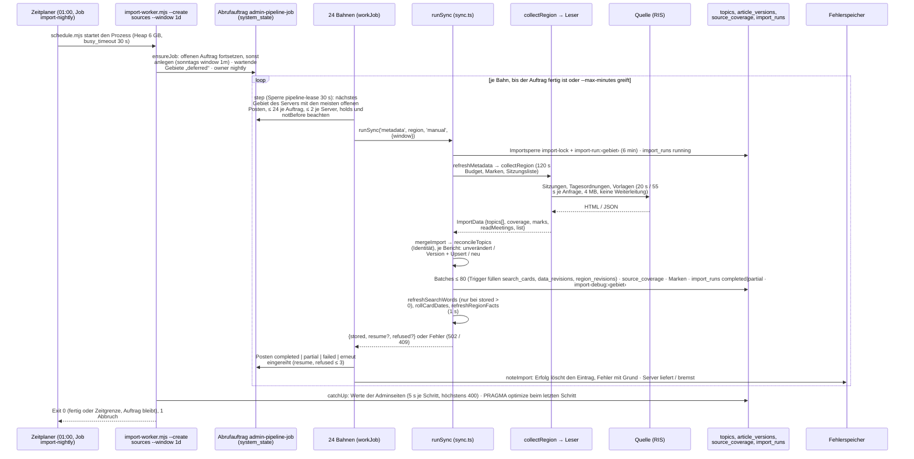
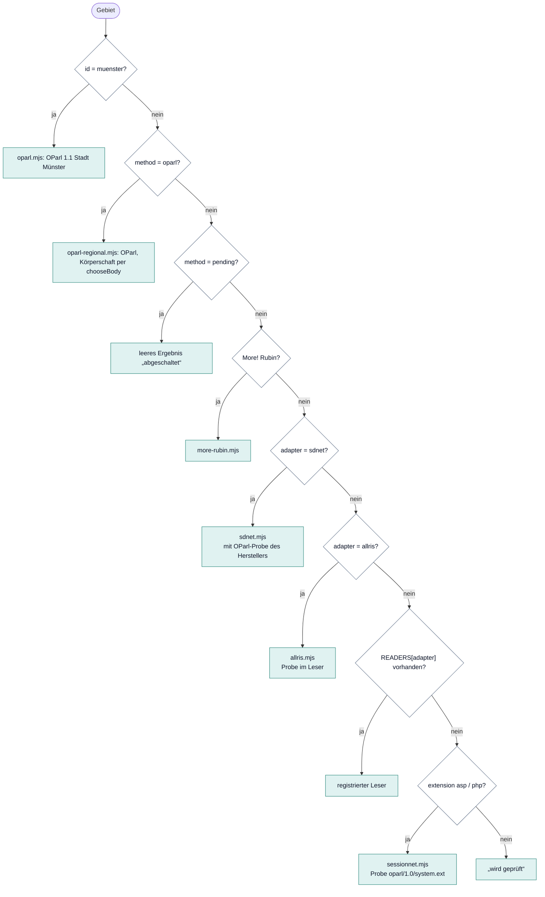
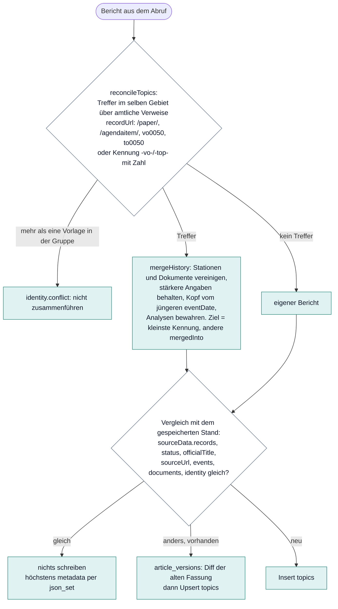

# Abruf: Berichte aus den Ratsinformationssystemen holen

Stand: 17. Oktober 2026, gelesen am Code des Branchs `nachtlauf-fixes`. Teil der [technischen Dokumentation](README.md). Begriffe:
[Glossar](glossar.md). Der Abruf ist die Stufe 1 der [Pipeline](pipeline.md); im Code heißt er durchgehend `import`.

## 1. Gebiet, Quelle, Leser, Server

| Begriff | Was es ist | Woher |
|---|---|---|
| **Gebiet** | Eintrag im Katalog `CATALOG` (`shared/catalog.mjs`), 5.324 Gebiete: NRW `nrw-<Schlüssel>` (dazu sieben benannte Kennungen wie `billerbeck`, `muenster`), Niedersachsen `nds-<Schlüssel>`, übrige Länder `de-<Schlüssel>`; Arten `city` (Gemeindeebene, auch Gemeindeverbände mit `members`) und `district` (Kreis) | `nrw-regions.json`, `nds-regions.json`, `de-regions.json` (BKG VG250, Stand 04.10.2026), Einwohner aus Wikidata |
| **Quelle** | Katalogeintrag mit derselben Kennung, der sagt, wie das Gebiet gelesen wird: `url`, `adapter` oder `method` (`oparl`, `pending`), `extension` (asp/php bei SessionNet), `body` (OParl-Körperschaft), `oparlFallback`, `fallback` (Ausweichquelle), `consent` | `NRW_SOURCES` in `server/integrations/source-catalog.mjs` aus sieben JSON-Dateien (`nrw-`, `nds-`, `de-`, `expanded-`, `nearby-`, `statewide-`, `citystate-sources.json`); bei gleicher Kennung gilt die zuletzt genannte Datei. Dazu sechs fest eingetragene Altquellen (`regions.mjs`) und Münster. `canImport` gilt für 4.041 Gebiete (alles außer `method:'pending'`) |
| **Leser** | Modul, das ein Ratsinformationsprodukt liest (Abschnitt 3); Registry `READERS` in `readers.mjs`, Auswahl in `collect-region.mjs` | |
| **Server** | Gruppe von Hosts nach registrierbarer Domain plus IP (`source-servers.mjs`, `source-servers.json`); `provider(region)` liefert ihn. Grenze 2 gleichzeitige Abrufe je Server, Pausen (`holds`) und Serverstufe in `source_hosts` hängen daran | |
| **Körperschaft** | OParl-Körperschaft innerhalb eines gemeinsamen Systems, gewählt über `source.body`, Gemeindeschlüssel oder normalisierten Namen; muss eindeutig sein (`body-identity.mjs`) | |

Die übrigen JSON-Dateien im Ordner dienen nicht dem Abruf: `source-overrides.json` fließt beim Katalogbau in `nrw-sources.json`
ein (`scripts/apply-source-overrides.mjs`), `source-consents.json` dem Katalogbau und dem Dashboard, `source-robots.json` und
`source-atlas.json` nur Admin und Lückenatlas.

## 2. Ein nächtlicher Abruf von Anfang bis Ende

1. **Auslöser:** der Zeitplaner startet um 01:00 `import-worker.mjs --create sources --window 1d --weekly-window 1m --weekly-day 0
   --max-minutes 240` (Job `import-nightly`). Die Argumente liest `parseArgs` in `pipeline-worker.mjs`; `windowForTonight` nimmt
   sonntags (deutsche Zeit) `1m`. Ist `RM_PDF_STORE` gesetzt, wird die Ablage eingebunden (`useDocumentStore`).
2. **Auftrag anlegen oder fortsetzen** (`ensureJob`): ein offener Auftrag wird fortgesetzt, außer er ist pausiert oder hat sich seit
   6 Stunden nicht bewegt. `pipelineAction({action:'create', stage:'metadata', regions:'sources', window, replace:true, deferred})`
   legt je Gebiet einen Posten an (`queued`, `deferred` für Gebiete mit wartendem Eintrag im Fehlerspeicher oder wartendem Server,
   `unavailable`), jeder mit `server: provider(region)`. Gespeichert als JSON in `system_state` `admin-pipeline-job`, danach
   `owner: 'nightly'`.
3. **24 Bahnen** (`workJob`): jede Bahn ruft in einer Schleife `pipelineAction({action:'step'})`. „Warteschlangenschritt läuft
   bereits“ heißt 2,5 s warten; ein ersetzter Auftrag beendet die Bahn; andere Fehler 5 s Pause, nach 5 in Folge gibt die Bahn auf.
   Jede Minute ein Protokolleintrag mit den Zählern.
4. **Ein Schritt** (`step` in `pipeline-jobs.mjs`, Sperre `pipeline-lease` 30 s): Posten, die über 5 Minuten „laufen“, werden
   `unknown`; `next()` wählt ein wartendes Gebiet des Servers mit den meisten offenen Posten, der noch Platz hat (höchstens 24 je
   Auftrag, 2 je Server, `holds` und `notBefore` beachtet); der Posten wird `running`. Der Import selbst läuft außerhalb der Sperre.
5. **`runSync`** (`server/services/sync.ts`): Zeitraum prüfen, mitgelieferte Startdaten einspielen (`ensureData`, nur beim ersten
   Mal), bisherigen Quellenstand lesen, Importsperre nehmen (`acquireImport`: `import-lock` gemeinsam plus `import-run:<gebiet>`, 6
   Minuten, nach dem Sammeln erneuert; 409 mit `busy: 'area'|'stock'`), Aufzeichnung anlegen (`createTrace`), `import_runs` mit
   `running` schreiben (Läufe älter als 30 Tage löschen), dann `refreshMetadata`.
6. **`refreshMetadata`:** alle gespeicherten Berichte des Gebiets laden, Sitzungsadressen sammeln, Marken (`import-marks:<gebiet>`)
   und gemerkte Sitzungsliste (`import-list:<gebiet>`, 6 h) aus `system_state` lesen, `collectRegion(region, {maxDurationMs:
   120000, window, marks, trace, oparlProbeAt})` aufrufen.
7. **Leser wählen und lesen** (`collect()` in `collect-region.mjs`, Abschnitt 3). Ergebnis `ImportData`.
8. **Zusammenführen:** Sperre erneuern; `mergeImport` (`merge-import.mjs`) versieht neue Berichte mit `metadata` und ruft
   `reconcileTopics` (Abschnitt 5); je Bericht `preserveAnalysis`, dann der Vergleich „unverändert?“, bei Änderung eine Zeile in
   `article_versions` und ein Upsert in `topics`. Geschrieben wird in Batches zu höchstens 80 Anweisungen; eine Identitätsgruppe
   bleibt in einem Batch.
9. **Quellenstand und Protokoll:** `importHealth` bewertet den Versuch, `source_coverage` wird per Upsert geschrieben; Marken und
   Sitzungsliste gespeichert; `import_runs` auf `completed` oder `partial`; Aufzeichnung
   unter `import-debug:<gebiet>` (höchstens 1.500 Anfragen).
10. **Nacharbeiten in `runSync`:** `refreshSearchWords` (nur bei `stored > 0`, `onlyIfBuilt`, höchstens 20.000 Karten), `rollCardDates`,
    `refreshRegionFacts` (nur ohne `resume`, 1 s Budget); im `finally` `invalidateReads()` und Sperre freigeben. Bei einer Ausnahme
    wird `source_coverage` mit dem gescheiterten Versuch geschrieben, Antwort 502, bei Bedarf mit `refused`.
11. **Ergebnis im Auftrag:** 409 wird je nach Fall wiederholt, zurückgestellt oder der Auftrag wartet; `refused` pausiert den Server
    (`hold`, 60 s bis 1 h, Standard 5 Minuten), das Gebiet folgt höchstens 3-mal; andere Fehler `failed`; `resume` reiht das Gebiet
    erneut ein (Meldung „(Teil n)“, höchstens `MAX_RESUMES` × Jahre des Zeitraums); sonst `completed` oder `partial`. Danach
    `noteImport` in den Fehlerspeicher. Der Schritt, der den Auftrag beendet, ruft `PRAGMA optimize`.
12. **Ende:** Bahnen enden bei `completed`, `cancelled`, pausiert, ersetzt oder `stop()` (Zeitgrenze); laufende Abrufe laufen zu
    Ende. Dann `catchUp` für die Werte der Adminseiten. Exit 0 fertig oder Zeitgrenze (der Auftrag bleibt), 1 Abbruch.
13. **Fortsetzung:** der Job `import` (alle 10 Minuten, `--run --max-minutes 240`) arbeitet einen offenen Auftrag weiter, lässt den
    Nachtauftrag aber aus, solange er sich in den letzten 10 Minuten bewegt hat (`nightlyBusy`). Gescheiterte Gebiete holt die
    Nacharbeit über `import-worker.mjs --direct --regions …` nach ([Pipeline](pipeline.md), Abschnitt 7).

### Weitere Einstiege

| Weg | Was passiert |
|---|---|
| Admin-Seite „Abruf“ (`components/admin-processing.tsx`) | legt mit `create` an und arbeitet im Browser mit `run` ab: bis 8 Bahnen je Anfrage, je 90 s (`POST /api/admin/pipeline`, dieselbe Ausführungsfunktion wie der Prozess). „Im Hintergrund abrufen“ legt den Auftrag nur an; der Job `import` holt ihn binnen 10 Minuten. Prozess und Browser dürfen denselben Auftrag treiben (jedes Gebiet genau einmal) |
| `POST /api/internal/sync` (Bearer `IMPORT_TOKEN`) | ein Gebiet; älterer Weg von außen über `scripts/run-imports.mjs` (Gebiet für Gebiet, 3 Versuche, danach `/api/internal/admin-refresh`) |
| `import-worker.mjs --direct --regions … --window …` | ohne Auftrag, direkt je Gebiet (Nacharbeit, Altbestand) |
| Seite Altbestand | rückwirkender Abruf je 8 Gebiete, 1 bis 24 Monate |

Aktionen des Auftrags: `create`, `cancel`, `pause`, `resume`, `status`, `step`, `run`. Struktur: Kopf `{id, stage, window, scope,
createdAt, updatedAt, status queued|running|completed|cancelled, paused?, holds?, owner?, items[]}`, Posten `{region, status
queued|running|completed|partial|failed|unknown|unavailable|deferred, processed, message, server, startedAt?, notBefore?, refusals?,
resumes?}`. Zeiträume `1d|1w|1m|3m|12m|24m`, Standard `12m` (`shared/history-window.mjs`).

## 3. Die Leser

### Auswahl (`collect()` in `collect-region.mjs`)

**OParl-Probe:** Viele Produkte bieten neben HTML eine OParl-Schnittstelle. Ein negatives Ergebnis der Probe gilt 30 Tage
(`PROBE_DAYS`, `oparlProbeAt` im Quellenstand); `oparlFallback` im Katalog überspringt sie; ein positives Ergebnis bricht mit
„Adapterfreigabe erforderlich“ ab, damit die Quelle bewusst auf `method:'oparl'` umgestellt wird.

**Ausweichquelle:** `fallback` im Katalog (Website der Kommune, Leser `website`) gilt nur, solange die Servergruppe des Systems
wartet (`source_hosts`); dann liest `collectRegion` mit `options.fallback` die Website statt des Systems. Ein Sitzungstag gehört der
Quelle, die ihn zuerst hatte. Einzelheiten: `server/integrations/fallback-source.mjs` und `docs/betrieb/node-server.md`, „Ausweichquelle“.

### Leser und Produkte

Zahlen: Einträge im Katalog dieser Arbeitskopie (4.035 Quellen), einmal ausgezählt.

| Leser (`adapter`) | Produkt | Modul | Einträge |
|---|---|---|---|
| Münster (fest) | OParl 1.1 Stadt Münster | `oparl.mjs` | 1 |
| `method:'oparl'` | OParl beliebiger Hersteller | `oparl-regional.mjs` (Öffentlichkeitsprüfung `public-agenda.mjs`) | 261 |
| (`extension` asp/php, auch `sessionnet`) | SessionNet (Somacos) bis 5.x, HTML-Seiten `si0040`, `si0057`/`si0056`/`to0040`, `vo0050` | `sessionnet.mjs` (Anwesenheit `sessionnet-details.mjs`) | 1.358 |
| `sessionnet6` | SessionNet 6, JSON `api/v1` | `sessionnet6.mjs` | 16 |
| `allris` | ALLRIS 4 (CC e-gov), `si010`/`to010`/`vo020` | `allris.mjs` | 390 |
| `allris3` | ALLRIS 3 (asp), fragt zuerst OParl | `allris3.mjs` | 137 |
| `sdnet` | SD.NET RIM (Sternberg), öffentliche Seiten | `sdnet.mjs` | 92 |
| `sdnet-rim4` | SD.NET RIM 4, selbst gehostet | `sdnet-rim4.mjs` | 98 |
| `more-rubin` | More! Rubin (`api.php`, JSON) | `more-rubin.mjs` | 346 |
| `ris-portal` | RIS-Portal comundus regisafe (Liferay) | `ris-portal.mjs` | 542 |
| `kic` | KIC-RIS (auch komuna), Gast-API | `kic.mjs` | 404 |
| `komfa` | KOMFA-RIS (kommunalfabrik) | `komfa.mjs` | 12 |
| `councilservice` | Sitzungsdienst mein-intra.net | `councilservice.mjs` | 52 |
| `ti-generator` | TI-Generator | `ti-generator.mjs` | 33 |
| `cron-ratsinfo` | cron Ratsinfo für TYPO3 | `cron-ratsinfo.mjs` | 6 |
| `typo3-bi` | TYPO3-Bürgerinformationssystem (risportal) | `typo3-bi.mjs` | 1 |
| `hw-typo3` | Ratsinformationsmodul Hirsch & Wölfl | `hw-typo3.mjs` | 4 |
| `meeting-mobile` | Meeting Mobile / RIS Web (Domino) | `meeting-mobile.mjs` | 4 |
| `provox-iip` | Provox IIP | `provox-iip.mjs` | 1 |
| `ecics-ris` | Gemeinde-RIS ecics | `ecics-ris.mjs` | 10 |
| `ris-ng`, `hhdocuments`, `rio-sys`, `hitcom-ris` | kleine Systeme über den gemeinsamen Rahmen `small-common.mjs` | je ein Modul | 0, 1, 1, 1 |
| `webcontact-ratsinfo` | Ratsinfo webcontact (Nuxt-JSON) | `webcontact-ratsinfo.mjs` | 1 |
| `muenchen-risi`, `sim-hannover`, `piwi`, `pio`, `parlis` | Eigenentwicklungen großer Städte (München, Hannover, Wiesbaden, Offenbach, Frankfurt) | je ein Modul | je 1 |
| `website` | Website einer Kommune ohne RIS: Bekanntmachungen, PDFs, RSS/iCal/WP-REST/JSON-LD/Sitemap | `website.mjs` (Hilfen `website-feeds.mjs`, `website-text.mjs`) | 256 |
| `ckan` | CKAN-Portal | `ckan.mjs` | 0 |
| `hamburg-transparenz`, `berlin`, `oparl-bezirke` | Transparenzportal Hamburg, Abgeordnetenhaus Berlin und Bezirke (nur mit Freigabe `consent`) | `citystates.mjs` | 1, 1, 0 |
| `method:'pending'` | abgeschaltet | – | 1 |

`nrw-snapshot.mjs` ist kein Leser, sondern der mitgelieferte NRW-Bestand für Startdaten und Rückfall (`data/nrw-seed*`).

### Was ein Leser liefert

`ImportData` (`server/types.ts`): `topics: StoredTopic[]`, `coverage` (`Coverage` plus `unchangedMeetings`, `resumable`, `warnings`,
`method`, `oparlProbeAt`), `marks` (gelesene Sitzungen), `readMeetings`, `list` (Sitzungsliste für die Fortsetzung).

Beispiel SessionNet (`sessionnet.mjs`):

1. Kalendermonate `si0040` vom Beginn des Zeitraums bis zum nächsten Monat, 3 parallel; Sitzungen vor dem Zeitraum fallen weg.
2. Je Sitzung, neueste zuerst, höchstens 400 je Abruf (`MAX_MEETINGS`): Tagesordnungsseite; nur öffentliche Punkte („Ö …“).
3. Ein Fingerabdruck der Tagesordnung entscheidet, ob die Seiten dahinter neu gelesen werden (Marken, Abschnitt 5).
4. Die Vorlagenseite `vo0050` liefert PDF-Links (`documents`) und Feldpaare (`sourceData.records`, darunter die Beratungsfolge als
   Text).
5. Punkte mit gleicher Kennung werden gruppiert, ihre Sitzungen als `events` gesammelt; der Bericht wird gebaut.

**Kennung eines Berichts:** SessionNet `<quelle>-vo-<kvonr>` (Vorlage) oder `<quelle>-top-<ksinr>-<nummer>` (Punkt ohne Vorlage);
dasselbe Muster bei allris, allris3, sdnet, more-rubin, sessionnet6, kic, ti-generator, councilservice; mit eigenem Infix bei
ris-portal (`-rp-`), komfa (`-kf-`), website (`-web-<datum>-<hash>`), hw-typo3 (`-hw-`); oparl-regional `<quelle>-oparl-<sha256 der
Vorlagen- oder Punktadresse, 20 Zeichen>`; Münster der Pfad der OParl-Kennung (`papers-…`).

**Was eine Zeile in `topics` ist:** ein Bericht. Verlinkt die Quelle eine Vorlage, ist es die Vorlage mit allen gelesenen Sitzungen;
sonst ein einzelner Tagesordnungspunkt einer Sitzung. Münster nimmt zusätzlich neue Vorlagen ohne Sitzung auf. Zeilen mit
`identity.mergedInto` sind Aliase (`active = 0`).

**`events[]`** (`TopicEvent`): je **gelesener** Sitzung, in der der Punkt öffentlich auf der Tagesordnung stand, ein Eintrag `{date,
committee, status, description, result, url, attendance, decision}`; über Abrufe hinweg vereinigt nach `[url, date, committee]`.
Die Beratungsfolge auf der Vorlagenseite wird bei SessionNet nicht zu `events`, sondern bleibt in `sourceData.records`.

**`status`:** je Station nach Regeln des Lesers, der Bericht übernimmt den Status der letzten Station. SessionNet (`itemStatus`):
künftige Sitzung → `consulting` (mit Vorlage) oder `announced`; „vertagt“ → `postponed`; „Kenntnis“ → `info`; „empfohlen“ →
`recommended`; „beschlossen/abgelehnt“ gilt nur bei einem beschließenden Gremium (`DECIDING_BODY` in `source-fields.mjs`) als
`approved`/`rejected`, sonst `recommended`; sonst `unknown`. OParl über `authoritative`/`role`; eine vergangene Sitzung ohne
Ergebnis wird `unknown`.

**`documents[]`** (`SourceDocument {title, url, kind}`): PDFs, die HTML-Tagesordnung (`html`), der OParl-Datensatz (`oparl`). Das
Hauptdokument (`primaryPdf`) wird beim Abruf nicht berechnet und nicht gespeichert; es entsteht erst in der Extraktion und in den
Regeln ([Pipeline](pipeline.md)).

## 4. Was der Abruf schreibt

| Ziel | Inhalt | Wann |
|---|---|---|
| `topics` | echte Spalten `id`, `region_id`, `source` (`city`/`district`, die Ebene, nicht die Quelle), `event_date`, `updated_at`, `status`; `payload` = das ganze `StoredTopic` (Abschnitt 5 im [Datenmodell](datenmodell.md)); generiert `active` | Upsert; bei Konflikt nur `event_date`, `updated_at`, `status`, `payload` |
| `article_versions` | vorige Fassung als Diff (`diff-v1`, `shared/article-version.mjs`, Wiederherstellung `restoreVersions`) | nur wenn sich der Bericht ändert |
| `source_coverage` | je Gebiet ein JSON: `Coverage` des Lesers zusammengeführt plus `importHealth` (`lastAttemptAt`, `lastSuccessAt`, `lastCompleteAt`, `attemptStatus`, `failureCount`, `nextRetryAt`), `importedAt`, `window`, `oparlProbeAt`, `apiCheck` | jeder Versuch, auch gescheiterte |
| `import_runs` | `running` zu Beginn, am Ende `completed`/`partial`/`failed` mit `details` (mode, region, trigger, window, count …) | jeder Lauf; Läufe älter als 30 Tage werden gelöscht |
| `system_state` | `import-marks:<gebiet>`, `import-list:<gebiet>`, `import-debug:<gebiet>` | |
| Trigger | `search_cards` (+ `search_fts`, `search_cards_gone`), `data_revisions` `content` und `search`, `region_revisions`; `source_coverage` erhöht `coverage` | mit jedem Schreiben |
| Fehlerspeicher | `work_failures` (`step='import'`, `key=<gebiet>`, `host=provider`), `source_hosts` | über `noteImport` |

Reihenfolge in `runSync`: `import_runs` → Batches aus `article_versions` und `topics` → `source_coverage` → Marken und Liste →
`import_runs` → `import-debug` → `refreshSearchWords` → `rollCardDates` → `refreshRegionFacts` → Sperre frei.

**Der Abruf löscht nie.** Ein leerer Abruf behält den alten Bestand, ein kürzerer Zeitraum verkürzt die belegte Spanne nicht.

## 5. Identität, Versionen, Marken

- **Zusammengeführt wird nur über amtliche Datensatz-Verweise** (`shared/topic-identity.mjs`, `IDENTITY_VERSION`
  `official-records-v1`), nie über Titel, Drucksachennummer oder PDFs: `recordUrl` erkennt `/paper/`, `/agendaitem/`, `vo0050`,
  `to0050`; dazu aus Kennungen abgeleitete Verweise (`-vo-`, `-top-` mit rein numerischem Rest). Nur im selben Gebiet.
- **Ziel und Aliase:** Ziel ist die kleinste Kennung der Treffer; die übrigen erhalten `identity.mergedInto` (`active = 0`).
  `getTopic` folgt `mergedInto`. Mehr als eine Vorlage in der Gruppe ergibt `identity.conflict` ohne Zusammenführung.
- **`mergeHistory`:** vereinigt Stationen und Dokumente, behält Anwesenheit und Beschluss, wenn der neue Abruf schwächere Angaben
  liefert, nimmt die Kopfdaten vom Stand mit dem jüngeren `eventDate`; Analyse- und KI-Felder bleiben über
  `preserveArticleContent` (`shared/article-record.mjs`) erhalten; ändert sich die Quelle, werden `contentAnalysis` und
  `labelAssessments.ai` auf `stale` gesetzt.
- **Unverändert, versioniert, neu:** unverändert, wenn `sourceData.records` (ohne Abrufzeitpunkte), `status`, `officialTitle`,
  `sourceUrl`, `events`, `documents` und `identity*` gleich sind (dann höchstens `metadata` per `json_set`); sonst eine Zeile in
  `article_versions` und Upsert; neu nur Insert.
- **Marken** (`meeting-marks.mjs`, `import-marks:<gebiet>`): je Sitzung `[Datum, Fingerabdruck, Lesezeit, Phase, Punkte]`. Innerhalb
  von 6 Stunden „vertraut“ (nicht einmal die Tagesordnung wird neu geholt); sonst gilt eine Marke nur bei unveränderter Phase, nicht
  innerhalb von 14 Tagen nach der Sitzung, bei einem Alter unter 45 bis 75 Tagen und solange die Berichte noch gespeichert sind.
  Die gemerkte OParl-Sitzungsliste (`import-list:<gebiet>`) gilt 6 Stunden.
- **Fortsetzbarkeit:** der Leser setzt `coverage.resumable`, wenn das Zeitbudget endete; `runSync` meldet `resume`, der Auftrag reiht
  das Gebiet erneut ein; vertraute Marken lassen gerade Gelesenes aus.

## 6. Schutz der Quellen und des eigenen Servers

| Mechanismus | Wo | Regel |
|---|---|---|
| Sperren | `import-lock.mjs`, `pipeline-lease` | gemeinsame Importsperre plus `import-run:<gebiet>`, 6 Minuten, nach dem Sammeln erneuert; 409 `busy: area\|stock`; der Auftrag selbst unter `pipeline-lease` (30 s) |
| Zeit | `sync.ts`, `request-budget.mjs`, `--max-minutes` | je Abruf 120 s Sammeln; je Anfrage 20 s bzw. 55 s; Wiederholung nur bei Timeout oder 502 bis 504 und nur mit Restbudget; danach „Zeitbudget“ und fortsetzbar |
| Abweisung | `refusalGate`, `paced` in `request-budget.mjs`; `holds` im Auftrag | nach dem ersten 429 oder einer Firewall-Seite keine Anfrage mehr an die Quelle; danach mindestens 600 ms Abstand; der Auftrag pausiert den Server 60 s bis 1 h, höchstens 3-mal |
| Last | `PER_PROVIDER`, `robots-policy.mjs` | höchstens 2 gleichzeitige Abrufe je Server |
| robots.txt | `robots.mjs`, `robots-policy.mjs` | wird vermerkt, nicht befolgt, außer mit `ROBOTS_POLICY=obey` (dann prüft der Website-Leser) |
| Weiterleitungen, Adressen | `no-redirect.mjs`, `sessionnet.mjs` `allowed`, `body-bytes.mjs` | keine automatische Weiterleitung, eigener User-Agent `VorOrt-PoliticalTopics/0.5`; SessionNet folgt höchstens 3 Weiterleitungen von Hand auf dieselbe Herkunft; Antworten bis 4 MB |
| Gesundheit der Quelle | `import-health.mjs`, `source_coverage.nextRetryAt` | Rückstellung 2^n Stunden, höchstens 24 h; wirksam nur bei `trigger === 'scheduled'` |
| Fehlerspeicher | `noteImport` → `work-failures.mjs` | Grund je Gebiet, Serverstufe je `provider`; wartende Gebiete und Server stehen im Nachtauftrag als „Zurückgestellt“ ([Pipeline](pipeline.md), Abschnitt 6) |

## 7. Lokal und auf dem Server

- **Lokal:** Abrufe meist über die Admin-Seite im Browser (`run`); der Dev-Server (`npm run dev`) startet daneben `dev-jobs.mjs`, das
  alle 15 s `schedule.mjs <job>` aufruft, aber nur bei „jetzt ausführen“ oder offener Arbeit (geplante Zeiten laufen lokal nicht).
  Der Importprozess läuft lokal nur nach `node scripts/build-node.mjs` mit `DATABASE_FILE=<sqlite> node
  dist/standalone/worker/import-worker.mjs --create --regions billerbeck --window 1d`. Datenbank: die Miniflare-Datei unter
  `.wrangler/`.
- **Server:** Jobs `import-nightly` (01:00, `--create`) und `import` (alle 10 Minuten, `--run`), beide über Zeitplaner und systemd
  (`ratsmonitor-import*.service`, Speicherrahmen 8 GB, höchstens 5 h, `IMPORT_BUSY_TIMEOUT_MS` 30 s, niedrige CPU- und
  Plattenpriorität). Ein Deployment startet nur den Webdienst neu; ein laufender Importprozess läuft mit seinem alten Stand zu Ende.
  Vor Migrationen Importprozess und Timer anhalten (`docs/betrieb/node-server.md`).

## 8. Befunde beim Schreiben dieser Dokumentation (17.10.2026)

Nur gelesen, nicht zur Laufzeit geprüft:

1. **Fenster des Nachtlaufs:** `schedules.mjs` nutzt `--window 1d --weekly-window 1m`; `docs/betrieb/node-server.md` (Abschnitt
   Importprozess) und der Kommentar in `ratsmonitor-import-nightly.service` sagen noch „eine Woche zurück“, der Timer-Kommentar
   nennt alte Uhrzeiten (Sicherung 03:30, Wortliste 04:15).
2. **Exit-Code 2** („pausierter frischer Auftrag“) kann kaum eintreten: `ensureJob` zählt pausierte Aufträge als veraltet und ersetzt
   sie.
3. **`RM_PDF_STORE` im Importprozess** hat im Metadaten-Abruf keine Wirkung: der Pfad ruft `readDocument` nicht auf
   (`enrichDocument` und der Modus `summaries` sind seit 20.10.2026 entfernt). `docs/betrieb/node-server.md` beschreibt, der Import lege jedes
   gelesene PDF ab; das trifft so nicht zu.
4. **Zwei Schlüsselarten in `source_hosts`:** der Abruf schreibt den Servergruppennamen (`provider`), die PDF-Schritte den Host der
   Adresse; `deferredRegions` sucht nach `provider(id)`.
5. **`nextRetryAt`** aus `import-health` wirkt nur bei `trigger === 'scheduled'`; Prozess und Admin-Seite rufen mit `'manual'` auf.
6. **`refreshSummaries`** (Modus `summaries` von `runSync`) ist kein Teil des Metadaten-Abrufs: nur von Hand über `POST
   /api/admin/analyse` und nur mit `OPENAI_API_KEY` (Methode `openai-summary-v1`, `ai-summary.mjs`). Das widerspricht dem Satz in
   `requirements/ai-processing.md`, es gebe keinen Weg zu automatischen Modellanfragen, sobald der Schlüssel gesetzt ist; in der
   Vorlage `ratsmonitor.env.example` ist er leer. **Erledigt 20.10.2026:** Modus `summaries`, `refreshSummaries`,
   `/api/admin/analyse` und `ai-summary.mjs` sind entfernt (`requirements/cleanup-analyse-2026-10-20.md`, C2).
7. Ob andere Leser (sim-hannover „Beratungsverlauf“, sdnet-rim4 `vorgang`, allris `vo020`) Stationen aus der Beratungsfolge der
   Vorlage bilden, ist ungeprüft; `MAX_MEETINGS = 400` gilt nur für SessionNet.
