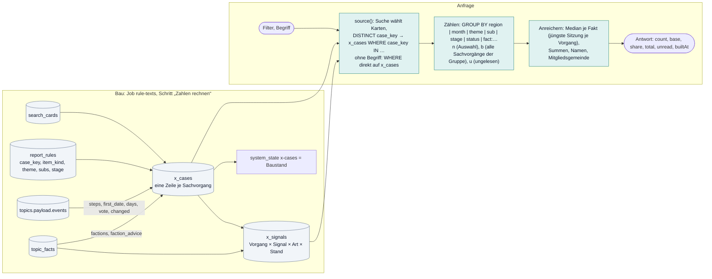

# Auswertungen: plenara.X, Vorberechnung, Social Media

Stand: 17. Oktober 2026, gelesen am Code. Teil der [technischen Dokumentation](README.md). Begriffe: [Glossar](glossar.md).
Produktsicht und Zielgruppen: `docs/produkt/plenara-x-ueberblick.md`; Konzepte `requirements/plenara-x-konzept.md` (teils überholt,
Abschnitt 8), `plenara-x-tools-konzept.md`, Signale `docs/produkt/plenara-x-signale.md`.

## 1. Ein Weg für alles

plenara.X ist der Analyse-Teil (Stufe Enterprise). Es gibt kein Modell im Ablauf; jede Zahl führt zurück zu Vorgängen und
Originalquellen. Seit 15.10.2026 geht jede Auswertung denselben Weg, ohne eigenes Datenmodell je Seite:

1. **Auswahl** über die normale Suche (`source()` in `plenara-x-query.mjs`): dieselben Filter wie auf der Startseite (`q`, Gebiet,
   Umkreis, Thema, Status, Zeitraum, `exact`, `noformal`), mit Begriff über Wortliste und Volltext (`part:'x'`).
2. **Zählen** in `x_cases`: Vorgänge, keine Suchkarten; Formalien nie; gleiche Titel je Gebiet einmal.
3. **Anreichern** aus `report_rules` (Thema, Unterthemen, „Was geschieht“) und `topic_facts` (Werte, Einordnungen); Signale zusätzlich
   über `x_signals`.

## 2. Der Bau der Zahlen (`scripts/plenara-x/build-x-cases.mjs`, `server/integrations/x-cases.mjs`)

Schritt 3 des Jobs `rule-texts` (nach „Regeln anwenden“ und „Suche aktualisieren“), läuft immer; lokal 48 s. Bricht ab, wenn
Migration 0036 fehlt. Eine einzige Transaktion (`BEGIN IMMEDIATE`, `busy_timeout` 60 s):

1. **Vergangene Vorgänge** (`BUILD`): `search_cards` LEFT JOIN `report_rules` je Karte, nur `date <= Bautag` und Art des Punkts
   `subject` (ohne `report_rules`-Zeile entscheidet `search_cards.formal`); gruppiert nach `coalesce(r.case_key, region_id ||
   '|' || lower(title))` mit `max(date)`: die übrigen Spalten (`label`, `stage`, `subs`, `status`, `card_id`) stammen von der Karte mit
   der letzten Sitzung; `cards` = Zahl der Sachpunkt-Karten, `unread` = 1 ohne `report_rules`.
2. **Künftige Vorgänge** (`FUTURE`): dieselbe Abfrage mit `min(date)` und `date > Bautag`, nur Schlüssel, die es unter den vergangenen
   nicht gibt (nur angesetzt, wie in der Suche).
3. `DELETE FROM x_cases`, Insert aller Zeilen (`month` = `date[0..7]`).
4. **`buildXSteps`:** je Vorgang den Zeitstrahl `payload.events` der Karte `card_id` lesen → `first_date`, `steps` (Zeilen
   `Datum<TAB>Status<TAB>Gremium`), `days` (erste Station bis Entscheidung), `vote` (`unanimous`, `majority`, ``), `changed`
   (`readResult` aus dem Ergebnistext der letzten entscheidenden Station); dazu `terms` = `termsText(title)` (Wörter ab 4 Buchstaben
   ohne Füll- und Sitzungswörter, `x-terms.mjs`) und `private_build` = `privateBuild(title)`.
5. **`buildXFactions`:** Fakten `faction` und `faction_advice` über alle Berichte desselben `case_key` → `factions` (Zeilen
   `Fraktion<TAB>antrag|anfrage`), `faction_advice` = 1, wenn eine Karte empfiehlt, dem Antrag nicht zu folgen.
6. **`buildXSignals`:** `DELETE FROM x_signals`, dann je Eintrag von `SIGNALS` ein `INSERT … SELECT DISTINCT case_key, signal, art,
   phase` (Abschnitt 4).
7. `system_state` `x-cases` = `{builtAt, today, cases, future, unread, steps, factions, signals}`; COMMIT (bei Fehler ROLLBACK).
8. Danach `warmX` (die `X_WARM_SQL`-Abfragen lesen `x_cases` mit vier Indizes und `x_signals` einmal ganz) und für den Reiter „Themen &
   Texte“ die Zählung je Thema, Unterthema und Fakt sowie `factCoverage` (Gemeinden mit Faktwerten).

Der Webserver hält dieselben Abfragen warm: 5 s nach dem Start und alle 10 Minuten (`serve.mjs`, dazu die 16 Teaser; aus mit
`RM_SKIP_WARM=1`).

### Spalten von `x_cases`

| Spalte | Migration | Bedeutung |
|---|---|---|
| `case_key` | 0036 | `report_rules.case_key` (= `region_id\|titleKey(title)`); ungelesen `region_id\|lower(title)` |
| `region_id`, `date`, `month` | 0036 | Gebiet; letzte Sitzung bis Bautag (künftige: erste anstehende); `date[0..7]` |
| `label` | 0036 | Thema = `search_cards.label` der Karte mit der letzten Sitzung (wie der Themenfilter der Suche) |
| `stage`, `subs` | 0036 | „Was geschieht“ und Unterthemen aus `report_rules`; `''` = ungelesen |
| `status`, `card_id`, `cards`, `unread` | 0036 | Status der Karte, ihre Kennung, Zahl der Karten, ungelesen |
| `first_date`, `steps`, `days`, `vote`, `changed` | 0041 | Verlauf aus dem Zeitstrahl (nur der Karte `card_id`) |
| `terms`, `private_build` | 0042 | Begriffe aus dem Titel (`Schlüssel<TAB>Wort` je Zeile), privater Bauantrag |
| `factions`, `faction_advice` | 0043 | Fraktionen aller Berichte des Vorgangs |

Indizes `_region(region_id,date)`, `_date`, `_label`, `_atlas(date,label,month,region_id,unread)`. Es gibt keine Spalten `title_key`,
`theme`, `sub`: Thema heißt `label`, Unterthemen `subs`.

## 3. Die Abfrage `GET /api/x` (`app/api/x/route.ts`, `plenara-x-query.mjs`)

1. **Zugang:** `gated(xGet, {feature:'analytics'})`; Antwort `Cache-Control: private, max-age=300, stale-while-revalidate=600`,
   `Vary: Cookie`.
2. **Zwischenspeicher `xCached`** (`atRevisionStale`): Schlüssel = Art (`x-v6`), Tagesdatum und sortierte Parameter; Stand =
   `system_state` `x-cases`; bei älterem Stand (jünger als 6 h) der alte Wert sofort, neue Rechnung im Hintergrund; 20 Filter je
   Art im Arbeitsspeicher des Hauptprozesses.
3. **Worker-Thread:** mit `RM_X_WORKER` rechnet einer von `RM_X_WORKERS` (2) Threads mit eigener Nur-Lese-Verbindung
   (`x-offload.mjs`, `x-registry.mjs`, `server/node/x-worker.mjs`); `RM_X_WORKER=0` schaltet ab, dann rechnet der Hauptprozess. Ohne
   Datei (Dev-Server) ändert sich nichts.
4. **`parseX`:** eigene Parameter `theme` (Seite: `thema`), `sub` (setzt das Thema), `stage`, `by` (`region|month|theme|sub|stage|status`
   oder `fact:<Art>`), `list=1`, `value`, `offset`, `view` (`atlas`, `fakten`), `sum` (nur `housing`), `region`; der Rest geht an
   `parseMonitorSearch` (Filter der Suche); ohne `to` gilt „bis heute“.
5. Ohne `system_state` `x-cases`: **503** „werden gerade aufgebaut“.
6. **`source()`:** `searchFilters(db, catalog, {...f, to, noformal:false, part:'x'})`. Ohne Begriff gilt der WHERE-Teil der Suche
   direkt auf `x_cases` (Gebiet, Datum, Label, Status heißen dort gleich); mit Begriff sucht die Suche einmal in `search_cards`, die
   Karten werden zu `DISTINCT case_key` (aus `report_rules` oder `region|lower(title)`), dann `x_cases WHERE case_key IN
   json_each(?)`. Optionen `steps`, `terms`, `factions` (Zusatzspalten) und `noPrivate` (`private_build=0`).
7. **Auswahl innerhalb** (`selection()`): `label = theme`, `subs LIKE ',sub,'`, `stage`, `region_id`.
8. **Zählen:** einfache Gliederung ein `GROUP BY` mit `n` (Treffer), `b` (alle Sachvorgänge der Gruppe unter denselben Suchfiltern,
   ohne Thema, Unterthema, Stand) und `u` (ungelesen); Unterthemen über `json_each(subs)`, Fakten über `topic_facts ⋈ report_rules
   ON case_key` mit `count(DISTINCT case_key)`; Nenner einmal je Anfrage (`memo`, `WITH sel AS MATERIALIZED`).
9. **Anreichern:** bei Fakten mit Zahl der Median je Gruppe (je Vorgang der Wert der jüngsten Sitzung, `NEWEST_ORDER`; Einheiten
   `X_FACT_NUM`); `sum=housing` je Vorgang der größte Wert, je Gruppe addiert; Namen, Gemeindeschlüssel, Mitgliedsgemeinde.
10. **Antwort:** `count` (Vorgänge), `base`, `share` (Prozent, eine Stelle), `total`, `unread`, `builtAt`, dazu `sum`, `median`.

Besondere Ansichten:

- **`view=atlas`** (`/analytics/atlas?thema=…&sub=…`, `pages/analytics/AtlasPage.tsx`, `XAtlasView.tsx`): `groupsAtOnce` zählt Thema,
  Monat und Ort in einem Durchgang über `idx_x_cases_atlas`; dazu Unterthemen oder Themen, die 10 jüngsten Vorgänge und `compare`
  („Ort im Vergleich“: genau ein `area`, ohne `q`, `sub`, `stage`; letzte 12 Monate; Vergleichsgruppe nach Art, Größenklasse, Land
  und Wilson-Einordnung aus `peer-norms.mjs`, Mindestmengen `NORM_RULE`). Werte aus den Unterlagen nur mit `facts=1` und
  `X_FACT_GATE`; die Seite fragt sie seit 14.10.2026 nicht mehr ab.
- **`view=fakten`** (`/analytics/fakten?fakt=…&wert=…`, `FaktenPage.tsx`): Orte (`by=region`) und `factMaps` für die freigegebenen
  `MAP_FACTS` (`shared/map-facts.mjs`, Freigabe ab 90 % Qualität: `hebesatz`, `budget`, `fee_rate`, `annual_result`, `land_price`): je
  Fakt und Gebiet Vorgänge mit Wert, Median, `latest()` (jüngster und voriger anderer Wert, rot bis grün), Mitgliedsgemeinde über
  `where()`; Haushalt je Einwohner, Wohneinheiten je 1.000 Einwohner.
- **`list=1&by=…&value=…&offset=…`:** 50 je Seite (`X_LIST_SIZE`), jüngste zuerst, Titel und Gremium aus `search_cards`,
  Ortsangabe über `where()`, bei Fakten mit Zahl der Wert (`pages/analytics/RadarDrill.tsx`).

Qualitätstore: `MAP_FACTS` (dritter Eintrag) für die Karte; `X_FACT_GATE`/`X_SUM_GATE` nur im Atlas mit `facts=1`. `by=fact:…` und die
Listen prüfen keines dieser Tore.

## 4. Signale (`/api/x/signale`, `plenara-x-signals.mjs`, `/analytics/signale`)

Zugang `feature:'analytics'`, Zwischenspeicher `x-signale-v8`, Auswahl wie `/api/x` über `parseX` und `source()`; Parameter
`signal`, `phase`, `art`, `offset`, `first=1`. Schneller Weg `fastSignals`: Zahl je Signal mit `count(DISTINCT case_key)` über
`x_signals`, die Vorgänge des gewählten Signals einmal lesen, in JavaScript nach Stand, Art und Ort zählen; „Erstmals hier“ =
frühester Vorgang dieses Signals je Gebiet über den ganzen Bestand, wenn der Bestand des Gebiets mindestens ein Jahr früher beginnt
(`firstOf`). Ohne `x_signals` Rückfall direkt über `topic_facts` (ein Test prüft die Gleichheit). Antwort `{signals, signal, phases,
arts, placeCount, places, total, offset, size 50, builtAt, firstCount?, items}`; `items` sind Karten wie in der Suche mit `place`,
`firstHere`, `phase`, `arts`. Keine Kennzahlen (Zahlen gehören zu Fakten).

Die 11 Einträge von `SIGNALS` (Fakt-Bausteine aus `factsOf` in `shared/topic-facts.mjs`, `facts-v27`):

| Signal | Fakt (`cases`) | Art (Filter) | Stand (`phase`) |
|---|---|---|---|
| `vergaben` | `tender` | Leistung | Detail des Fakts |
| `wohnbau` | `plan_use` Wohnen/Mischgebiet, `plot_price`, `area_dev` Wohnen | `wohnbau_art` | Verfahrensschritt `plan` |
| `gewerbe` | `plan_use` (Gewerbe), `land_price`, `area_dev`, `retail` | Nutzung | `plan` |
| `wind` | `wind_step`, `wind_count`, `ee_power` = Wind | Verfahren | aus `wind_step` |
| `solar` | `solar`, `ee_power` = Photovoltaik | Art | `x_cases.stage` |
| `waerme` | `heat_plan`, `energy` | Art | Schritt aus `heat_plan`, sonst „Maßnahme“ |
| `schulen` | `school_build` | Einrichtung | `x_cases.stage` |
| `strasse`, `wasser`, `breitband` | `street`, `water`, `broadband` | Vorhaben | Detail des Fakts |
| `mobil` | `project` ohne „Öffentliches WLAN“ | Angebot | `x_cases.stage` |

Nur aus dem Titel: `projectsOf`, `tenderOf`, `wind_step`, `area_dev`, `solar`, `energy`, `school_build`, `retail`, `street`, `water`,
`broadband`; aus Titel und Text: `planOf`, `planUseOf`, `heatPlanOf`, `windCountOf`, `eePowerOf`, Grundstückspreise.

**Freigabe:** `shared/rule-quality.json` führt je Signal `quality`, `recall`, `art`, `phase`; der Reiter „Themen & Texte“ zeigt „offen“ erst
ab 90 % Qualität, Art und Stand und 80 % Trefferquote (`signalGate` in `admin-rule-texts.tsx`). Die Abfrage und die Seite werten das
nicht aus: sie liefern immer alle 11 Kategorien.

## 5. Die Tools (`/api/analytics/*`)

Alle mit `gated(…, {feature:'analytics'})` außer `diffusion` (nur `gated()`), alle über `xCached`, alle 503 ohne Bau. Mit `by=…` liefern
sie die Liste hinter einer Zahl über `listPage` (`analytics-lists.mjs`: Gebiet + `titleKey` einmal, 50 je Seite, Ortsangabe über
`where()`; Ortsvergleich zusätzlich `place=<Schlüssel>`).

| Tool (Seite, Route, Modul) | Eingabe | Wie gezählt wird | Besonderheit |
|---|---|---|---|
| **Ausbreitung** (in Trends, `diffusion`, `analytics-diffusion.mjs`) | Suchfilter, Begriff Pflicht (je Wort ab 3 Buchstaben), `to` = heute | `source()`, je Gebiet `min(FIRST_DATE)`, `max(date)`, `count` in `x_cases`, nur Gemeindeebene | Verbände je Mitgliedsgemeinde über `where()`; Bestandsbeginn aus `search_cards`; „von Anfang an“ = erste 14 Tage; zählt private Bauanträge mit |
| **Themennetz** (`/analytics/graph`, `graph`, `analytics-graph.mjs`) | Suchfilter, Begriff optional | alle Vorgänge über `source(steps, terms, noPrivate)`; Begriffe aus `terms`, Gremien aus `steps`, Thema aus `label`, Land | Gewichtung wie tf-idf gegen `search_words.cards`; Kanten mit Jaccard, n ≥ 2, w ≥ 0,04; 45 Begriffe, je Art 8 Knoten; Liste `by=node` |
| **Trends** (`/analytics/trends`, `trends`, `analytics-trends.mjs`) | Suchfilter ohne Zeitraum, `window` 30/90/180 | zwei gleich lange Fenster in `x_cases` über `source(terms, noPrivate)`; Begriffe aus `terms` | z-Test für Anteile: mindestens 5 Treffer, Verhältnis ≥ 1,4, z ≥ 2,5; Gruppen neu, steigend, fallend; `part=spread` = Ausbreitung je Begriff über `FIRST_DATE`; Liste `by=term` |
| **Ortsvergleich** (`/analytics/vergleich`, `compare`, `analytics-compare.mjs`) | `area` + `more`, 2 bis 4 Orte, `scope=only` | je Ort `source(steps, terms, noPrivate)`: gesamt, je 1.000 Einwohner, Themen- und Statusanteile, Gremien, Monate; Vergleichsbasis alle Gebiete mit denselben Filtern (5 Minuten im Speicher) | „typische“ Begriffe z ≥ 3, Verhältnis ≥ 1,8, n ≥ 4; `peer-norms.mjs` wird hier nicht genutzt (nur im Atlas); Liste `by=all\|label\|committee\|term&place=` |
| **Beschlüsse** (Trends, Reiter *Ausgang*, `/analytics/beschluesse`, `decisions`, `analytics-decisions.mjs`) | Suchfilter, `to` = heute | `source(steps)`; Endstand aus `status`; Gremienebene aus jeder Station in `steps`, je Vorgang, Ebene und Status einmal; Abstimmung, Änderung, Dauer aus `vote`, `changed`, `days` | Beschlussquote = beschlossen / (beschlossen + abgelehnt + vertagt), Abweichung mit Wilson-Spanne; Mindestmengen Thema 20, Land 60, Abstimmung 8; keine Quote für Ausschüsse; Liste `by=label\|kind\|land&outcome=` |
| **Beratungswege** (`/analytics/gremien`, `network`, `analytics-network.mjs`) | Suchfilter; mit `area` wird `scope=only` erzwungen | `source(steps)`, Status consulting bis postponed; Folge der Stationen aus `steps` (gleiche Gremien hintereinander einmal, mindestens 2 Stationen) | ein Ort: echte Gremiennamen, sonst `gremiumType()`; höchstens 18 Knoten, 60 Kanten, mindestens 2 je Kante, Median-Tage 0 bis 730; Liste `by=edge&value=Von\|Nach` |
| **Fraktionsprofil** (`/analytics/fraktionen`, `fraktionen`, `analytics-factions.mjs`) | Suchfilter, `to` = heute | `source(noPrivate, factions)`, nur `factions <> ''`, je Vorgang und Fraktion eine Zeile | `faction_advice` macht „beschlossen“ zu „abgelehnt“; Fraktionen ab 10 Anträgen; Themenindex gegen alle Fraktionsanträge; Liste `by=party&outcome=` |
| **Newsradar** (`/analytics/news`, `news`, `analytics-news.mjs`) | Suchfilter; Standard 30 Tage zurück, 10 Tage voraus; `noformal`; `n` 12 (bis 30) | Stufe 1: alle Vorgänge über `source(noPrivate, factions)` mit Titel, Fakten `kita_fee`/`plan` über `case_key`, Vorbewertung `prescore`; Stufe 2: für die besten 300 `topics.payload` lesen | Kern nur aus zitierfähigen Sätzen der Regel-Zusammenfassung; Ausgang über `outcomeOf`, `NO_RESULT` (Platzhalter wie „nicht belegt“) ist kein Ausgang; `NOT_NEWS` filtert Besetzungen; Obergrenze je Gebiet; keine Liste |

Ohne private Bauanträge (`noPrivate`) zählen Themennetz, Trends, Ortsvergleich, Fraktionsprofil und Newsradar; mit ihnen Ausbreitung,
Beschlüsse, Beratungswege, Atlas, Fakten und Signale.

**Teaser** (`/api/x/teaser`, `plenara-x-teaser.mjs`, nur `gated()`, ohne Enterprise): 16 feste Auszüge für die Anwenderseiten (Signale
der letzten 6 Monate, Hebesätze mit Median und Quartilen, 3 Meldungen, 5 steigende Begriffe, 4 häufigste Gremienübergänge,
Ausgangsquoten), über `atRevisionStale` am Baustand, vom Webserver vorgeladen.

**Mitgliedsgemeinde** (`where()` in `member-place.mjs`): nur für Gebiete, deren Name mit Samtgemeinde, Verbandsgemeinde, Amt,
Verwaltungsgemeinschaft oder (Gemeinde-)Verwaltungsverband beginnt; Reihenfolge: genau eine Mitgliedsgemeinde als Wort im Gremium
(kein Verbandsgremium) → Ratsmuster im Gremium („Ortsgemeinderat X“) → „der/des Gemeinde/Stadt … X“ im Titel → genau ein
Mitgliedsname als Wort im Titel. Rückgabe `{key, label}`; genutzt in Listen, Signalen, Fakten-Karte, Ausbreitung, Newsradar,
`fact-coverage`. Bei der Gebietsauswahl der Suche zählt der Schlüssel eines Mitglieds zu seinem Verband (`isPlace`).

**Frontend:** Seiten unter `components/ratsmonitor/pages/analytics/` (`AnalyticsPages.tsx` zeigt sie nur bei Stufe `enterprise`, sonst
`AnalyticsLocked`); gemeinsamer Kopf `XKopf.tsx`, Befund `Befund.tsx`, Ergebnis je Adresse 10 Minuten
gemerkt (`useAnalysisRun.ts`), Abfrage aus Suche und Filtern `useAnalyticsQuery.ts`; Adressen in `lib/routes.ts`.

## 6. Startseite: Karte und Trends (`scripts/startseite-trends.mjs`)

Job `startseite-trends` (05:10): ruft je Begriff aus `components/ratsmonitor/info/startseite-topics.json` die Ausbreitung
`diffusion(q, level=city)` auf und legt je Kreis die früheste Gemeinde und den Verlauf je Monat ab (`system_state`
`startseite-trends` = `{stand, topics}`; mit `--file` auch `public/data/startseite-trends.json`). Route `/api/startseite-trends` (nur
`gated()`, Cache 1 h) liefert den Wert oder 404; die Startseite fällt dann auf die mitgelieferte Datei zurück. Der Job läuft vor
`rule-texts`, rechnet also auf dem `x_cases` des Vortags.

## 7. Vorberechnung der Administration (`region-facts.mjs`, `region-series.mjs`, `admin-builds.mjs`)

Unabhängig von `x_cases`; liest `topics`. Die Adminseiten rechnen beim Öffnen nichts (`requirements/admin-performance-konzept.md`).

- **Je Gebiet:** `region_stats` (`count` und `FIGURES` aus `admin-data.mjs`: `firstEvent`, `lastEvent`, `contentSummaries`, `aiLabels`,
  `aiSummaries`, `ruleSummaries`, `ruleScoreSum`, `qualityPassed`, `pdfArticles`, `conflicts`, `textIssues`, `pendingAnalysis`) und
  `region_series` (`event_days`, `import_days`, `statuses`). Veraltet, wenn `region_revisions.revision` abweicht oder `v` nicht zu
  `FIGURES_VERSION` (6) bzw. `SERIES_VERSION` (1) passt. Rechnung kleinste Gebiete zuerst, in Stücken bis 25.000 Berichte, je Stück
  eine Transaktion; ältere Stände überschreiben nie neuere.
- **Wann:** nach dem Abruf eines Gebiets (1 s), `catchUp` nach den Abrufen (5 s je Schritt, höchstens 400), `POST
  /api/internal/admin-refresh` (Runner, 5 s), Admin-Qualität (8 s), eine offene Adminseite (`RegionCatchUp`), lokal
  `scripts/refresh-admin.mjs` (`--full` setzt `v=0`); der Dev-Server beim Start (`RM_SKIP_ADMIN_REFRESH=1` schaltet ab).
- **Sperre:** `admin-refresh-lease` in `system_state`; belegt → sofort `busy`; Gnadenfrist 20 s; Bauaufträge warten, solange ein
  Importjob läuft (`heavyJobRunning`).
- **Bauaufträge** (`admin-builds.mjs`, Ziele = Qualitätsprüfungen `quality:<check>`): Zustand in `system_state` `admin-build:<ziel>`
  (Bestand beim Start, Cursor, Teilsummen in `admin_agg`); je Schritt Stücke bis 25.000 Berichte, 8 s Budget, 150 ms Pause; jedes
  Stück ein Batch mit Bedingung „Cursor unverändert“ (ein doppelt geschickter Schritt ändert nichts); Fortsetzen innerhalb 1 h,
  danach Neustart. Ergebnis über `writeStored` (gzip, base64, Teile zu 90.000 Zeichen unter `admin-stored:<name>#nnn`, mit `stockSum`
  und `content`-Revision); Hochrechnung in `admin-stored`, Qualität in `admin-quality-check`.
- **Lesen:** GETs schreiben nie und lesen `topics.payload` nie über mehr als ein Gebiet (`tests/admin-readonly.test.mjs`); Antworten
  mit schwachem ETag und Stand (`admin-http.ts`, `admin-stand.mjs`); die Gebietsliste in Teilen `summary`, `areas`, `static` (je
  Deploy, `STATIC_VER`), `area?id=`.

## 8. Social Media (`social-topics.mjs`, Admin „Social Media“)

Liest die Karten der letzten 30 Tage direkt aus `search_cards` (`formal=0`), nicht aus `x_cases`. Bewertet rein regelbasiert
(`fitScore` 0 bis 100: Themenwert aus `shared/social-calibration.json` und `social-ratings.json`, Streit im Vorgang aus
`events[].result`, Alltagsnähe, Reichweite, Aktualität, Konkretheit, Verständlichkeit; Abzüge für Einzelstraße, Ortsteil-Gremium,
Planungsverfahren). Höchstens 3 Vorschläge je Tag, je Ort und Tag einer, je Ort, Gruppe und Woche einer, Mindesteignung 40 %.
`cleanTitle`, `matchTitle` und `evidenceOf` nutzt auch der Newsradar. Lernen: `node scripts/learn-social.mjs` nach Änderungen an
`GROUPS`.

## 9. Befunde beim Schreiben dieser Dokumentation (17.10.2026)

1. **Stand der Signale nicht eindeutig:** `phase` kommt aus einer Unterabfrage `LIMIT 1` ohne `ORDER BY`; tragen mehrere Berichte
   eines Vorgangs verschiedene Werte, ist offen, welcher gilt.
2. **Zahl der Signale:** Code 11 Einträge, Kommentar 10; `docs/produkt/plenara-x-signale.md` führt Pflege und Einzelhandel als eigene
   Kategorien (im Code steckt Einzelhandel in `gewerbe`, Pflege fehlt; der Fakt `care` wird gebaut, aber nicht genutzt) und nennt den
   Cache-Schlüssel `x-signale-v5` (Code `v8`).
3. **Freigabe der Signale wird nicht durchgesetzt:** `rule-quality.json` hat Werte unter 90 % (`sig_tender`, `sig_waerme`,
   `sig_wasser`), die Abfrage liefert trotzdem alle.
4. **`X_FACT_GATE`** im Code: `plan`, `hebesatz`, `faction`, `annual_result`, `plan_use`, `fee_rate`, `heat_plan`, `grant`, `land_price`;
   `CLAUDE.md` nennt „derzeit plan, hebesatz, faction“. Das Tor greift nur im Atlas mit `facts=1`.
5. **Zugang:** `/api/analytics/diffusion` verlangt kein `feature:'analytics'` (die Startseite nutzt dieselbe Rechnung);
   `docs/produkt/plenara-x-ueberblick.md` nennt `/analytics/ueber` und `/analytics/tools` als frei, im Code gibt es die Routen nicht
   mehr (`FRONTEND.md`: keine Übersichtsseiten, 404).
6. **Verlauf aus einer Karte:** `steps`, `first_date`, `terms`, `private_build` kommen nur aus Zeitstrahl und Titel der Karte `card_id`;
   Kommentare und Überblick sagen „alle Karten eines Vorgangs“. Ob der Zeitstrahl der jüngsten Karte immer alle Gremien enthält, ist
   ungeprüft.
7. **Ungelesene Sammelpunkte und Routine** zählen mit, bis der Bericht gelesen ist (nur `search_cards.formal` filtert).
8. **Konzept veraltet:** `requirements/plenara-x-konzept.md` beschreibt `x_cases` mit anderen Spalten sowie `x_docs`, `x_stats` und
   `plenara-x-build.mjs`; so ist es nicht umgesetzt.
9. `server/repositories/analytics.ts` (`getAnalytics`, älterer Weg über `topics.payload`) hat keinen Aufruf in einer Route mehr.
10. Der Kommentar in `deploy/node/ratsmonitor-startseite-trends.service` nennt 04:50, der Zeitplaner 05:10.
