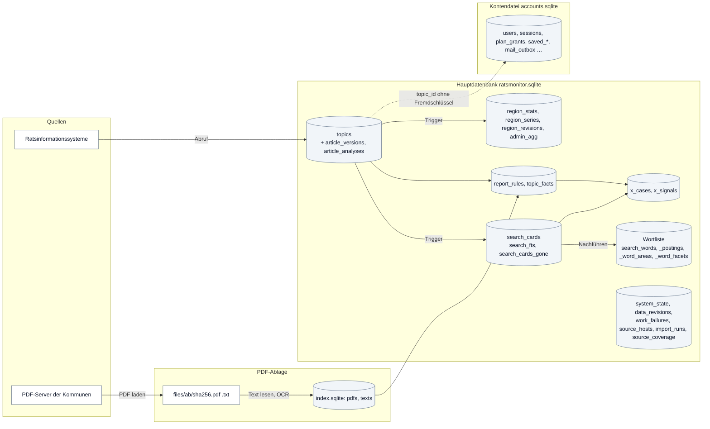
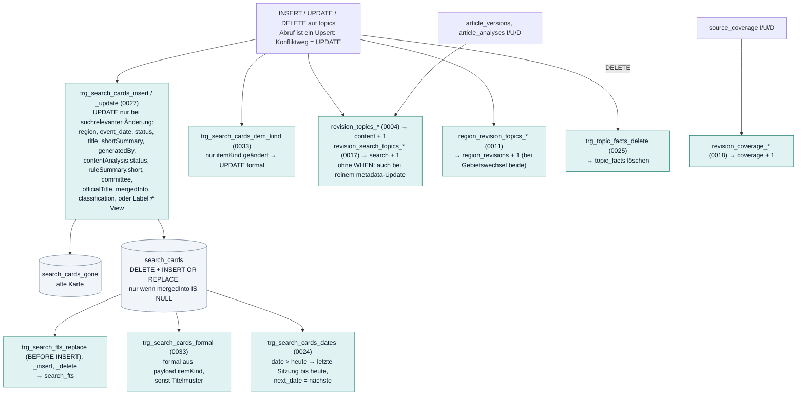

# Datenmodell: Speicher, Tabellen, Trigger, Stände

Stand: 17. Oktober 2026, Migrationen `drizzle/0000` bis `0045`, `drizzle-accounts/0001` bis `0002`. Teil der [technischen
Dokumentation](README.md). Begriffe: [Glossar](glossar.md). Kein Drizzle-ORM im Code: alle Tabellen sind rohes SQL in den
Migrationen, alle Zugriffe `db.prepare(...)` über die D1-Schnittstelle.

## 1. Die drei Speicher

| Speicher | Datei | Schnittstelle | Inhalt |
|---|---|---|---|
| **Hauptdatenbank** | `ratsmonitor.sqlite` (`DATABASE_FILE`); lokal die Miniflare-Datei unter `.wrangler/state/v3/d1/` | `env.DB` (D1-API, auf dem Node-Server über `server/node/d1-sqlite.mjs`), Migrationen `drizzle/`, Buchführung `d1_migrations` | Berichte, Suchkarten, Indizes, Regeln, Fakten, Vorgänge, Signale, Vorberechnung, Betriebszustand |
| **Kontendatei** | `accounts.sqlite` (`ACCOUNTS_FILE`); im Dev-Server in der Hauptdatenbank | `env.ACCOUNTS`, Migrationen `drizzle-accounts/`, Buchführung `accounts_migrations` | Konten, Anmeldesitzungen, Stufen, gespeicherte Suchen und Berichte, Postausgang |
| **PDF-Ablage** | Ordner `RM_PDF_STORE` mit `index.sqlite` und `files/` | `server/node/pdf-store.mjs` (nur Node) | Original-PDFs, Textfassungen, Stand je Adresse und Datei |

Dazu lesen Skripte und Prozesse mit eigenen Verbindungen auf dieselbe Hauptdatenbank (WAL, `busy_timeout` 30 bis 60 s). Die
Kontendatei ist von allen Jobs außer Webdienst und Kontojob abgeschirmt (`InaccessiblePaths` in den systemd-Einheiten) und gehört
nie in Kopien, Export oder MCP.

Keine Fremdschlüssel in der Hauptdatenbank. Wird ein Bericht gelöscht (der Abruf tut das nie), löschen Trigger nur `search_cards`
und `topic_facts`; Zeilen in `article_versions`, `article_analyses`, `report_rules`, `ai_work_items` und `ai_usage` bleiben stehen.

## 2. Tabellen der Hauptdatenbank

### A. Quellenstand (schreibt der Abruf)

| Tabelle | Zweck | Schlüssel, wichtige Spalten | schreibt | liest | Migration |
|---|---|---|---|---|---|
| `topics` | ein Bericht je Zeile; der fachliche Inhalt steht in `payload` (JSON, Abschnitt 5) | PK `id`; `region_id` (Standard `muenster`), `source` (`city`/`district`: die Ebene, nicht die Quelle), `event_date`, `updated_at`, `status`, `payload`; generiert `active` = `json_extract(payload,'$.identity.mergedInto') IS NULL` (VIRTUAL). Teilindizes `idx_topics_canonical_*` hängen an `active=1` (Abfragen müssen genau `active=1` schreiben); weitere `idx_topics_event_date`, `_region_updated`, `_inactive`, `_ai_local_*` | Abruf (`sync.ts` Upsert; nur `$.metadata` per `json_set`), Erstbefüllung (`seed.ts`, `apply-backfill.mjs`), Titelregel (`manual-analysis.mjs`), Regeln (`read-reports.mjs`), KI (`ai-local-work.mjs`, `ai-jobs.mjs`, `prepared-analysis.mjs`) | `repositories/topics.ts` (`/api/topics/[id]`, Artikelseite, `/api/dokument`), `monitor-search.mjs` (Stationen aus `events`), `regions.ts` (`/api/sources`), Admin (`admin-data.mjs`, `region-facts.mjs`), `x-cases.mjs` (Zeitstrahl), Export (`database-transfer.mjs`) | 0000, 0001, 0020, 0026, 0028 |
| `source_coverage` | Quellenstand je Gebiet | PK `region_id`; `payload` (`Coverage` plus `importHealth`, `window`, `oparlProbeAt`, `apiCheck`) | Abruf (jeder Versuch), Erstbefüllung | Abruf (Rückstellung), `/api/sources`, Suche (`coverage`), Admin, `scripts/import-gaps.mjs` | 0001 |
| `import_runs` | Protokoll der Läufe (Abruf, KI-Übernahme, Analysen) | PK `id`; `started_at`, `finished_at`, `status` (`running`, `completed`, `partial`, `failed`), `details` (JSON: mode, region, trigger, window, count); Indizes auf Start und `details.region` | Abruf (Start, Ende; Läufe älter als 30 Tage löschen), `ai-jobs.mjs`, `manual-analysis.mjs` | Admin (letzte 30), `import-trace.mjs`, `/api/internal/sync`, Nachtbericht, Wege zählen | 0000, 0016 |
| `article_versions` | frühere Fassungen eines Berichts als Diff (`diff-v1`) | PK `id`; `topic_id`, `captured_at`, `payload` | Abruf (bei Änderung), `prepared-analysis.mjs`, `ai-local-work.mjs`; gekürzt von `scripts/compact-versions.mjs`, `prune-versions.mjs` | Admin (Zählung), Export, Kürzungsskripte | 0001 |
| `article_analyses` | Ergebnisse der Analysen je Bericht als Verlauf | PK `id`; `topic_id`, `kind` (`summary`, `teaser`, `ai-label`, `rule-label`, `ai-local-attempt`), `method`, `input_hash`, `created_at`, `payload` | KI (`ai-local-work.mjs`, `ai-jobs.mjs`), Titelregel (`rule-label`), `prepared-analysis.mjs`, Modus `summaries` | `ai-jobs.mjs`, Admin, Export | 0003, 0017 |

### B. Suche (Projektion und Indizes)

| Tabelle | Zweck | Schlüssel, Spalten | schreibt | liest | Migration |
|---|---|---|---|---|---|
| `search_cards` | Suchkarte je **aktivem** Bericht | PK `id` (= `topics.id`), dazu `rowid` (FTS, Wortliste); `region_id`, `date` (Stand heute), `next_date`, `status`, `label` (View), `title` (≤ 1000), `teaser` (≤ 1200), `gremium`, `search`, `search_exact`, `formal`; Indizes `_date`, `_status`, `_label`, `_facets(region_id,label,status,date)`, `_noformal` (dasselbe `WHERE formal=0`), `_next` | **nur Trigger** auf `topics`; `rollCardDates` (`date`, `next_date`); Nachfüll-Updates der Migrationen | Suche, `/api/sources`, Wortliste, `x-cases.mjs`, alle `analytics-*`, plenara.X, Kunden-MCP, Social Media, `server/accounts/account.mjs` (gespeicherte Berichte) | 0006, 0010, 0014, 0017, 0019, 0024 |
| `search_cards_gone` | Protokoll ersetzter und gelöschter Karten für das Nachführen der Wortliste | ohne PK; `card_rowid`, `id`, `region_id`, `label`, `status`, `search` | Trigger auf `topics` | `search-words.mjs` (`readGone`); geleert vom Nachführen, vom vollen Aufbau und von Migrationen | 0015 |
| `search_fts` (virtuell) | FTS5-Volltextindex über `search_cards.search`, Trigram, external content | `fts5(search, content='search_cards', content_rowid='rowid', tokenize='trigram')` | Trigger `trg_search_fts_*` auf `search_cards` | Suche (Rückfall bei fehlenden Kandidaten) | 0023 |
| `search_words` | Wortliste: je Wort die Kartenzahl (501 = „mehr als 500“) | PK `word`; `cards`; vom Code zusätzlich `hits_city`, `hits_district` (Migration 0013 kennt sie nicht; der volle Aufbau legt die Tabelle neu an) | `search-words.mjs` (Abruf mit `onlyIfBuilt`, Skript `refresh-search-words.mjs`) | Suche (`knownWords`, `candidateCards`, `precomputed*`), Themennetz (tf-idf) | 0013 |
| `search_postings` | Karten-IDs je seltenem Wort (bis 500 Karten) | PK `(word, card_id)` WITHOUT ROWID | wie oben | Suche (Kandidaten) | 0013 |
| `search_word_areas` | Trefferzahl je Gebiet für häufige Wörter | PK `(word, region_id)`; `n` | wie oben | Suche (vorberechnete Zahlen) | 0013 |
| `search_word_facets` | Trefferzahl je Ebene, Label, Status für häufige Wörter | PK `(word, kind, label, status)`; `n` | wie oben | Suche | 0013 |

### C. Regeln und Auswertungen

| Tabelle | Zweck | Schlüssel, Spalten | schreibt | liest | Migration |
|---|---|---|---|---|---|
| `report_rules` | Stand der Regeln je Bericht; gleicher `key` = nichts neu rechnen | PK `topic_id`; `key`, `version` (`READ_VERSION`), `summary_issue`, `read_at`; `case_key` (= `region_id\|titleKey(title)`), `item_kind`, `theme`, `subs` (kommagetrennt), `stage`; Indizes `_theme` (`WHERE item_kind='subject'`), `_case` | `read-reports.mjs` | `read-reports.mjs`, `x-cases.mjs`, plenara.X, Newsradar, `fact-coverage.mjs`, Wege zählen | 0032, 0035 |
| `topic_facts` | Fakten je Bericht | PK `(topic_id, kind, value)`; `detail`, `method` (`facts-v27:text\|title`); Index `(kind, value)`; Trigger `trg_topic_facts_delete` | `read-reports.mjs` (erst `DELETE … method LIKE 'facts-%'`, dann Insert), Modus `summaries` | Fraktionsprofil, Newsradar, plenara.X (Fakten, Signale), `x-cases.mjs` (Fraktionen), `fact-coverage.mjs` | 0025 |
| `x_cases` | eine schmale Zeile je Sachvorgang für plenara.X | PK `case_key`; `region_id`, `date`, `month`, `label`, `stage`, `subs`, `status`, `card_id`, `cards`, `unread`; `first_date`, `steps`, `days`, `vote`, `changed` (0041); `terms`, `private_build` (0042); `factions`, `faction_advice` (0043); Indizes `_region(region_id,date)`, `_date`, `_label`, `_atlas(date,label,month,region_id,unread)` | `x-cases.mjs` (`DELETE`, dann Insert in einer Transaktion), Schritt „Zahlen rechnen“; nie im Abruf | `/api/x`, `/api/x/signale`, `/api/x/teaser`, alle `/api/analytics/*`, `fact-coverage.mjs`, `serve.mjs` (warmhalten) | 0036, 0041 bis 0045 |
| `x_signals` | Signale je Vorgang vorberechnet | ohne PK; `case_key`, `signal`, `art`, `phase`; Indizes `(signal, case_key)`, `(case_key)` | `x-cases.mjs` (`buildXSignals`) | `/api/x/signale`, warmhalten | 0039 |

### D. Vorberechnung der Administration

| Tabelle | Zweck | Schlüssel, Spalten | schreibt | liest | Migration |
|---|---|---|---|---|---|
| `region_revisions` | Änderungszähler je Gebiet | PK `region_id`; `revision` | **nur Trigger** `region_revision_topics_*` | `region-facts.mjs`, `region-series.mjs`, `admin-stand.mjs` (`stockSum`, ETags), `admin-builds.mjs`, `quality-check.mjs` | 0011 |
| `region_stats` | Kennzahlen je Gebiet (`FIGURES`, `FIGURES_VERSION` 6) mit dem Zählerstand ihrer Berechnung | PK `region_id`; `revision`, `computed_at`, `stats` (JSON) | `refreshRegionFacts` (Abruf 1 s, `catchUp`, `/api/internal/admin-refresh`, `scripts/refresh-admin.mjs`) | `admin-data.mjs`, `admin-stand.mjs`, `area-figures.mjs`; Routen `admin/areas`, `summary`, `coverage` | 0011 |
| `region_series` | Tageswerte je Gebiet (Sitzungstag, Aufnahmetag, Zählung nach Status), `SERIES_VERSION` 1 | PK `region_id`; `revision`, `v`, `computed_at`, `event_days`, `import_days`, `statuses` | wie oben | Routen `admin/timeline`, `estimate`, `coverage` | 0016 |
| `admin_agg` | Teilsummen laufender Bauaufträge (heute nur Liste `host` der Qualitätsprüfung) | PK `(build, list, g, k)` WITHOUT ROWID; `n`, `a`, `b`, `c` | `admin-builds.mjs`, `quality-check.mjs` | `quality-check.mjs` | 0016 |

### E. KI

| Tabelle | Zweck | Schlüssel, Spalten | schreibt / liest | Migration |
|---|---|---|---|---|
| `ai_work_items` | Arbeitsposten der lokalen KI je Bericht | PK `topic_id`; `input_hash`, `state` (`processing`, `completed`, `stale`, `failed` …), `agent`, `claim_token`, `lease_expires_at`, `attempts`, `last_error`, `read_state`, `updated_at`, `last_result_*`, `last_receipt`; Index `(state, lease_expires_at)` | `ai-local-work.mjs` (`list`, `claim`, `read`, `renew`, `release`, `submit`, `fail`) über `/api/admin/ai-local`, MCP intern, `scripts/ai-local.mjs`; liest `rule-texts.mjs` (`ai-counts`), Debug | 0028 |
| `ai_usage` | Tokenverbrauch je KI-Versuch | PK `id`; `topic_id`, `region_id`, `method`, `agent`, `model`, `kinds`, `created_at`, `outcome`, Zähler je Art | `shared/ai-usage.mjs` (`insertUsage`); liest `scripts/ai-usage.mjs`; `mcp-runtime.mjs` verlangt die Tabelle | 0007, 0029, 0030 |
| `ai_dispatches`, `ai_job_articles` | Altweg der KI-Aufträge per Datei: Export-Zeitpunkt je Bericht und Art; eingefrorene Berichte eines Auftrags mit „übernommen“ | PK `(topic_id, kind)` bzw. `(job_id, topic_id)` | nur `ai-jobs.mjs` (`/api/admin/ai-job`, `scripts/ai-job.mjs`); Manifest in `system_state` `admin-ai-job` | 0005 |

### F. Betrieb

| Tabelle | Zweck | Schlüssel, Spalten | schreibt / liest | Migration |
|---|---|---|---|---|
| `system_state` | Schlüssel-Wert-Speicher (Abschnitt 4) | PK `key`; `value` (meist JSON) | viele Module | 0000 |
| `data_revisions` | globale Datenstände | PK `id` ∈ {`content`, `search`, `coverage`}; `revision` | Trigger und einzelne Skripte (Abschnitt 3) | 0004, 0017, 0018 |
| `work_failures` | Fehlerspeicher je Schritt und Gegenstand | PK `(step, key)`; `host`, `class`, `reason`, `http`, `tries`, `first_at`, `last_at`, `next_try_at`, `event_date`, `origin`, `release`; Indizes `next_try_at`, `host` | `work-failures.mjs` für Abruf (`noteImport`) und Ablage (`failures.mjs`); Nacharbeit, Altbestand, `job.mjs`; liest Debug, Altbestand, `pipeline-worker.mjs`, `text.mjs` | 0040 |
| `source_hosts` | Serverstufe je Server | PK `host`; `state`, `fails`, `level`, `next_try_at`, `last_ok_at`, `last_fail_at`, `reason`, `updated_at` | `work-failures.mjs`, `failures.mjs`, `job.mjs`; liest Abrufer, Debug, `stats.mjs` | 0040 |
| `push_subscriptions` | Web-Push-Abonnements | PK `id`; `endpoint`, `auth`, `p256dh`, `created_at`, `last_sent_at` | niemand (Web-Push seit 20.10.2026 entfernt; die Tabelle bleibt) | 0000 |
| `d1_migrations` | Buchführung der Migrationen (wie Wrangler) | `id`, `name` UNIQUE, `applied_at` | `scripts/node-migrate.mjs`; `serve.mjs` prüft die Tabelle beim Start | (Code) |

### View `topic_effective_labels` (Fassung `0038`)

Spalten `id`, `label`, nur für `topics.active=1`. Rangfolge: Einordnung von Hand → KI-Label (`ai-local-content-v2`, Katalog
`labels-v2`/`v3`, passende `sourceSignature`) → `payload.theme` (`themes-v3`, `evidence` = heutiger Titel; `offen` → `unklar`) →
Titelregel (`title-rules-v*`, `evidence` = Titel). Alte Labels werden übersetzt. Gelesen nur von den Suchkarten-Triggern und den
Nachfüll-Updates der Migrationen; die JavaScript-Entsprechung ist `storedClassification` (`shared/analysis-state.mjs`), Test
`tests/effective-labels.test.mjs`. `THEMES_VERSION` steht fest im View: ein Wechsel braucht eine neue Migration.

## 3. Trigger-Kette und Datenstände

Die Ausführungsreihenfolge mehrerer Trigger auf demselben Ereignis legt SQLite nicht fest.

Kurzform: `topics` → { `search_cards` (→ `search_fts`, `formal`, `date`) + `search_cards_gone` } · `data_revisions` `content` und
`search` · `region_revisions` · bei DELETE `topic_facts`. `rollCardDates` ändert `search_cards` direkt und erhöht `search` und
`content` selbst.

### Datenstände (`data_revisions`)

| Stand | erhöht von | geprüft von |
|---|---|---|
| `content` | Trigger auf `topics`, `article_versions`, `article_analyses`; `read-reports.mjs` (wenn gelesen), `search-card-dates.mjs`; Migrationen 0019, 0024, 0027, 0034, 0037, 0038 | `CONTENT_REVISION_SQL` (`revision-cache.mjs`): `atRevision`/`atRevisionStale` als Standard (Admin-Daten, Gebietswerte, Ausbreitung), `processing-status.mjs`, `admin-stored.mjs`, Beleg in `ai-jobs.mjs` und `database-restore.mjs` |
| `search` | Trigger auf `topics` (0017, Startwert aus `content`), `search-card-dates.mjs`, dieselben Migrationen | `SEARCH_REVISION_SQL` (`search-words.mjs`; ersatzweise `content`): Suche (Stand in der Antwort, 409 bei Abweichung des Parameters `revision`), Gültigkeit der Wortliste (`system_state` `search-words`) |
| `coverage` | nur Trigger auf `source_coverage` (0018) | `SOURCES_REVISION_SQL` = `content` + `coverage`: `/api/sources`, `admin-stand.mjs` (geht in die Admin-ETags ein), Export |
| Bau von `x_cases` | `system_state` `x-cases` (`{builtAt, today, cases, future, unread, steps, factions, signals}`), geschrieben von `buildXCases` | `X_REVISION_SQL` (`x-cases.mjs`): `xCached` für `/api/x`, `/api/x/signale`, `/api/analytics/*`, `/api/x/teaser` (`atRevisionStale`: bis 20 Filter je Art, alter Wert bis 6 h, Rechnung im Hintergrund) |
| je Gebiet | `region_revisions` (Trigger) | `region-facts.mjs` rechnet nur abweichende Gebiete; `admin-stand.mjs` bildet `stockSum` und Stempel für ETags (`server/repositories/admin.ts`, 304 aus `admin-etag.mjs`) |

Zwischenspeicher im Prozess: `server/services/read-cache.mjs` (30 s, 3 Einträge, geleert mit `invalidateReads()` nach Schreibvorgängen),
`cachedSearch` in `monitor-search.mjs` (200 Einträge am Datenstand `search`), `atRevision*` in `revision-cache.mjs`.

## 4. Schlüssel in `system_state`

| Bereich | Schlüssel | Zweck |
|---|---|---|
| Abruf | `admin-pipeline-job`, `pipeline-lease` | Abrufauftrag und seine Sperre (30 s) |
| | `import-lock`, `import-run:<gebiet>` | Importsperre (`<expiry>` exklusiv oder `shared`), Marke je Gebiet; auch von KI-Übernahme, Analysen, Titelregel genutzt |
| | `import-marks:<gebiet>`, `import-list:<gebiet>` | gelesene Sitzungen, gemerkte Sitzungsliste |
| | `import-debug:<gebiet>` | Anfragen des letzten Abrufs |
| | `latest-decision` | Altlast: letzter erkannter Beschluss für Web-Push (Münster), seit 20.10.2026 nicht mehr geschrieben |
| | `seed-init-lock`, `regional-v5-…`, `nrw-<rev>`, `history-backfill-*`, `last-data-restore` | Sperren und Marken der Erstbefüllung, Nachladung, Wiederherstellung |
| Suche | `search-words`, `search-words-lease` | Stand (`{rowid, topId, revision, complete, counted, hasHits, words, postings, at}`) und Sperre der Wortliste |
| Regeln, plenara.X | `x-cases` | Baustand von `x_cases` (= X-Revision) |
| | `rule-texts-last`, `rule-texts-all` | Ergebnis je Schritt, Wunsch „Alle neu erstellen“ |
| | `ai-counts` | KI-Stand (Zustände, neuer Text, ohne KI-Fassung) |
| | `pipeline-trace` | Wege der Berichte |
| | `startseite-trends` | vorgerechnete Trends der Startseite |
| Zeitplaner | `schedules`, `schedule-runs`, `schedule-now`, `schedule-stop`, `schedule-log`, `systemd-units` | Einstellungen, Läufe, Wünsche, Anhalten, Laufbuch (≤ 400), Zustand der Einheiten |
| Ablage | `pdf-store-stats`, `pdf-store-job`, `pdf-store-progress-chain`, `pdf-store-progress-ocr`, `pdf-store-runs`, `pdf-store-stop`, `pdf-store-count`, `pdf-store-heartbeat`, `pdf-store-errors-csv:N`, `pdf-daily-last` | Stand, Aufträge, Fortschritt je Bahn, Läufe (≤ 50), Anhalten, Zählwunsch, Lebenszeichen, Fehlerliste, Ergebnis des Tageslaufs |
| Nacharbeit, Altbestand | `nacharbeit-last`, `altbestand-requests`, `altbestand-last`, `altbestand-rework-last` | Ergebnisse und Wünsche |
| Speicher | `server-disk`, `server-disk-count` | Plattenbelegung, Messwunsch |
| Administration | `admin-refresh-lease`, `admin-build:<ziel>`, `admin-stored:<name>` (+ `#000`…), `admin-quality-check`, `admin-owner-v1`, `admin-todos-v1` | Sperre der Rechenschritte, Bauaufträge, gepackte Auswertungen (gzip, base64, Teile zu 90.000 Zeichen), Qualitätsprüfungen, alter Admin-Besitzer, To-do-Board |
| KI (alt) | `admin-ai-job`, `ai-job-lease`, `last-ai-apply` | Manifest, Sperre, Übernahmebeleg des Dateiwegs |
| Altlast | `coverage` | wird in `repositories/topics.ts` gelesen; kein Schreiber im Code gefunden |

## 5. Das Payload eines Berichts (`topics.payload`)

Typ `StoredTopic` (`server/types.ts`) erweitert `TopicDetail` und `TopicCard` (`shared/types.ts`). Die Felder nach Herkunft:

| Herkunft | Felder |
|---|---|
| **Abruf** (Leser und `refreshMetadata`) | `id`, `source`, `regionId`, `public`, `title`, `officialTitle`, `status`, `category`, `committee`, `eventDate`, `updatedAt`, `reference`, `referenceStatus`, `documents[]`, `events[]` (`date`, `committee`, `status`, `description`, `url`, `result`, `created`, `modified`, `attendance`, `decision`), `relevanceReason`, `sourceUrl`, `sourceText`, `documentText`, `hasDocumentText`, `documentSource`, `documentIssue`, `paperType`, `sourceData` (`version`, `method`, `fetchedAt`, `records[]`, `detailStatus`, `issues`), `identityLinks`, `identityRecords`, `identity` (`version`, `mergedInto?`, `conflict?`), `metadata` (`version`, `firstImportedAt`, `sourceModifiedAt`, `lastFetchedAt`, `lastProcessedAt`), `quality`; automatischer Text `shortSummary`, `longSummary`, `generatedBy: 'Automatischer Quellenüberblick'` |
| **Regeln** (ohne Modell) | `classification` (Titelregel, `method` `title-rules-v7`, `version` `labels-v3`, `evidence` = Titel), `labelAssessments.rule`, `analysisFeatures` (Titelregel, `manual-analysis.mjs`); `itemKind`, `theme` (`id`, `subs`, `source`, `version`, `evidence`), `stage`, `ruleSummary` (`short`, `long`, `score`, `generatedBy`, `generatedAt`, `source`), `ruleSummaryTried` (alt; wird gelöscht), `summaryAttemptedAt`, `summaryMethod`, `summaryIssue` (`read-reports.mjs`, Modus `summaries`) |
| **KI** | `shortSummary`, `longSummary` (überschrieben), `generatedBy: 'KI-Zusammenfassung'` (Altfälle mit Zusatz), `summaryGeneratedAt`, `summaryMethod`, `summaryModel`, `contentAnalysis` (seit 0021 ohne Text; der Text steht in `article_analyses` `summary`), `labelAssessments.ai` (`Classification` mit `status`, `sourceSignature`), `aiAttempts`, `metadata.lastProcessedAt` |
| **Von Hand** | `labelAssessments.review` (`primary`, `reviewer`, `reviewedAt`, `reason`, `status?`, `sourceSignature?`); gelesen vom View und von `storedClassification`; ein Schreiber im Code wurde nicht gefunden (nur Tests) |
| entfernt | `weightedKeywords` (0019), `summaryEvidence` (0022, wo `contentAnalysis.evidence` vorhanden ist) |

`preserveArticleContent` (`shared/article-record.mjs`) behält beim erneuten Abruf `contentAnalysis`, `labelAssessments`, `metadata`,
`ruleSummary` und vorhandene KI-Texte; ändert sich die Quelle (`analysisSignature`), werden `contentAnalysis` und
`labelAssessments.ai` `stale`.

## 6. Kontendatei (`drizzle-accounts/`)

Geheimnisse nur als SHA-256, Adressen nur dort im Klartext, wohin versendet wird, keine IP-Adressen.

| Tabelle | Zweck |
|---|---|
| `users` | Konten (`id` `u_…`) mit bestätigter E-Mail, Name, Organisation, Kundentyp, Status `active`/`blocked` |
| `user_roles` | Rollen je Konto (derzeit nur `admin`) |
| `plan_grants` | Freischaltungen der Stufen `basic`/`pro`/`enterprise` mit Quelle `manual`/`beta`/`stripe` und Laufzeit; ohne Zeile gilt Gast; `end_notice_at` vermerkt den Hinweis vor dem Ablauf |
| `consents` | Zustimmungen (`agb`, `alter18`) je Fassung mit Zeitpunkt, Widerruf, Fassung der Datenschutzerklärung |
| `invites` | Einladungen je E-Mail mit Stufe, Laufzeit, Notiz, Einladendem, Ablauf |
| `login_requests` | Zählprotokoll der Anmeldeanfragen (HMAC von Adresse und IP) für die Begrenzung; bereinigt vom Kontojob |
| `login_flows` | laufende Anmeldeabläufe mit Versuchszähler und Ablauf (Flow-Cookie) |
| `login_tokens` | Einmallinks und -codes (`id` = Hash des Tokens, `code_hash` aus Zweck, Flow und Code) für `login`, `signup`, `delete`, `export`, mit Ziel `next` und `used_at` |
| `sessions` | Anmeldesitzungen (Hash des Cookie-Werts), gleitender und absoluter Ablauf, Admin-Host-Kennzeichen, Gerät; seit 0002 `admin_verified_at` (zweiter Faktor, 12 h) und `view_tier` („Ansehen als“) |
| `saved_searches` | gespeicherte Suchen je Konto mit Zustand, Abfrage, Mail-Benachrichtigung (`notify_mail`, `notify_freq`, seit 0005 `notify_since`) |
| `saved_articles` | gemerkte oder gefolgte Berichte mit Momentaufnahme und letztem Status (seit 0005 `follow_since`); `topic_id` verweist ohne Fremdschlüssel auf die Hauptdatenbank |
| `user_settings` | Wochenbericht (an/aus, Wochentag 0–6, 7 = täglich, `weekly_since`), Kalenderauswahl als JSON, seit 0005 Kalender-Mails (`calendar_mail`, `calendar_freq`, `calendar_since`) |
| `notify_items` | Treffer der Benachrichtigungen je Konto, Bezug (`s:<Suche>`, `a:<Vorgang>`, `c` Kalender) und Bericht bzw. Ereignis, mit Fälligkeit, Karte, Mail-ID oder Verfall; 30 Tage (`server/accounts/notify.mjs`) |
| `notify_tokens` | Abbestell-Tokens aus den Mails (SHA-256), je Bezug oder `*`; 180 Tage |
| `calendar_feeds` | geheime Kalender-Abo-Kennungen je Konto mit Widerruf |
| `auth_events` | Protokoll sicherheitsrelevanter Ereignisse |
| `admin_audit` | ändernde Admin-Zugriffe, stundenweise verdichtet (`UNIQUE (user, path, action, hour)`) |
| `mail_outbox` | Warteschlange ausgehender Mails mit Status, Versuchen, Verfall, Kontingentklasse (seit 0005 auch `notify`); nach dem Versand werden Adresse und Inhalt gelöscht |
| `dev_mail` | im Dev-Betrieb abgefangene Mails (Postfach `/konto/postfach`) |
| `user_totp` | TOTP-Schlüssel der Admins, AES-GCM-verschlüsselt mit `ACCOUNTS_SECRET`; `last_step` verhindert doppelte Codes |

## 7. PDF-Ablage (`index.sqlite`)

| Tabelle | Spalten | Zweck |
|---|---|---|
| `pdfs` | PK `url`; `sha256`, `bytes`, `pages`, `status` (`ok`, `error`, `unsupported`, `text-only`), `http`, `error`, `fetched_at`, `region_id`, `topic_id`, `doc_type`, `formal`, `event_date`, `role` (`other` = Anlage, leer = Hauptdokument); Indizes `sha`, `(status, fetched_at)` | eine Zeile je **Adresse** |
| `texts` | PK `sha256`; `status`, `method` (`text`, `ocr`, `mixed`), `version` (`TEXT_VERSION`), `pages`, `ocr_pages`, `ocr_needed`, `chars`, `error`, `made_at`, `head_type`; Teilindex `WHERE ocr_needed>0` | eine Zeile je **Datei** (Textfassung) |
| `meta` | `key`, `value` | `doc-type-version`, `failures-seeded` |
| `text_hashes`, `facts_keys` | | Altlasten der Skripte `summaries.mjs` und `facts.mjs` (entfernt 20.10.2026, ersetzt durch `report_rules`); niemand liest oder schreibt sie |
| `ocr_refetch`, `ocr_slow` | | Altlasten, einmal in den Fehlerspeicher übertragen, danach nur noch ohne Fehlerspeicher geschrieben |

Dateien `files/<sha256[0..1]>/<sha256>.pdf` und `.txt` (Seiten getrennt durch `\f`); gleiche Bytes liegen einmal, auch unter
mehreren Adressen. Das Laufprotokoll liegt nicht hier, sondern in `system_state` `pdf-store-runs`.

## 8. Migrationen

- Reihenfolge: `scripts/node-migrate.mjs` sortiert die Dateinamen; von den beiden Dateien mit Nummer `0017` läuft
  `0017_search_cards_label_version.sql` vor `0017_search_formal_revision.sql`. Buchführung in `d1_migrations`; eine lokal migrierte
  Datenbank gilt als auf demselben Stand wie der Server.
- Dauer auf echten Daten (lokale Kopie mit 941.000 Karten, Server etwa das Anderthalbfache): 0017 142 s (Spalte `formal`), 0019 45 s,
  0020 28 s, 0023 43 s (+650 MB FTS), 0024 3,8 s; Einzelheiten und die Reihenfolge nach dem Einspielen (Wortliste `--full`,
  Gebietswerte neu, `rule-texts --all`) in `docs/betrieb/node-server.md`, Abschnitt „Migrationen“.
- Die Migrationen 0019, 0027, 0034, 0037 und 0038 löschen den Stand der Wortliste und leeren `search_cards_gone`, damit der nächste
  Lauf voll aufbaut; 0034 und 0037 setzen die Labels aller Karten neu.
- `deploy/node/deploy.sh` prüft nur (`--check`) und bricht bei fehlenden Migrationen ab; eingespielt wird von Hand mit angehaltenem
  Importprozess. Die Kontendatei migriert das Skript selbst (nur additiv, vorher verschlüsselte Sicherung).

## 9. Befunde beim Schreiben dieser Dokumentation (17.10.2026)

1. `labelAssessments.review` (Einordnung von Hand) hat keinen Schreiber im Code; nur View, `storedClassification` und Tests lesen es.
2. `system_state` `coverage` wird gelesen (`repositories/topics.ts`), aber nirgends geschrieben.
3. `search_words.hits_city`/`hits_district` legt nur der Code an; auf einer Datenbank, die nur Migrationen gesehen hat, fehlen sie,
   bis `schemaOk` den vollen Aufbau auslöst.
4. `scripts/pdf-store/summaries.mjs` und `facts.mjs` ruft kein Job mehr auf; sie schreiben aber noch `topics`, `article_analyses`,
   `topic_facts`, `data_revisions` sowie `text_hashes`/`facts_keys`. Fakt-Art `funding` (Kommentar in 0025) gibt es im heutigen
   `factsOf` nicht mehr. **Erledigt 20.10.2026:** beide Skripte sind entfernt.
5. `requirements/plenara-x-konzept.md` beschreibt `x_cases` mit `id`, `member_id`, `routine`, `text_state` sowie `x_docs`, `x_stats`
   und `plenara-x-build.mjs`; so ist es nicht umgesetzt.
6. Zwei Schreibweisen des Vorgangsschlüssels: gelesene Berichte `titleKey` (Satzzeichen zu Leerzeichen), ungelesene `lower(title)`
   (`x-cases.mjs`, `plenara-x-query.mjs`); derselbe Titel mit Satzzeichen kann so vorübergehend zwei Vorgänge ergeben.
