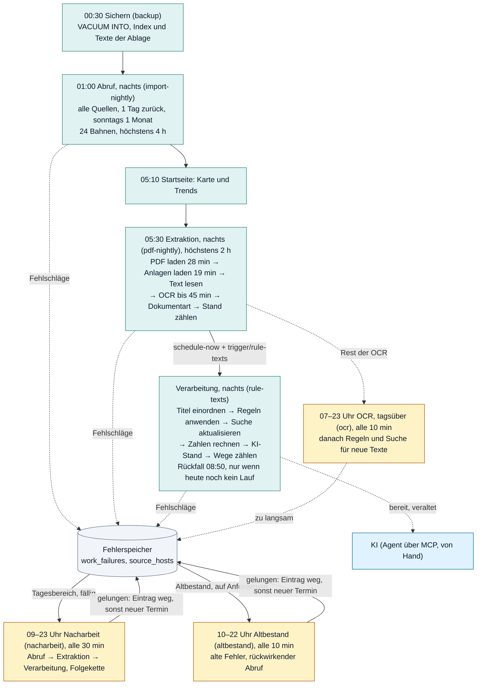
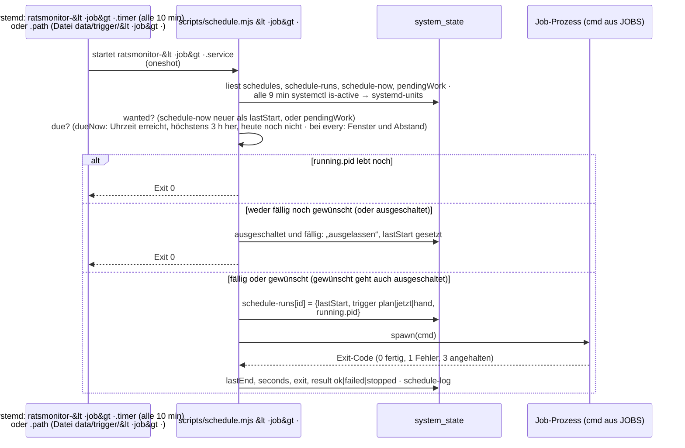
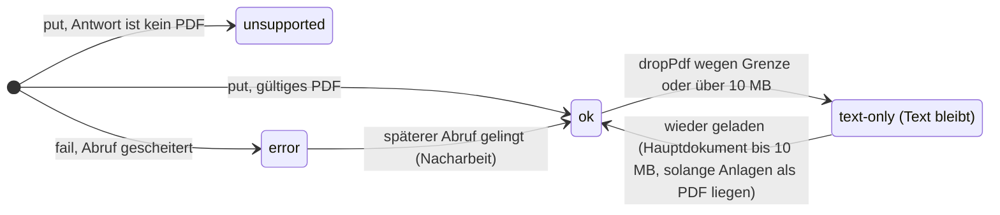
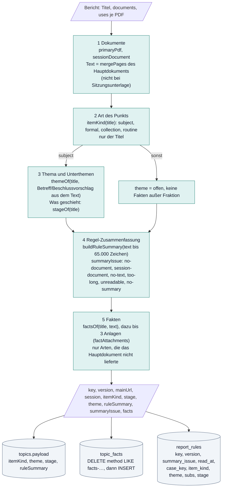
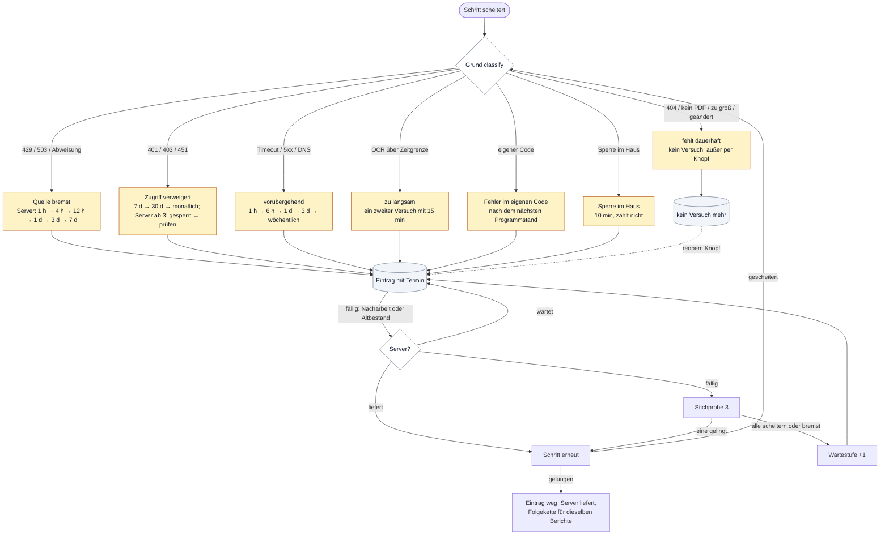
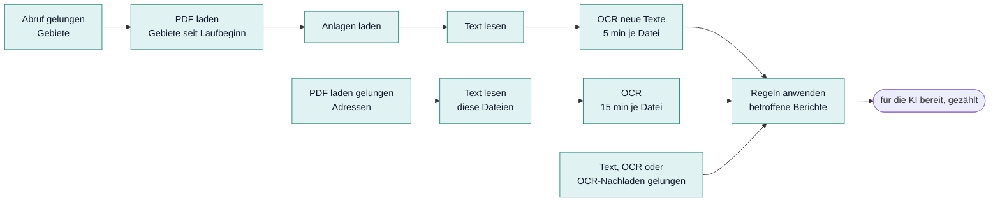
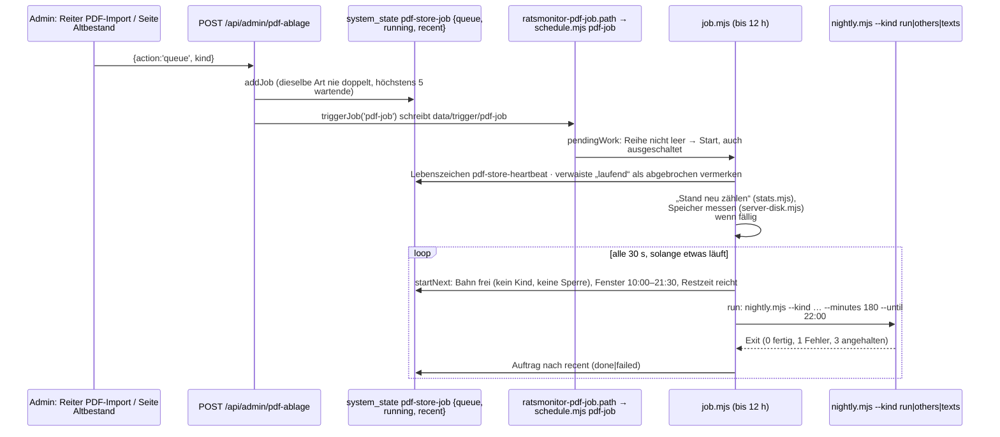

# Pipeline: Tagespipeline, Extraktion, Verarbeitung, Nacharbeit, Altbestand

Stand: 17. Oktober 2026, gelesen am Code des Branchs `nachtlauf-fixes`. Teil der [technischen Dokumentation](README.md). Begriffe:
[Glossar](glossar.md). Der Abruf selbst (Stufe 1) hat ein eigenes Kapitel: [Abruf](abruf.md). Konzept und Begründungen:
`requirements/betriebsplan-konzept.md`; interaktives Ablaufbild mit allen Verzweigungen: `requirements/betriebsplan-ablauf.html`;
Prozesstapete als PDF: `requirements/betriebsplan-prozesstapete.pdf` (erzeugt von `requirements/betriebsplan-tapete.mjs`).

## 1. Überblick

Drei **Abläufe**, drei **Stufen** je Bericht, benannte **Schritte** (`shared/pipeline-terms.mjs`; dieselben Wörter stehen in
Protokollen, Admin-Seiten und hier):

| Ablauf | Wann | Was |
|---|---|---|
| **Tagespipeline** | jede Nacht, feste Reihenfolge | holt und verarbeitet, was neu ist; was scheitert, kommt in den Fehlerspeicher, die Pipeline wartet nicht |
| **Nacharbeit** | tagsüber, automatisch, nur Tagesbereich | versucht erneut, was gescheitert ist, Stufe für Stufe, mit Folgekette |
| **Altbestand** | nur auf Knopfdruck, 10 bis 22 Uhr | Älteres rückwirkend abrufen, extrahieren, verarbeiten; alte Fehler aufarbeiten |

| Stufe | Schritte (Schlüssel in `STEPS`) | Skript |
|---|---|---|
| – | Sichern (`backup`) | `deploy/node/backup.sh` |
| **Abruf** | Abruf (`import`) | `import-worker.mjs` → `runSync` |
| **Extraktion** | PDF laden (`pdf`), Anlagen laden (`others`), Text lesen (`text`), OCR (`ocr`), OCR-Nachladen (`ocr-fetch`), Dokumentart (`doctype`), Grenze halten (`budget`) | `scripts/pdf-store/fetch.mjs`, `text.mjs`, `budget.mjs` |
| – | Stand zählen (`stats`) | `scripts/pdf-store/stats.mjs` |
| **Verarbeitung** | Titel einordnen (`title`), Regeln anwenden (`rules`), Suche aktualisieren (`search`), Zahlen rechnen (`xcases`), KI (`ai`) | `scripts/reclassify-rules.mjs`, `scripts/pdf-store/read-reports.mjs`, `scripts/refresh-search-words.mjs`, `scripts/plenara-x/build-x-cases.mjs`, Agent über `scripts/mcp-internal.mjs` |
| – | Wege zählen (`trace`) | `scripts/pipeline-trace.mjs` |

Reihenfolge der Nacht und warum: Sichern vor dem Abruf (ein Stand vor den Änderungen des Tages); Abruf vor der Extraktion (neue
Berichte bringen neue PDFs); Text und OCR vor der Verarbeitung (die Regeln haben morgens den ganzen Text); Regeln vor Suche und
Zahlen (Zusammenfassungen ändern den Suchtext).

## 2. Jobs und Zeitplaner

### Die Jobs (`JOBS` in `server/integrations/schedules.mjs`)

| Job (`id`) | Name im Admin | Ablauf | Zeit / Fenster | Grenze | Befehl |
|---|---|---|---|---|---|
| `accounts` | Konten: Pflege und Sicherung | – | 00:10 | Sekunden | `bash deploy/node/accounts-job.sh` |
| `backup` | Sichern | Tagespipeline | 00:30 | Platz 1,5 × Datenbank | `bash deploy/node/backup.sh` |
| `import-nightly` | Abruf, nachts | Tagespipeline | 01:00 | 4 h | `import-worker.mjs --create sources --window 1d --weekly-window 1m --weekly-day 0 --max-minutes 240` |
| `startseite-trends` | Startseite: Karte und Trends | Tagespipeline | 05:10 | Minuten | `scripts/startseite-trends.mjs` |
| `pdf-nightly` | Extraktion, nachts | Tagespipeline | 05:30 | 2 h | `scripts/pdf-store/nightly.mjs --kind nightly --daily --minutes 120 --budget-gb 80 --ocr-workers 2` |
| `rule-texts` | Verarbeitung, nachts | Tagespipeline | direkt nach `pdf-nightly`; 08:50 nur als Rückfall (`fallback`: nicht, wenn heute schon gelaufen) | meist unter 1 h | `scripts/rule-texts.mjs` |
| `nacharbeit` | Nacharbeit | Nacharbeit | alle 30 min, 09:00 bis 23:00 | 20 min, 500 Einträge | `scripts/nacharbeit.mjs --range daily --minutes 20` |
| `ocr` | OCR, tagsüber | Nacharbeit | alle 10 min, 07:00 bis 23:00 | 3 h | `nightly.mjs --kind ocr --ocr-only --range daily --minutes 180 --ocr-workers 2 --until 23:00` |
| `altbestand` | Altbestand | Altbestand | alle 10 min, 10:00 bis 22:00, nur mit Anforderung | 2 h | `scripts/altbestand.mjs --minutes 120 --until 22:00` |
| `import` | Abrufaufträge | Altbestand | alle 10 min, nur mit Auftrag | 4 h | `import-worker.mjs --run --max-minutes 240` |
| `pdf-job` | PDF-Aufträge und Messungen | Altbestand | alle 10 min; Aufträge 10:00 bis 21:30 | 3 h je Auftrag, Dienst bis 12 h | `scripts/pdf-store/job.mjs --minutes 180 --budget-gb 80` |

Einstellungen (ein/aus, Uhrzeit in 10-Minuten-Schritten deutscher Zeit, Abstand) liegen in `system_state` `schedules`; Läufe in
`schedule-runs` (Start, Ende, Dauer, Ergebnis, laufende PID), Laufbuch `schedule-log` (höchstens 400), Wünsche `schedule-now`,
Anhalten `schedule-stop`, Zustand der systemd-Einheiten `systemd-units`.

### Wie ein Job startet

- **„Jetzt ausführen“** (`POST /api/admin/zeitplaene {action:'now'}`): `runScheduleNow` setzt `schedule-now[id]`, `triggerJob(id)`
  schreibt die Datei `<RM_TRIGGER_DIR | trigger neben DATABASE_FILE>/<job>`; `ratsmonitor-<job>.path` (`PathModified`) startet den
  Dienst sofort. Läuft der Dienst schon, passiert nichts. `pendingWork` zählt ebenfalls als Wunsch: beim `pdf-job` eine offene
  Zählung, Speichermessung oder ein wartender Auftrag, beim `altbestand` eine offene Anforderung im Fenster.
- **„Anhalten“**: `requestScheduleStop` schreibt `schedule-stop[id]` (nur Anzeige „wird angehalten“) und `triggerStop(id)` die Datei
  `trigger/stop-<job>`; `ratsmonitor-stop-<job>.path` startet `ratsmonitor-stop@<job>.service` (root), das `systemctl stop
  ratsmonitor-<job>.service` ausführt. `schedule.mjs` gibt SIGTERM an das Kind weiter und vermerkt `stopped`. Jobs nie mit
  `systemctl stop …timer` stoppen: der Job startet dann nie wieder (Befund 16.10.2026); die Debug-Seite und der Nachtbericht warnen
  bei inaktiven Einheiten.
- Laufeinträge schreibt der Zeitplaner mit bis zu 6 weiteren Versuchen à 10 s, weil die Verarbeitung die Schreibsperre länger als
  `busy_timeout` halten kann.

## 3. Die Tagespipeline Schritt für Schritt

### 3.1 Sichern (`backup`, 00:30)

`deploy/node/backup.sh`: älteste Sicherung löschen (nie mehr als 2 Stände je Art), Datenbank per `VACUUM INTO` kopieren (die Website
läuft weiter), prüfen, mit zstd packen; dazu `index.sqlite` der Ablage (`.backup`) und ihre Textfassungen als `tar.zst` (sonntags
voll, sonst nur seit der letzten Sicherung geänderte); mit `BACKUP_REMOTE` (rclone) eine Kopie außer Haus. PDFs werden nicht
gesichert, sie lassen sich neu laden. Bei Fehler bleibt die vorige Sicherung.

### 3.2 Abruf, nachts (`import-nightly`, 01:00)

`import-worker.mjs --create sources --window 1d --weekly-window 1m --weekly-day 0`: ein Abrufauftrag über alle angebundenen Quellen,
1 Tag zurück plus die schon angesetzten künftigen Sitzungen; sonntags einen Monat zurück, damit Niederschriften und Beschlüsse, die
Wochen nach der Sitzung erscheinen, ankommen. Gebiete mit wartendem Eintrag im Fehlerspeicher und Gebiete auf wartenden Servern
stehen im Auftrag als „Zurückgestellt“ (`deferredRegions`); die Nacharbeit holt sie. 24 Bahnen, je Server höchstens 2. Jeder Ausgang
geht über `noteImport` (`pipeline-jobs.mjs`) in den Fehlerspeicher: Erfolg löscht den Eintrag und setzt den Server auf „liefert“; ein
teilweiser Abruf mit Netzfehler steht als „vorübergehend, teilweise: …“ ohne Server. Der Nachtauftrag trägt `owner: nightly`; der Job
„Abrufaufträge“ lässt ihn aus, solange er sich bewegt (`nightlyBusy`, 10 Minuten ohne Stand). Nach jedem Gebiet: Wortliste, Datum
„Stand heute“ und Werte der Adminseiten nachführen. Einzelheiten: [Abruf](abruf.md).

### 3.3 Startseite: Karte und Trends (`startseite-trends`, 05:10)

Rechnet je Beispielbegriff der Startseite die Ausbreitung wie `/api/analytics/diffusion` und legt sie in `system_state`
`startseite-trends` ab (`/api/startseite-trends`). Ohne Eintrag zeigt die Startseite den mitgelieferten Stand
`public/data/startseite-trends.json`.

### 3.4 Extraktion, nachts (`pdf-nightly`, 05:30, `nightly.mjs --daily`)

Sperre `nightly.lock` (Bahn „Laden“ der Ablage). Zeit 120 min, `--fetch-share 0.4`, Reserve 25 min. Jeder Schritt ist ein
Kindprozess (`--max-old-space-size=4096`); scheitert einer, laufen die übrigen weiter, der Lauf endet dann mit Exit 1.

1. **Stichtag:** `since` = `pdf-daily-last.startedAt` (ohne Eintrag: 48 h zurück), `boundary` = `dailyBoundary` (7 Tage, frühestens
   12.10.2026).
2. **PDF laden:** `fetch.mjs --since-updated <since> --event-from <boundary> --origin daily --budget-gb 80 --max-minutes 28`:
   Hauptdokumente aller Berichte, die seit `since` geschrieben wurden (`updated_at`), und aller Berichte mit Sitzung ab `boundary`.
   Zwei Abfragen, beide über Indizes. Wartende Server werden ausgelassen, fällige bekommen eine Stichprobe von 3.
3. **Anlagen laden:** dasselbe mit `--others`, höchstens 19 min. In der Grenze stehen Anlagen unter allen Hauptdokumenten.
4. **Grenze halten:** nur wenn die Ablage über 80 GB liegt: `budget.mjs --backfill`, dann `budget.mjs --budget-gb 80 --apply`.
5. **Text lesen:** `text.mjs --max-minutes <Rest − 25>`: Textebene aller abgelegten PDFs ohne Text (nicht nur die dieses Laufs).
6. **OCR:** die Dateien, deren Text in diesem Lauf entstand und Seiten ohne Text hat, Hauptdokumente zuerst, dann wenigste Seiten:
   `text.mjs --ocr --shas … --origin daily --workers 2 --file-minutes 5 --max-minutes min(45, Rest − 15)`. Entfällt bei weniger
   als 5 min Rest. Der Rest kommt im Job „OCR, tagsüber“ dran.
7. **Dokumentart:** `budget.mjs --backfill` (`texts.head_type` nachtragen).
8. **Stand zählen:** `stats.mjs --budget-gb 80` → `pdf-store-stats`, Fehlerliste als CSV.
9. Wenn nicht angehalten: `pdf-daily-last = {startedAt, finishedAt, failed}`.
10. **Verarbeitung anstoßen**, wenn `rule-texts` eingeschaltet ist: `schedule-now['rule-texts']` setzen und `triggerJob('rule-texts')`.

Fortschritt: `pdf-store-progress-chain` vor jedem Schritt und minütlich aus den Schritten; Protokoll des Laufs in `pdf-store-runs`
(höchstens 50). Anhalten: `pdf-store-stop.chain` (alle 2 s geprüft) oder SIGTERM → SIGTERM an den Schritt, nach 60 s SIGKILL,
Lauf „angehalten“, Exit 3.

### 3.5 Verarbeitung, nachts (`rule-texts`, direkt danach, `scripts/rule-texts.mjs`)

Jeder Schritt läuft als Kindprozess; Schritte mit `fatal:false` beenden den Lauf bei Fehler nicht. Ergebnis je Schritt in
`system_state` `rule-texts-last` (`{startedAt, finishedAt, result, all, steps[{name, seconds, ok, fatal, summary}], facts, warnings}`),
Anzeige im Reiter „Themen & Texte“. Der Wunsch „Alle neu erstellen“ (`rule-texts-all`) wird beim Start gelesen und gelöscht.

| Nr. | Schritt | Was | Aufruf |
|---|---|---|---|
| 0 | Titel einordnen | Titelregel für Berichte mit fehlender oder veralteter `classification` (Pakete zu 500 unter `import-lock`): schreibt `payload.classification`, `labelAssessments.rule`, `analysisFeatures` und `article_analyses` (`rule-label`) | `scripts/reclassify-rules.mjs` → `analysePending` (`manual-analysis.mjs`) |
| 1 | Regeln anwenden | Regeln je Bericht für alle aktiven Berichte, deren Eingaben sich geändert haben (Abschnitt 5); bei „alle neu“ `--all` | `scripts/pdf-store/read-reports.mjs` |
| – | Fakten zählen | Berichte mit Fakten, davon aus Text, veraltete Fassung | SQL im Skript |
| 2 | Suche aktualisieren | `rollCardDates`, dann Wortliste nachführen; bei „alle neu“ `--full` | `scripts/refresh-search-words.mjs --quiet` |
| 3 | Zahlen rechnen | `x_cases`, `x_signals` bauen, warmhalten, Zählung je Thema, Unterthema, Fakt, `factCoverage` | `scripts/plenara-x/build-x-cases.mjs` |
| 4 | KI-Stand zählen | Zustände der Arbeitsposten, Berichte mit neuem Text seit der KI-Fassung, ohne KI-Fassung → `ai-counts` | im Skript |
| 5 | Wege zählen | Seite „Letzte Nacht“ (Abschnitt 10), nicht fatal | `scripts/pipeline-trace.mjs` |

Exit 0 fertig, 1 Fehler, 3 angehalten. Stürzt eine Regel bei einem Bericht ab, wird er als „Fehler im eigenen Code“ (`rules`,
`internal`) vermerkt und der Lauf geht weiter.

## 4. Extraktion im Detail: die PDF-Ablage

Nur auf dem Node-Server (`RM_PDF_STORE`, Standard `tmp/pdf-store`, Server `/srv/ratsmonitor/data/pdf-store`); `server/node/pdf-store.mjs`
öffnet sie, `scripts/pdf-store/store-lib.mjs` enthält die gemeinsamen Teile der Skripte. Der Server erzeugt alles aus seinen
eigenen PDFs, übertragen wird nichts.

### Speicher

- `index.sqlite` (WAL, `busy_timeout` 30 s): `pdfs` (eine Zeile je **Adresse**: `url`, `sha256`, `bytes`, `pages`, `status`, `http`,
  `error`, `fetched_at`, `region_id`, `topic_id`, `doc_type`, `formal`, `event_date`, `role`), `texts` (eine Zeile je **Datei**:
  `sha256`, `status`, `method` text/ocr/mixed, `version`, `pages`, `ocr_pages`, `ocr_needed`, `chars`, `error`, `made_at`, `head_type`),
  `meta` (`doc-type-version`, `failures-seeded`), `text_hashes`, `facts_keys` (Altlast, ersetzt durch `report_rules`), `ocr_refetch` und
  `ocr_slow` (Altlasten, einmal in den Fehlerspeicher übertragen).
- `files/<ab>/<sha256>.pdf` und `.txt` (Seiten getrennt durch `\f`); gleiche Bytes unter mehreren Adressen liegen einmal. Geschrieben
  wird als `.tmp`, dann umbenannt.
- Sperren und Hilfsdateien im Ordner: `nightly.lock` (Bahn Laden), `ocr-lane.lock` (Bahn OCR), `ocr.lock` (OCR-Treiber),
  `ocr-beat-<pid>.json`, `step-summary-<pid>.json` u. a.

### Status einer Adresse und Rolle

- `pdfs.role`: `'other'` = Anlage (übriges PDF), leer = Hauptdokument. Welches PDF Hauptdokument ist, entscheidet `primaryPdf`
  (`shared/document-type.mjs`): nur PDFs, keine Unterlage an 5 und mehr Berichten, bevorzugt mit Text, Rang nach Dokumentart.
- `wants(url,{retryDays,textOnlyBelow})` entscheidet, ob eine Adresse geladen wird: ohne Eintrag ja; `ok`/`unsupported` nein; `error`
  erst nach `retryDays` (mit Fehlerspeicher nie, das macht die Nacharbeit); `text-only` nur Hauptdokumente bis 10 MB, solange noch
  Anlagen als PDF liegen.

### Score und feste Grenze

Score 0 bis 1 je Datei (`shared/pdf-rank.mjs`) = Dokumentart (Vorlage, Beschluss 1; Niederschrift 0,7; Anlage, Sonstiges 0,4;
Einladung 0,1) × Formalie (0,5, nicht bei Niederschriften) × Inhalt (Zeichen plus 800 je OCR-Seite gegen 4.000, mit der Wurzel) ×
Größe (voll bis 100 KB, darüber mit der Kubikwurzel). Über 10 MB: Score 0, nur Text. Anlagen stehen immer unter allen
Hauptdokumenten (`order = score − 1`).

Grenze `BUDGET_GB` = 80 für PDFs und Texte zusammen (`keeper` in `store-lib.mjs`): jede neue Datei wird sofort bewertet (Textebene
gleich gelesen); ist die Grenze erreicht, verdrängt sie die schlechteste behaltene Datei, wenn sie besser ist, sonst fliegt sie
selbst raus. Vor dem Löschen nur die Textebene, keine OCR. Ist der Lauf angehalten, wird nichts mehr verdrängt. `budget.mjs
--apply` ist nur das Sicherheitsnetz und löscht nur Dateien, die schon eine Textfassung haben.

### PDF laden (`fetch.mjs`)

- Abruf über `fetchDocument` (`document-proxy.mjs`): Kennung `VorOrt-PoliticalTopics/0.5 (public council information)`, nur https und
  öffentliche Ziele, Weiterleitungen von Hand geprüft, 10 s für Kopf und Inhalt, über 30 MB „Dokument zu groß“. Standard 32 Abrufe
  gleichzeitig, 3 je Server, 200 ms Abstand.
- Was gesammelt wird: je Bericht das Hauptdokument; mit `--others` die Anlagen; mit `--urls` die Adressen aus einer Datei (Nacharbeit);
  mit `--since-updated`/`--event-from` der Tagesbereich; sonst Monat für Monat zurück (`--months`, Aufträge des Altbestands).
- Server: wartende werden ausgelassen, fällige bekommen 3 Adressen als Stichprobe, der Rest wartet in `held` und folgt nach dem
  ersten Erfolg. Liefert ein Server 429 oder 503 oder 3 Fehler in Folge, wird seine Reihe für den Lauf geleert.
- Fehlerspeicher: Fehler und `unsupported` als Schritt `pdf`; Erfolg löscht den Eintrag und setzt einen wartenden Server auf ok.
- Anhalten bricht laufende Abrufe ab; sie zählen nicht als Fehler. Am Ende eine Zusammenfassung (`stepSummary`).

### Text lesen und OCR (`text.mjs`)

- **Textebene:** `unpdf`/pdf.js `getTextContent`; eine Seite „braucht OCR“ bei weniger als 20 Zeichen ohne Leerraum. Gespeichert mit
  `method:'text'`, `version: TEXT_VERSION` (1; eine neue Version liest alles neu). Defekte PDFs als `text`/`internal` in den
  Fehlerspeicher.
- **OCR:** tesseract.js und `@napi-rs/canvas` aus `OCR_TOOLS`, Sprachdaten in `OCR_CACHE`, Sprache `deu`, Maßstab bis 2,5, höchstens
  12 Mio. Pixel je Seite. Nur Seiten, die OCR brauchen; am Ende `method` ocr oder mixed, `ocr_needed=0`.
- **Reihe** `ocrQueue`: Dateien mit `ocr_needed>0` (Status `ok` oder `text-only`); Reihenfolge Hauptdokument vor Anlage, abgelegte vor
  verdrängten, neuester Sitzungstag zuerst, dann wenigste OCR-Seiten. `text.mjs` nimmt heraus, was im Fehlerspeicher wartet
  (`ocr`/`ocr-fetch`; `slow` nur mit `--include-slow`), filtert `--shas` und `--range daily|backlog` (`ocrRange`: Sitzungstag,
  sonst Ladetag, gegen `dailyBoundary`).
- **Treiber und Pakete:** der Elternprozess hält `ocr.lock` (läuft schon einer, endet er sofort als „ausgelassen“) und startet Pakete
  zu 25 Dateien als Kindprozesse (`--max-old-space-size=2048`, RSS-Grenze 2,5 GB). Ein **Wächter** beendet ein Paket ohne
  Lebenszeichen (`ocr-beat-<pid>.json`) nach 180 s mit SIGKILL; seine laufenden Dateien gelten als zu langsam. Ein Paket ohne
  Fortschritt beendet den Lauf. Grenzen: 90 s je Seitengruppe, `--file-minutes` je Datei (5; Nacharbeit 15). 2 Worker in den Jobs.
- **Verdrängte Dateien** (`text-only`) lädt `ocrWithRefetch` kurz nach (gleiche Prüfsumme), liest sie und löscht sie gleich wieder;
  Nachladefehler stehen als `ocr-fetch` im Fehlerspeicher, Zeitüberschreitung als `ocr`/`slow`. Ein Server mit 3 Fehlern in Folge
  oder wartend im Fehlerspeicher wird im Paket ausgelassen.

### Dokumentart (`budget.mjs --backfill`)

`documentType(title)` aus dem ersten Wort des Titels, berichtigt durch `documentTypeFromText` über die ersten 600 Zeichen
(`texts.head_type`; `''` ohne Merkmal, `NULL` noch nicht bestimmt). Bei neuer `DOC_TYPE_VERSION` (6) werden alle Werte neu geschrieben,
sonst nur fehlende.

### Wie Abruf und KI die Ablage nutzen

`import-worker.mjs` schaltet mit `useDocumentStore(openPdfStore(RM_PDF_STORE))` den Lesezugriff ein; `readDocument`
(`documents.mjs`) liest erst die Textfassung (`getText`, über 150 Seiten Fehler, sonst `mergePages` bis 65.000 Zeichen), dann das PDF
(`get`), sonst aus dem Netz (30 s, 12 MB) und legt es mit `put` ab, ohne Gebiet und Rang.

## 5. Verarbeitung im Detail: Regeln je Bericht

`readReport` (`server/integrations/report-rules.mjs`) ist eine reine Funktion: feste Reihenfolge, jede Regel liest nur Quellen
(Titel, Dokumentliste, Text des Hauptdokuments, passende Anlagen), nie das Ergebnis einer anderen. Plan:
`requirements/regel-schritt-plan.md`.

- **Schlüssel:** `readKey` = Hash über `READ_VERSION`, Titel, Adresse des Hauptdokuments, Sitzungsunterlage ja/nein und Textstand des
  Hauptdokuments und der Anlagen. `read-reports.mjs` liest nur Berichte, deren Schlüssel vom gespeicherten in `report_rules.key`
  abweicht; `--all` verwirft alle Schlüssel, `--ids <datei>` liest die genannten immer (Nacharbeit, OCR tagsüber).
- **Versionen:** `READ_VERSION` = `read-v4:doc6:item-kind-v4:themes-v3:stage-v4:sum3:facts-v27`, zusammengesetzt aus `DOC_TYPE_VERSION`,
  `ITEM_KIND_VERSION`, `THEMES_VERSION`, `STAGE_VERSION`, `RULE_SUMMARY_VERSION`, `FACTS_VERSION`. Jede Änderung liest beim nächsten Job
  alle Berichte neu (Server etwa 40 Minuten für 1,5 Mio. Berichte). `THEMES_VERSION` steht zusätzlich fest im View
  `topic_effective_labels`: ein Wechsel braucht eine neue Migration. Die Titelregel (`LABEL_VERSION`, `CLASSIFIER_VERSION`) gehört
  nicht dazu; sie läuft als Schritt „Titel einordnen“.
- **Schreiben:** Pakete zu 500 in `BEGIN IMMEDIATE`; Payload nur bei Änderung; eine alte `ruleSummary` wird gelöscht, außer bei
  `no-text`, `too-long`, `unreadable`; `topic_facts` mit `method = 'facts-v27:text|title'`; am Ende Datenstand `content` + 1.
  KI-Felder (`shortSummary`, `longSummary`, `labelAssessments.ai`, `contentAnalysis`) bleiben unberührt.
- **Vorgang:** `case_key` = `region_id + '|' + titleKey(coalesce(officialTitle, title))`; gleiche Titel je Gebiet sind ein Vorgang.
- **Regel-Zusammenfassung** (`rule-summary.mjs`): nur Originalsätze, nichts wird umformuliert. Der Text wird in Beschluss, Sachverhalt
  und Ende geteilt; gewählt werden bis zu 2 Beschlusssätze, eine Einleitung, ein Satz mit Betrag, ein Begründungssatz, dann weitere
  nach Gewicht. Kurz = ein Satz (Ziel 30, höchstens 40 Wörter), lang = Ziel 100, höchstens 140 Wörter, in Dokumentreihenfolge mit
  Lücken „[…]“. Güte 0 bis 100 aus Struktur, Einleitung, Titelabdeckung, Satzqualität, Länge, Lesbarkeit, Betrag; gespeichert nur,
  wenn beide Fassungen existieren und ihr Mittel mindestens 60 erreicht. Keine Zusammenfassung bei persönlichen Schreiben,
  Niederschriften oder fehlender Struktur.
- **Qualität:** `shared/rule-quality.json` (von Hand nach jeder Messung, ehrliche Zahl einer frischen Server-Stichprobe), Belege in
  `docs/qualitaet/plenara-x/regeln-2026-10-14.md`, Anzeige im Reiter „Themen & Texte“.

Was danach aus den Ergebnissen wird: Suchkarten und Wortliste ([Suche](suche.md)), Vorgänge und Signale ([Auswertungen](auswertungen.md)).

## 6. Fehlerspeicher

Migration `drizzle/0040`, Modul `server/integrations/work-failures.mjs`. Ohne die Tabellen tun alle Funktionen nichts.

**`work_failures`** (ein Eintrag je Schritt und Gegenstand; ein neuer Fehlschlag ersetzt den alten mit `tries + 1`, `first_at` bleibt):

| Spalte | Inhalt |
|---|---|
| `step`, `key` | `import` (Gebiet), `pdf` (Adresse), `text`, `ocr`, `ocr-fetch` (Prüfsumme), `rules` (Bericht); Stufe über `PHASES` |
| `host` | Server der Quelle (für die Serverstufe) |
| `class`, `reason`, `http` | Grund, Meldung, HTTP-Code |
| `tries`, `first_at`, `last_at`, `next_try_at` | Versuche, erster und letzter Fehlschlag, nächster Termin (NULL: kein automatischer Versuch) |
| `event_date`, `origin` | Sitzungstag; Herkunft `daily` oder `backlog` |
| `release` | Programmstand bei „Fehler im eigenen Code“ |

**`source_hosts`** (je Server): `state` (`ok`, `bremsen`, `gesperrt`, `pruefen`), `fails` (zählende Fehler in Folge), `level`
(Wartestufe), `next_try_at`, `last_ok_at`, `last_fail_at`, `reason`.

### Gründe und Wiedervorlage (`classify`, `nextTry`, `hostFailed`)

| Grund (`class`) | Erkennung (Reihenfolge der Prüfung) | nächster Versuch des Eintrags | Wirkung auf den Server |
|---|---|---|---|
| zu langsam (`slow`) | vom Aufrufer gesetzt (OCR über 90 s je Seite oder über der Dateigrenze) | 1. Mal sofort, ab dem 2. kein Versuch (nur `reopen`) | keine |
| Sperre im Haus (`busy`) | 409, „database is locked“, „Import läuft bereits“ | +10 min, `tries` steigt nicht | keine |
| Quelle bremst (`blocked`) | `refused`, 429, 503, Retry-After, Abweisungsseite | Termin des Servers, sonst +1 h | zählt; sofort `bremsen`: 1 h, 4 h, 12 h, 1 d, 3 d, 7 d; ein längeres Retry-After geht vor (60 s bis 7 d) |
| fehlt dauerhaft (`gone`) | `changed`, `unsupported`, 404, 410, „zu groß“, „kein PDF“, übrige 4xx | kein Versuch; wieder offen per Knopf oder bei neuer Adresse | keine |
| Zugriff verweigert (`denied`) | 401, 403, 451 | 7 d, 30 d, danach alle 30 d | zählt; ab 3 in Folge `gesperrt`: 7 d, 30 d, dann `pruefen` (Stichprobe alle 30 d) |
| vorübergehend (`transient`) | 5xx außer 503, Zeitüberschreitung, DNS, Verbindung, TLS, „unvollständig“; alles Unpassende | 1 h, 6 h, 1 d, 3 d, danach wöchentlich | zählt; ab 3 in Folge `bremsen` |
| Fehler im eigenen Code (`internal`) | Ausnahme in Parser, Regel oder Leser, defektes PDF | fällig, sobald `release` nicht mehr der laufende Programmstand ist | keine |

- **Serverstufe:** `hostWaiting` (nicht ok, Termin in der Zukunft oder ohne Termin): alle Abrufer lassen den Server aus, seine Einträge
  bleiben offen und zählen keine Versuche. `hostDue` (Termin erreicht): Stichprobe von `SAMPLE` = 3 Einträgen; gelingt einer, liefert
  der Server wieder (`hostOk` setzt alle Zähler zurück); scheitern drei oder bremst er, steigt die Wartestufe. „Freigeben“ (Seiten
  Fehler & Server, `releaseHost`) zieht die Prüfung vor.
- **Tagesbereich:** `DAILY_SINCE` = 12.10.2026, `DAILY_DAYS` = 7; `dailyBoundary` ist das Spätere aus (heute − 7 Tage) und
  `DAILY_SINCE`; ein Eintrag liegt im Tagesbereich, wenn `first_at ≥ DAILY_SINCE`, der Sitzungstag (sonst `first_at`) ≥ Grenze und
  `origin <> 'backlog'`. Der Bereich wird bei jeder Abfrage neu bestimmt: ein `daily`-Eintrag rutscht nach 7 Tagen von selbst in den
  Altbestand. Herkunft beim Schreiben: `backlog`, wenn der Aufrufer es sagt oder der Eintrag außerhalb liegt, sonst `daily`; ein
  vorhandenes `daily` bleibt `daily`.
- **Fällige Einträge** (`dueEntries`): Termin erreicht oder `internal` mit anderem Programmstand; Reihenfolge Abruf, Extraktion,
  Regeln, darin neuester Sitzungstag, wenigste Versuche, ältester letzter Versuch; wartende Server ausgelassen; je Server höchstens 20
  (ein fälliger Server 3); höchstens 500.
- **Wer schreibt:** Abruf über `noteImport` (`pipeline-jobs.mjs`): kein Ergebnis → `internal`, `refused` → `blocked`, Status ≠ 200 →
  `classify`, teilweise mit Netzfehler → `transient` ohne Server, 409 → nichts, Erfolg → `clearFailure` mit Server. Die Skripte der
  Ablage über `scripts/pdf-store/failures.mjs` (eigene schreibende Verbindung): `pdf` aus `fetch.mjs`, `text`/`internal` und
  `ocr`/`slow` und `ocr-fetch` aus `text.mjs`, `rules`/`internal` aus `read-reports.mjs`. `seedFromStore` überträgt beim ersten Lauf
  die alten Fehler der Ablage als `backlog` (Abruffehler, `ocr_refetch`, `ocr_slow`, Server nach der alten 90-%-Regel).
- Kein Fehler im Sinn des Speichers: ein Abruf über der Zeitgrenze (die nächste Nacht setzt hinter dem Cursor fort) und „Quelle reicht
  nicht“ bei der KI (`ai_work_items`).

## 7. Nacharbeit (`scripts/nacharbeit.mjs`)

Job `nacharbeit`, alle 30 Minuten zwischen 09:00 und 23:00, `--range daily --minutes 20`.

1. Ohne Fehlerspeicher Exit 0. Sperre `nightly.lock` nehmen (`takeLane`); hält sie die Nachtkette, ein Auftrag der Ablage oder der
   Altbestand, lässt der Lauf aus.
2. `dueEntries(daily, 500, perHost 20, includeSlow)` holen; `planBatches` bündelt nach Schritt in der Reihenfolge `import`, `pdf`,
   `text`, `ocr-fetch`, `ocr`, `rules`.
3. Je Schritt (solange mindestens 1 Minute übrig): Schlüssel in eine Datei schreiben und denselben Befehl wie nachts aufrufen:

   | Schritt | Befehl |
   |---|---|
   | Abruf | `import-worker.mjs --direct --regions … --window <1w, 1m, 3m, 12m oder 24m je nach Alter des ersten Fehlschlags> --origin … --no-catch-up` |
   | PDF laden | `fetch.mjs --urls … --origin … --budget-gb 80` (Hauptdokumente und Anlagen; die Rolle bleibt) |
   | Text lesen | `text.mjs --shas …` |
   | OCR, OCR-Nachladen | `text.mjs --ocr --include-slow --shas … --workers 2 --file-minutes 15` |
   | Regeln anwenden | `read-reports.mjs --ids …` |

4. Ausgang je Eintrag: Eintrag weg = gelungen; `last_at` geändert = neuer Termin (oder endgültig, wenn `next_try_at` NULL); unverändert
   = nicht drangekommen, `next_try_at` + 1 h, damit er nicht jede halbe Stunde wiederkommt.
5. **Folgekette** (`followUp`): nach gelungenem Abruf für die Gebiete PDF laden (`--since-updated` Laufbeginn), Anlagen laden, Text
   lesen, OCR der neuen Texte, Regeln der Berichte mit `updated_at ≥ Beginn`; nach gelungenem PDF laden Text lesen, OCR, Regeln; nach
   Text oder OCR nur die Regeln. Die KI startet nicht; gezählt wird `readyForAi`.
6. Ergebnis in `nacharbeit-last`; Exit 1 bei `failed`.

## 8. OCR, tagsüber (`ocr`, `nightly.mjs --ocr-only --range daily`)

Eigene Einheit `ratsmonitor-ocr.service` (Anhalten trifft nur die OCR), alle 10 Minuten von 07:00 bis 23:00, höchstens 3 Stunden.
Sperre `ocr-lane.lock` (Bahn OCR), `text.mjs` zusätzlich `ocr.lock`.

1. OCR des Tagesbereichs: `text.mjs --ocr --range daily --workers 2 --file-minutes 5`.
2. Danach, wenn auf der Seite Altbestand angefordert (`altbestand-requests.ocr` ohne `stoppedAt`), zwischen 10:00 und 21:55 und mit
   mindestens 5 Minuten Rest: OCR des Altbestands mit `--range backlog --file-minutes 15 --include-slow --origin backlog`.
3. Hat kein Schritt Dateien gelesen: Exit 0 ohne Protokolleintrag.
4. Dokumentart nachtragen; dann **Regeln anwenden** für die Berichte, deren Text seit Laufbeginn per OCR entstand (`read-reports.mjs
   --ids`), und Suche aktualisieren. Entfällt, solange „Verarbeitung, nachts“ läuft (dann kommt der Text dort an).

## 9. Altbestand (`scripts/altbestand.mjs`, Seite `/admin?seite=altbestand`)

Die Seite legt nur Wünsche in `altbestand-requests` ab (`altbestandAction` in `altbestand-admin.mjs`) und stößt die Jobs an:

| Aktion | Wirkung |
|---|---|
| `import` | `{regions, window 1m/3m/12m/24m, requestedAt, done:[], failed:[]}`: Gebiete rückwirkend abrufen (alle angebundenen oder eine Liste); ersetzt einen früheren Wunsch; `import-stop` setzt `stoppedAt` |
| `rework` | `{requestedAt, phase}`: alte Fehler erneut versuchen; mit `reopen` werden auch wartende und endgültige Einträge sofort fällig |
| `ocr` / `ocr-stop` | OCR des Altbestands anfordern (führt der Job `ocr` aus) bzw. anhalten |
| `pdf` | Auftrag der Ablage (`run` Ältere Monate laden, `others` Anlagen laden, `texts` Text lesen) für den Job `pdf-job` |
| `rules` | Verarbeitung jetzt bzw. alle Berichte neu (`rule-texts`) |
| `release` | Server freigeben (`releaseHost`) |

Job `altbestand` (alle 10 Minuten, 10:00 bis 22:00, `--minutes 120 --until 22:00`):

1. Ohne offenen `import`- oder `rework`-Wunsch Exit 0; Restzeit unter 5 Minuten: Ende; ohne Fehlerspeicher: Ende.
2. **Vorrang der Nacharbeit:** gibt es fällige Einträge im Tagesbereich und lief die Nacharbeit seit 25 Minuten nicht, lässt der
   Lauf aus. Sperre `nightly.lock`; belegt: aus.
3. **Alte Fehler** (`rework`): solange mindestens 2 Minuten übrig, `nacharbeit({range:'backlog', includeSlow, minutes: min(30, Rest)})`
   in Runden; keine fälligen Einträge mehr: `finishedAt`; eine Runde ohne Ausgang beendet die Schleife. Ergebnis
   `altbestand-rework-last`.
4. **Rückwirkend abrufen** (`import`): je 8 offene Gebiete `import-worker.mjs --direct --regions … --window <window> --origin backlog
   --no-catch-up`; gescheitert ist ein Gebiet mit Eintrag `import` seit Paketbeginn; für gelungene die Folgekette mit
   `origin: backlog`; `done`/`failed` fortschreiben, bis nichts mehr offen ist, dann `finishedAt`. Fortsetzbar über Tage, anhaltbar.
5. `altbestand-last` schreiben.

Der Knopf „Alte Fehler erneut versuchen“ im Reiter PDF-Import (Auftrag `retry`) macht die wiederholbaren Abruffehler (`pdf`,
`ocr-fetch` mit `transient`, `denied`, `blocked`) und alle wartenden Server sofort fällig, setzt `rework` und stößt `altbestand` und
`nacharbeit` an; geladen wird dabei nichts.

## 10. Aufträge der Ablage (`pdf-job`, `scripts/pdf-store/job.mjs`)

Vom Knopf zum Lauf:

Besonderheiten: Auftrag `ocr` wird nur übergeben (`altbestand-requests.ocr`, `schedule-now.ocr`, `triggerJob('ocr')`); Auftrag
`retry` lädt nichts, sondern macht Einträge und Server fällig (Abschnitt 9). Zwei Bahnen laufen nebeneinander: Laden (`run`,
`retry`, `others`, `texts`, auch die Nachtkette, Nacharbeit und Altbestand) und OCR (`ocr`); Sperren `nightly.lock` und
`ocr-lane.lock`. Anhalten je Bahn über `pdf-store-stop[lane]`. Die Anzeige hält einen Auftrag ohne Rückmeldung seit 30 Minuten für
`stale`; ohne Lebenszeichen seit 20 Minuten sperrt die Seite die Knöpfe („kein Ausführer“, lokal immer).

## 11. Debug: Wege der Berichte, Nachtbericht

- **Wege zählen** (`scripts/pipeline-trace.mjs`, Schritt am Ende von `rule-texts`, nicht fatal): für aktive Berichte mit `updated_at`
  in den letzten 24 h bzw. 7 Tagen eine Kette von Stufen: PDF ja/nein → Hauptdokument, nur Sitzungsunterlage oder keines → Status in
  der Ablage samt Fehlerklasse → Text → OCR (none/waiting/done) → Regeln (read/stale/never) → Regel-Zusammenfassung → Titelregel →
  KI (`ai_work_items.state`); dazu `work_failures` nach Schritt, Grund und Herkunft, `import_runs` nach Status. Ergebnis in
  `pipeline-trace`.
- **Seite Letzte Nacht** (`/admin?seite=nacht`, früher `debug`, `pipeline-debug.mjs`; Fehlerspeicher auf `/admin?seite=fehler`): liest nur `system_state` (Laufbuch, Läufe, `rule-texts-last`,
  `nacharbeit-last`, `ai-counts`, `pipeline-trace`, `pdf-daily-last`, `admin-pipeline-job`, `altbestand-*`, `systemd-units`) und die
  Tabellen des Fehlerspeichers; Aktionen `release` und `reopen` im Tagesbereich, danach `triggerJob('nacharbeit')`. Vorübergehend,
  bis der Betrieb läuft.
- **Nachtbericht** (`scripts/pipeline-report.mjs`, nur lesend, ohne Deploy über ssh): Schalter, Auslöser, Laufbuch je Job, Abruf,
  Extraktion, Verarbeitung, Nacharbeit, Fehlerspeicher (neu, fällig, Gründe), Server, auffällige Journalzeilen je Einheit.
- **Abruf-Protokoll** (`import-trace.mjs`): je Gebiet die Anfragen des letzten Abrufs (`import-debug:<region>`, höchstens 1.500).

## 12. Befunde beim Schreiben dieser Dokumentation (17.10.2026)

Abweichungen zwischen Code, Konzept und Kommentaren, nur gelesen, nicht zur Laufzeit geprüft. Nichts davon ist hier geändert.

| Nr. | Befund | Belege |
|---|---|---|
| A1 | „PDF laden höchstens 29 Minuten“ (Konzept, Admin-Text); der Code rechnet `floor(120·0,4·0,6)` = 28 | `nightly.mjs`, `schedules.mjs` |
| A2 | Der Kopf von `nightly.mjs` sagt, `--kind nightly` stelle einen Auftrag „OCR starten“ an; `queueJob` wird importiert, aber nie aufgerufen (die Tagesrest-OCR macht der Job `ocr`) | `nightly.mjs` |
| A3 | `fetch.mjs` nennt „letzte 14 Tage = daily“, der Code nutzt `DAILY_DAYS` = 7 | `fetch.mjs`, `work-failures.mjs` |
| A4 | `ratsmonitor-pdf-nightly.service`/`.timer` nennen Zusammenfassungen, Fakten, Wortliste und 180 min; tatsächlich 120 min ohne diese Schritte | `deploy/node/ratsmonitor-pdf-nightly.*` |
| A5 | `nacharbeit.mjs` dokumentiert `--include-slow`; die Kommandozeile setzt `includeSlow` immer | `nacharbeit.mjs` |
| A6 | `altbestand-requests.rework.phase` wird gespeichert, aber nicht gelesen; „je Stufe und Grund“ wirkt nur über `reopen` | `altbestand-admin.mjs`, `altbestand.mjs` |
| A7 | Das Aufräumen veralteter OCR-Einträge in `text.mjs` läuft nie (Bedingung `!flag('child')` im Zweig der Pakete); fertige Dateien behalten ihren Eintrag, die Nacharbeit schiebt ihn stündlich weiter | `text.mjs`, `nacharbeit.mjs` |
| A8 | `text`/`internal` „nach dem nächsten Deploy“ greift nicht: `failText` schreibt `texts.version = TEXT_VERSION`, `textless` liefert nur Dateien ohne oder mit älterer Fassung; die defekte Datei wird nicht neu gelesen | `pdf-store.mjs`, `text.mjs` |
| A9 | „3 zählende Fehler in Folge“: `fetch.mjs` und `text.mjs` rufen `hostOk` nur für schon wartende Server; Erfolge an einem ok-Server mit `fails` 1 bis 2 setzen nicht zurück (der Abruf tut es über `clearFailure`) | `fetch.mjs`, `text.mjs`, `failures.mjs` |
| A10 | Beim OCR-Nachladen gilt „3 Fehler je Server“ je Paket (25 Dateien), nicht je Lauf | `text.mjs` |
| A11 | `pdf-store-admin.mjs` beschreibt `ocr` als „OCR aller PDFs“; `job.mjs` übergibt den Auftrag nur an den Job `ocr` | `pdf-store-admin.mjs`, `job.mjs` |
| A12 | `ratsmonitor-ocr.service` hat `TimeoutStopSec=30`, die Kette plant 60 s Gnadenfrist und spricht von 90 s | `deploy/node/ratsmonitor-ocr.service`, `nightly.mjs` |
| A13 | Kommentar in `ratsmonitor-import.timer` sagt „eine Woche zurück“; der Job nutzt 1 Tag, sonntags 1 Monat | `deploy/node/ratsmonitor-import.timer` |
| A14 | Einen Rollenwert `'primary'` gibt es nicht; Hauptdokument heißt „Rolle leer“ | `pdf-store.mjs` |

Risiken, aus dem Code gelesen:

1. **Die Tagespipeline kann einen Tag ausfallen:** hält jemand `nightly.lock` (Nacharbeit, Altbestand, PDF-Auftrag), endet
   `nightly.mjs` mit Exit 0; der Zeitplaner vermerkt `ok` mit `lastStart`, danach ist der Job für heute nicht mehr fällig.
2. **OCR der Nacharbeit gegen den Job `ocr`:** läuft der Job `ocr` (bis 3 h), endet `text.mjs` in der Nacharbeit sofort an `ocr.lock`;
   die Einträge gelten als „nicht versucht“ und rücken stündlich weiter.
3. **„Nicht versucht“ altert nie** (`tries` steigt nicht): Einträge, die der Schritt grundsätzlich nicht anfassen kann (A7, A8,
   Adresse nicht mehr im Bericht), kommen dauerhaft stündlich wieder.
4. **Die OCR des Altbestands hat kein Ende:** `altbestand-requests.ocr` bekommt nie `finishedAt`; der Job `ocr` liest täglich von 10
   bis 22 Uhr den Altbestand, bis jemand anhält.
5. **PDF-Aufträge außerhalb des Fensters** halten `pendingWork('pdf-job')` wahr; der Zeitplaner startet `job.mjs` alle 10 Minuten, der
   sich jedes Mal ohne Start beendet.
6. **Abruf umgeht die Grenze:** `readDocument` legt PDFs mit `put` ab, ohne `keeper`, Gebiet und
   Rang; nur der Sicherungsschritt der Nacht fängt das auf.
7. **Score ohne Titel:** `ranked` ruft `effectiveType` ohne Titel; die Titel-Ausnahme „beginnt mit Anlage“ greift im Score nicht.
8. Mit `--include-slow` sind zu langsame Dateien nach dem ersten Versuch sofort wieder in der Reihe, nach dem zweiten dauerhaft
   draußen bis `reopen`; das deckt sich mit dem Konzept, `ocr_slow`-Altfälle werden dadurch sofort fällig.
