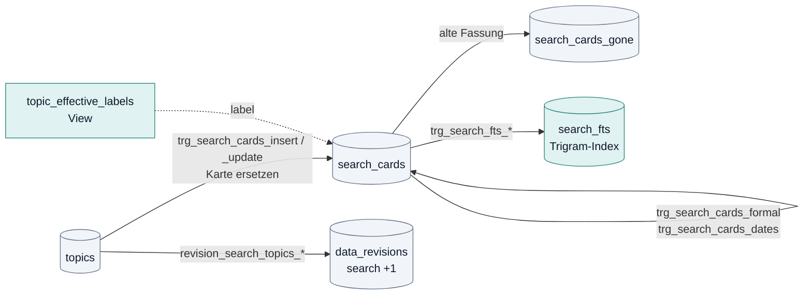
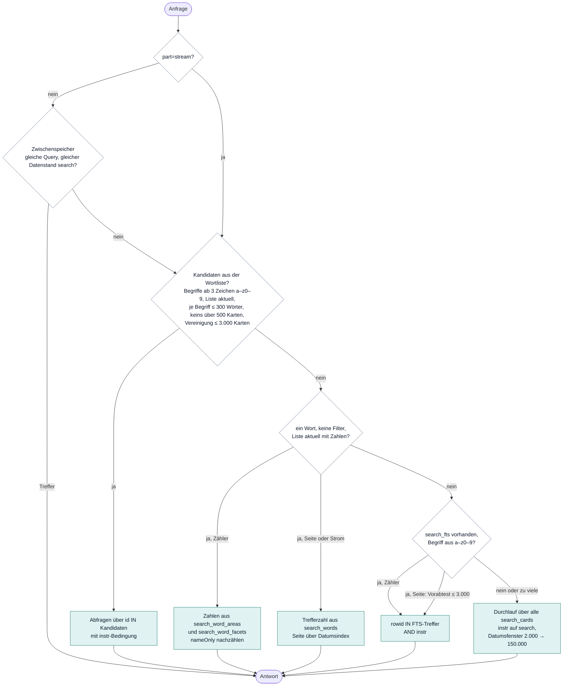

# Suche: Suchkarten, Wortliste, Volltextindex

Stand: 17. Oktober 2026. Teil der [technischen Dokumentation](README.md). Begriffe: [Glossar](glossar.md).

Die Suche ist die Grundlage von Startseite, Landkarte, Kalender, Social Media und plenara.X: Jede Auswertung wählt zuerst über die
Suche aus (`source()` in `plenara-x-query.mjs`, siehe [Auswertungen](auswertungen.md)). Sie liest nie `topics.payload`, sondern nur
die **Suchkarten** und ihre Indizes.

## 1. Die Suchkarte (`search_cards`)

Eine Zeile je aktivem Bericht (`topics.active=1`, also ohne `identity.mergedInto`). Gepflegt von den Triggern
`trg_search_cards_insert` und `trg_search_cards_update` auf `topics` (heutiger Stand `drizzle/0027`), die eine Karte immer **ersetzen,
nie ändern**; die vorige Fassung landet in `search_cards_gone`.

| Spalte | Herkunft | Beleg |
|---|---|---|
| `id` | `topics.id` | `drizzle/0006` |
| `region_id`, `status` | Spalten von `topics` | |
| `date` | `substr(event_date,1,10)`, danach „Stand heute“: Trigger `trg_search_cards_dates` setzt bei künftigem Datum `date` auf die letzte Sitzung bis heute und `next_date` auf die nächste anstehende | `drizzle/0024` |
| `title` | `payload.title`, höchstens 1000 Zeichen | |
| `gremium` | `payload.committee` | |
| `teaser` | KI-Kurzfassung, wenn vorhanden (`shortSummary` mit `generatedBy LIKE 'KI-Zusammenfassung%'` oder `contentAnalysis.status='completed'`), sonst die Sätze der Regel-Zusammenfassung (`ruleSummary.short`), sonst `shortSummary`; höchstens 1200 Zeichen | `drizzle/0019` |
| `search` | `lower(title + teaser + committee)`, Umlaute zu a/o/u, ß zu ss: der **Suchtext** | `drizzle/0019` |
| `search_exact` | derselbe Text mit Umlauten (für `exact=1`: „Bär“ findet nicht „Bar“) | `drizzle/0014` |
| `label` | aus dem View `topic_effective_labels` (Rangfolge Hand → KI → Regel-Thema → Titelregel), sonst `unklar` | `drizzle/0027`, `0038` |
| `formal` | 1, wenn `payload.itemKind` in (`formal`, `collection`, `routine`); ohne `itemKind` die alten LIKE-Muster `FORMAL`/`NOT_FORMAL`. Ändert sich nur `itemKind`, setzt `trg_search_cards_item_kind` die Spalte nach | `drizzle/0017`, `0033` |
| `next_date` | nächste anstehende Sitzung, sonst NULL | `drizzle/0024` |

Das Update-Trigger feuert auch, wenn sich nur das effektive Label ändert. Jede Änderung an `topics` erhöht außerdem den Datenstand
`search` in `data_revisions` (Trigger `revision_search_topics_*`, `drizzle/0017`, ohne WHEN-Bedingung): auch „Titel einordnen“ und
„Regeln anwenden“ machen damit die Wortliste veraltet, bis „Suche aktualisieren“ läuft.

**`rollCardDates`** (`server/integrations/search-card-dates.mjs`) rückt Karten nach, deren `next_date` erreicht ist: `date` wird die
letzte Sitzung bis heute, `next_date` die nächste oder NULL. Läuft nach jedem Metadaten-Import (`sync.ts`) und in
`scripts/refresh-search-words.mjs`.

## 2. Die Indizes

### Wortliste (`search-words.mjs`, Migration `0013`)

| Tabelle | Inhalt |
|---|---|
| `search_words` | je Wort (ab 3 Zeichen aus a–z und 0–9, nicht nur Ziffern; `wordsOf`): Zahl der Karten (`cards`, 501 = „mehr als 500“), Treffer je Ebene (`hits_city`, `hits_district`) |
| `search_postings` | Karten-IDs je Wort, nur für Wörter mit höchstens `POSTING_MAX` = 500 Karten |
| `search_word_areas` | vorberechnete Zahl je Gebiet für häufige Wörter |
| `search_word_facets` | vorberechnete Zahl je Thema und Status für häufige Wörter |
| `system_state` `search-words` | Stand: `complete`, `revision` (Datenstand `search` beim Lesen), `hasHits`, gemerkte rowid |

Die Liste gilt als **aktuell** (`listCurrent`), wenn `complete` gesetzt ist und `revision` dem heutigen Datenstand `search` gleicht
(`SEARCH_REVISION_SQL` in `revision-cache.mjs`; ohne Migration `0017` gilt `content`).

**Nachführen** (`refreshSearchWords`, Sperre `search-words-lease` in `system_state`, Frist 3 Minuten, beim vollen Aufbau 1 Stunde,
vor jedem Abschnitt verlängert):

1. `search_cards_gone` lesen. Mehr als `GONE_MAX` = 5.000 Einträge: nichts abziehen, die vorberechneten Zahlen verfallen.
2. Ersetzte und gelöschte Karten abziehen (IDs, Trefferzahl, Gebiets- und Themenzahlen).
3. Karten an den protokollierten rowids und alle Karten mit größerer rowid als der gemerkten neu lesen.
4. Wörter, die über 500 Karten kommen, verlieren ihre IDs.
5. Stimmt die Bilanz nicht (`hitsOk`), werden die vorberechneten Zahlen gelöscht; der nächste Skriptlauf baut dann voll neu
   (`fullIfNoHits`).

**Voller Aufbau** (`buildAll`): bei `--full`, fehlendem oder unvollständigem Stand, passender Karte nicht an der gemerkten rowid,
fehlenden Zahlen oder Schemawechsel. Tabellen neu anlegen, alle Karten lesen, „blockierte“ seltene Wörter bestimmen (in häufigen
Wörtern enthalten, über 300 Wörter oder über 3.000 Karten), für diese die Zahlen zählen, Protokoll bis zum Startstand leeren.
Lokal zuletzt 158 s.

Aufrufer: der Abruf (`sync.ts`, `onlyIfBuilt`, höchstens 20.000 Karten je Lauf), `scripts/refresh-search-words.mjs` (Schritt
„Suche aktualisieren“ des Jobs `rule-texts`), der Dev-Server beim Start. Die Migrationen `0027`, `0034` und `0038` löschen den Stand,
damit der nächste Lauf voll aufbaut.

### Volltextindex (`search_fts`, Migration `0023`)

FTS5 mit Trigram-Tokenizer als „external content“ über `search_cards.search`, mitgeführt von vier Triggern auf `search_cards`.
Lokal 650 MB bei 941.000 Karten. Genutzt nur, wenn die Wortliste keine Kandidaten liefert (Abschnitt 3), für Begriffe aus
`[a-z0-9]{3,}`, und nur, wenn die Tabelle existiert. Für Seite und Strom nur, wenn ein Vorabtest höchstens `FTS_PAGE_MAX` = 3.000
Treffer zählt; Zähler laufen ohne Grenze über den Index. Die Bedingung `instr(search,?)>0` bleibt zusätzlich bestehen, damit das
Ergebnis dasselbe ist wie ohne Index (Test `tests/search-fts.test.mjs`).

### Tippfehler-Register (`search-suggest.mjs`, keine Migration, seit 31.10.2026)

„wrmeplsnung“ → „Meinten Sie Wärmeplanung?“. Grundlage ist die Wortliste: `search_suggest_words` (alle Wörter aus `search_words`
mit mindestens `MIN_CARDS` = 2 Karten) und darüber `search_suggest_trg` (FTS5, Trigram, external content) plus `search_suggest_vocab`
(fts5vocab: wie viele Wörter jedes Trigramm enthalten). Angelegt und gefüllt wird zur Laufzeit von `syncSuggestIndex`, in Stücken
und wiederaufnehmbar (Stand `search-suggest` in `system_state`, Sperre `search-suggest-lease`): der Node-Server ruft nach dem Start
`POST /api/internal/search-suggest` auf, bis die Wortliste einmal durch ist (serve.mjs; erstes Mal bei 1,5 Mio. Wörtern rund 10 bis
20 s in Stücken von höchstens 4 s, danach Sekunden), nachts führt `scripts/refresh-search-words.mjs` nach. Mit `DATABASE_READONLY=1`
füllt nur das Skript. Register gemessen (1,46 Mio. Kunstwörter): rund 150 MB.

Vorschlag (`suggestWord`): nur Wörter aus Buchstaben ab 4 Zeichen, die in der Wortliste fehlen. Die seltensten Trigramme des
Begriffs (zusammen höchstens `TRIGRAM_BUDGET` = 20.000 Register-Zeilen, mindestens zwei) liefern Kandidaten, die Editierdistanz
(Damerau-Levenshtein; bis 5 Zeichen 1, bis 9 Zeichen 2, sonst 3) wählt, bei gleicher Distanz die größere Kartenzahl. Die
Schreibweise mit Umlauten und Großbuchstaben kommt aus bis zu 20 Suchkarten, die das Wort enthalten (`displayForm`, über
`search_fts` wie die Suche, sonst LIKE). Gemessen bei 1,46 Mio. Wörtern: 25 bis 105 ms je Wort.

`GET /api/search/suggest?q=…` (`guard()`, für alle Stufen gleich, eine Stunde zwischenspeicherbar) zerlegt den Suchtext wie
`parseMonitorSearch` und antwortet `{suggestions:[{from,to}]}` je unbekanntem Wort (höchstens 3). Die Oberfläche fragt nur,
wenn die Suche ohne Treffer zu Ende ist (`ResultsPanel.tsx`, `useSuggestions`), zeigt „Meinten Sie …?“ und setzt beim Klick die
Wörter im Suchtext ein (`applySearch`); nichts wird still korrigiert, Trefferzahl, Glocken und plenara.X bleiben unberührt.
Ohne Wortliste oder Register gibt es keine Vorschläge und keinen Fehler. Test: `tests/search-suggest.test.mjs`.

## 3. Eine Anfrage an `GET /api/search`

Route `app/api/search/route.ts` → `guard()` (Stufe des Kontos; Gäste bekommen höchstens 10 Treffer und keine Seite über 1,
`guest-search.mjs`) → `monitorSearch` in `server/integrations/monitor-search.mjs`.

### Parameter (`parseMonitorSearch`)

| Parameter | Bedeutung |
|---|---|
| `q` | Begriff, höchstens 200 Zeichen. Komma, Semikolon, `\|` und „oder“ trennen ODER-Gruppen; Wörter in einer Gruppe sind UND. Normalisiert (klein, ohne Diakritika, ß→ss), Füllwörter fallen weg. Höchstens 8 Gruppen, 12 Wörter je Gruppe, 30 insgesamt |
| `exact=1` | nur ganze Wörter (GLOB auf `search_exact`), Umlaute bleiben |
| `area`, `scope=only\|with`, `more` | Gebiet (AGS mit 2, 5, 8 oder 9 Stellen), nur das Gebiet oder mit Untergliederungen, bis zu 8 weitere Orte |
| `within` / `without` | Umkreis als AGS-Liste (höchstens 2.000; der Client schickt die kürzere Liste) |
| `level` | `city` oder `district` ohne Ortsangabe |
| `label` | Themenname; alte Namen (`labels-v2`) werden übersetzt |
| `month`, `from`, `to` | Zeitraum |
| `status` | einer der acht Status |
| `noformal=1` | ohne Formalien (`formal=0`) |
| `sort` | `asc`, `desc`, `relevance` (Titeltreffer zählt dreifach) |
| `page`, `size` | Seite ab 1 (höchstens 250), 15 oder 20 Treffer |
| `part` | `''` (alles), `page`, `facets`, `stream` (NDJSON); `x` nur intern für plenara.X |
| `revision` | Datenstand des Clients; weicht er ab, antwortet die Route mit 409 „Datenstand wurde geändert“ (Weiterblättern braucht dann ein Neuladen) |

Es gibt keinen Cursor; geblättert wird über `page` und `revision`.

### Antwort

| Teil | Inhalt |
|---|---|
| `articles` | je Suchkarte `id`, `date`, `status`, `title`, `teaser`, `gremium`, `regionId`, `ags`, `gemeinde`, `thema` (Labelname, sonst „Sonstiges“) und `steps` (Stationen `{d,s,c}` der Beratungsfolge, nur von derselben Quelle, für den Zeitstrahl der Trefferzeile) |
| `hasMore`, `page`, `pageSize`, `revision`, `storageAvailable` | Blättern und Stand |
| `total` | Trefferzahl |
| `areaCounts` | Zähler je AGS-Präfix (voll, 5, 2 Stellen) für die Landkarte; Thema- und Statusfilter wirken, der Ortsfilter nicht; ein Bericht eines Gemeindeverbands zählt bei jeder Mitgliedsgemeinde |
| `badgeCounts` | Abzeichen der Landkarte: jede Karte genau einmal, Summe = `total` |
| `themaCounts`, `statusCounts` | Zähler je Label (ohne Themenfilter) und je Status (ohne Statusfilter) |
| `monatCounts` | immer leer (Altlast im Client-Typ) |

Im Strom (`part=stream`) kommen Zeilen `{known}` oder `{known,total}`, dann `{articles}` mehrfach, zuletzt
`{end,hasMore,revision,pageSize}`.

### Entscheidungsbaum

Weitere Regeln:

- **Gebietsbedingung:** umfasst die Auswahl höchstens die Hälfte des Katalogs, `region_id IN (…)`, sonst `NOT IN`. Ein Begriff, der
  in einem Gebietsnamen vorkommt, trifft zusätzlich alle Karten dieses Gebiets (`OR region_id IN (…)`, nur bei nicht leerer Liste).
  „Nur das Gebiet“ mit dem Schlüssel einer kreisfreien Stadt meint die Stadt selbst (`ownCity`).
- **Formalien:** mit Spalte `formal` die Bedingung `formal=0` (ohne Begriff über den Teilindex `idx_search_cards_noformal`); ohne
  Spalte 25 LIKE-Muster auf `lower(title)`. Die Muster stehen doppelt (`monitor-search.mjs` und `drizzle/0017`), ein Test hält sie
  gleich.
- **Strom:** mit Kandidaten oder kleinem Ort (bis 30 Gebiete) eine einzige Abfrage; sonst zuerst `knownWords` („no“ beendet sofort),
  dann Datumsfenster, die sich von 2.000 Karten verdoppeln bis 150.000.
- **Seite:** `ORDER BY date … LIMIT CAST(? AS REAL)`, damit SQLite nach einer Seite über den Datumsindex abbricht.
- **Zwischenspeicher:** je Datenbankobjekt 200 Einträge (Schlüssel = sortierte Query), gültig solange der Datenstand `search`
  gleich bleibt; `part=stream` umgeht ihn. Dazu HTTP `Cache-Control: private, max-age=30, stale-while-revalidate=120`. Die
  Gebietsabdeckung (`/api/search/coverage`) hat einen eigenen Speicher (5 Minuten).

Gemessen auf der lokalen Kopie (Zähler, ms, ohne Wortliste): „haushalt“ 5.101 → 187 mit Index, „turnhalle“ 2.776 → 17, „kormoran“
468 → 7 (Belege und weitere Zahlen in `requirements/datenmodell-plan.md`).

## 4. Einordnung: welches Label die Suche zeigt

`storedClassification` (`shared/analysis-state.mjs`) und der View `topic_effective_labels` (`drizzle/0038`) wählen in dieser
Reihenfolge; `tests/effective-labels.test.mjs` prüft, dass beide dasselbe ergeben:

1. **Einordnung von Hand** `labelAssessments.review` (Reviewer, Datum, nicht `stale`, passende `sourceSignature`).
2. **KI-Label** `labelAssessments.ai` (`status='completed'`, `method='ai-local-content-v2'`, Katalog `labels-v2` oder `labels-v3`).
3. **Thema aus den Regeln** `payload.theme` (nur mit `version='themes-v3'` und `evidence` = heutiger Titel; `offen` wird `unklar`).
4. **Titelregel** `payload.classification` (`method` beginnt mit `title-rules-v`, `evidence` = heutiger Titel; erzeugt von
   `classifyTopic` = Art des Punkts plus Thema nur aus dem Titel).
5. Sonst `unklar` („Sonstiges“).

Labels aus `labels-v2` (16 Werte) werden fest übersetzt (`LEGACY_LABELS`: Klima → Umwelt, Gesundheit → Soziales, Sport → Kultur,
Sitzung und Allgemein → unklar). Formalien erkennt die Suche nicht über ein Label, sondern über `formal`.

Die Themenregel selbst (`shared/themes.mjs`): 10 Themen mit je 7 Unterthemen; das Thema ist das des zuerst genannten starken
Begriffs im Titel, erst wenn der Titel kein Thema nennt, zählen Betreff und Beschlussvorschlag aus dem Text (`subjectOf`, höchstens
etwa 500 Zeichen). Schwache Themen (Finanzen, Verwaltung) zählen nur ohne starken Begriff eines anderen Themas. Gemessene Qualität
in `shared/rule-quality.json` (Thema 90 % bei 84 % Abdeckung, frische Stichprobe 14.10.2026).

## 5. Was die Suche nicht tut

- Sie liest nie `topics.payload` und nie die PDF-Ablage; alles kommt aus der Suchkarte und den Indizes.
- Sie rechnet keine plenara.X-Zahlen; `part:'x'` liefert nur die Karten-IDs, gezählt wird in `x_cases` ([Auswertungen](auswertungen.md)).
- Sie schreibt nichts außer ihrem Zwischenspeicher im Prozess.

## 6. Bekannte Eigenheiten (Stand 17.10.2026)

- `monatCounts` ist immer leer; der Client-Typ führt das Feld noch.
- Die Relevanzsortierung vergleicht den Titel mit Umlauten gegen den normalisierten Begriff; der Titelbonus greift bei Begriffen mit
  Umlaut vermutlich nicht.
- Solange der Job `rule-texts` zwischen „Regeln anwenden“ und „Suche aktualisieren“ steht, ist die Wortliste veraltet und die Suche
  läuft über den Volltextindex oder alle Karten.
- Verliert ein Nachführen die Sperre (harter Abbruch), ist die Wortliste bis zum Ablauf der Frist nicht nachführbar.
