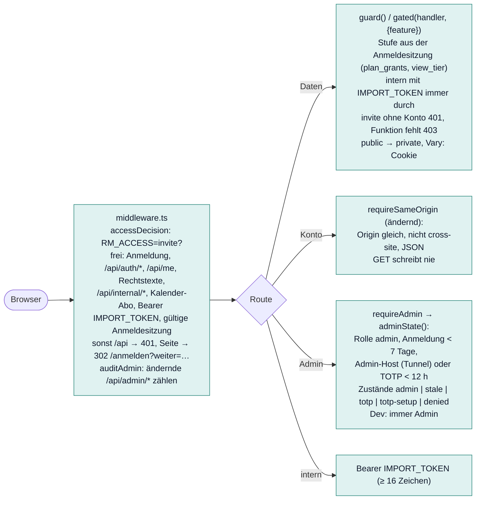
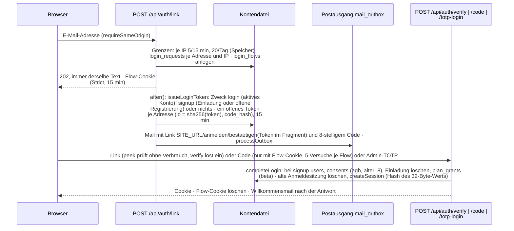
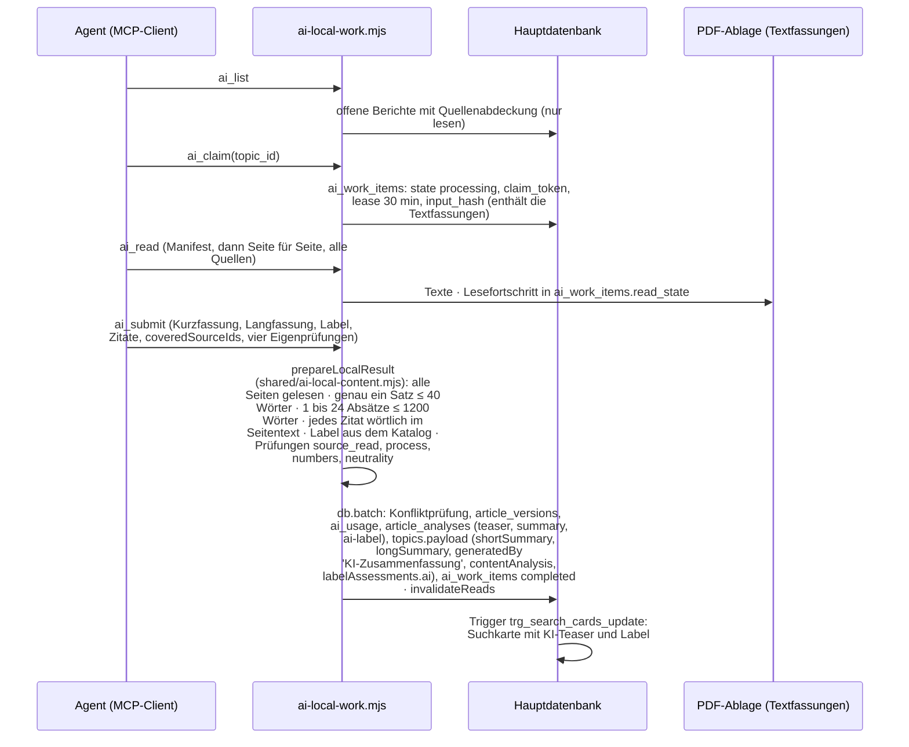

# Zugang, Konten, Oberfläche, KI-Weg, Tests

Stand: 17. Oktober 2026, gelesen am Code. Teil der [technischen Dokumentation](README.md). Begriffe: [Glossar](glossar.md).
Konzept der Konten: `requirements/konten-konzept.md`; Frontend-Karte: `components/ratsmonitor/FRONTEND.md`; KI-Vertrag:
`requirements/ai-processing.md`.

## 1. HTTP-Schicht: wer darf was

- **`middleware.ts`** ruft `accessDecision` (`server/accounts/access.mjs`): die Zugangssperre greift nur bei `RM_ACCESS=invite` und
  nicht im Dev; frei sind statische Dateien, Anmeldung, `/registrieren`, `/api/auth/*`, `/api/me`, Rechtstexte, `/api/internal/*`,
  `/api/calendar/feed/*`, `/api/dev/*`, Bearer `IMPORT_TOKEN` und gültige Anmeldesitzungen. Für `/admin`, `/api/admin`, `/api/auth`,
  `/api/me`, `/anmelden`, `/konto` setzt sie `private, no-store` und `X-Robots-Tag: noindex`. `auditAdmin` zählt ändernde Admin-Anfragen
  je Konto, Pfad und Stunde in `admin_audit`.
- **`server/services/session.ts`:** `requestTier()` liest die Stufe aus der Anmeldesitzung (ohne Kontendatei `accounts:false`, dann
  keine Stufengrenzen: Cloudflare-Build); `guard()` lässt interne Aufrufe immer durch, antwortet bei `invite` ohne Konto 401 und bei
  fehlender Funktion der Stufe 403; `gated(handler, {feature:'analytics'|'calendar'})` umhüllt eine Datenroute und macht `public`
  zu `private` mit `Vary: Cookie`; `adminState()` liefert `admin`, `stale` (Anmeldung älter als 7 Tage), `totp`, `totp-setup` oder
  `denied`; der alte Kopfzeilenweg (`Oai-Authenticated-User-*` aus Caddy, `admin-owner-v1`) nur mit `ADMIN_LEGACY_HEADER=1` oder
  solange keine Kontendatei eingerichtet ist.
- **Admin-Routen:** `adminRead()` = `requireAdmin` + `readResponse` mit schwachem ETag (304 bei passendem `If-None-Match`, ohne den
  Body zu bauen; `admin-etag.mjs`); Kopfzeilen `private, no-cache`; `/api/admin/static?v=` für immer im Cache.
- **Kontorouten:** `requireSameOrigin` (`server/accounts/http.mjs`): `Origin` gleich, nicht `cross-site`, `Content-Type` JSON, sonst 403
  bzw. 415. Cookies `__Host-rm_session` und `__Host-rm_flow` (https), `rm_session` im Tunnel, `rm_dev_session` im Dev. `clientIp` nimmt
  den letzten Eintrag von `X-Forwarded-For`, IPv6 auf /64 gekürzt; gespeichert wird nie eine IP, nur HMACs für Grenzen.

### API-Routen (78 `route.ts` unter `app/api/`)

**Daten (öffentlich, mit `guard`/`gated`; Gäste gekürzt)**

| Route | Zweck |
|---|---|
| `GET /api/search`, `/api/search/coverage` | Suche (auch NDJSON-Strom), Gebiete mit Berichten je Ebene |
| `GET /api/sources` | Quellen und Abdeckung |
| `GET /api/topics/[id]` | ein Bericht im Detail (folgt `mergedInto`) |
| `GET /api/dokument` | Originalunterlage beim Klick durchreichen (`document-proxy.mjs`: nur https, nur öffentliche Ziele, ohne zu speichern) |
| `GET /api/startseite-trends` | vorgerechnete Startseite (404 = mitgelieferte Datei nehmen) |
| `GET /api/x`, `/api/x/signale` | plenara.X (`feature:'analytics'`); `/api/x/teaser` ohne Enterprise |
| `GET /api/analytics/{compare,decisions,fraktionen,graph,network,news,trends}` | Tools (`feature:'analytics'`); `diffusion` nur `gated()` |
| `GET /api/calendar`, `/api/calendar/ics`, `/api/calendar/feed/[token]` | Sitzungstermine als JSON und ICS (`feature:'calendar'`), Abo mit Token statt Cookie |
| `/api/push/config`, `/api/push/latest`, `POST\|DELETE /api/push/subscribe` | Web-Push (eigene Herkunftsprüfung) |

**Konto** (`POST` mit `requireSameOrigin`)

| Route | Zweck |
|---|---|
| `/api/auth/link`, `peek`, `verify`, `code` | Anmeldelink anfordern (immer 202), Link prüfen ohne Verbrauch, Link einlösen, Code einlösen (Flow-Cookie) |
| `/api/auth/logout`, `refresh` | abmelden, Anmeldesitzung verlängern (GET schreibt nie) |
| `/api/auth/totp`, `totp/setup`, `totp-login` | zweiter Faktor der Admins (12 h), Einrichtung nur im Tunnel, Anmeldung mit Adresse und App-Code (`LOGIN_TOTP=1`) |
| `GET /api/me` | Stufe, Rollen, Rechte, Zugangsmodus |
| `/api/me/searches`, `articles`, `settings`, `sessions`, `calendar-feed`, `import`, `export`, `delete`, `view-tier` | gespeicherte Suchen und Berichte, Einstellungen, Geräte, Abo-Link, Browserdaten übernehmen, Datenauskunft, Konto löschen (mit Code), Admins „ansehen als“ |

**Administration** (29 Routen, alle `requireAdmin`): `ai-local`, `ai-job`, `altbestand`, `analyse`, `area`, `areas`, `static`, `atlas`,
`coverage`, `timeline`, `summary`, `claim` (alt), `database` (Export), `debug`, `run-debug`, `estimate`, `export` (CSV), `import`,
`pipeline`, `pdf-ablage`, `pdf-ablage/fehler`, `prepared-analysis`, `quality`, `refresh`, `review`, `social`, `speicher`, `todos`,
`zeitplaene`.

**Intern** (Bearer `IMPORT_TOKEN`): `GET /api/internal/health` (Hauptdatenbank, Kontendatei, Migrationen, Mails, Zugang; vom Deploy
geprüft), `POST /api/internal/outbox` (Postausgang, jede Minute vom Webserver), `/api/internal/sync` (älterer Abrufweg),
`/api/internal/admin-refresh` (Rechenschritte für den Runner).

**Dev** (sonst 404): `POST /api/dev/login`, `GET /api/dev/mails`, `PATCH /api/dev/tier`.

## 2. Konten und Anmeldung (`server/accounts/`)

Ohne Passwort: E-Mail-Link oder achtstelliger Code; Tokens, Codes und Anmeldesitzungen nur als SHA-256 gespeichert; Antwort und
synchrone Arbeit von `/api/auth/link` sind für alle Adressen gleich, alles Adressabhängige läuft nach der Antwort (`after()`).

- **Anmeldesitzung** (`sessions.mjs`): im Cookie ein 32-Byte-Zufallswert, in der Datenbank nur sein Hash; Laufzeiten Nutzer 30 Tage
  Leerlauf und 90 Tage absolut, Admin-Host 12 h und 7 Tage; verlängert über `POST /api/auth/refresh`. Stufe nur aus `plan_grants`
  (`effectiveTier`); ohne Zeile Gast (`ACCOUNT_DEFAULT_TIER`).
- **Stufen** (`shared/plans.mjs`, eine Quelle für Server und Oberfläche; `docs/produkt/stufen.md` wird von Hand mitgezogen):

  | Stufe | Treffer | Filter | Merkliste / Suchen / Benachrichtigungen | Mails | Kalender | plenara.X |
  |---|---|---|---|---|---|---|
  | `guest` | 10 | nein | 0 / 0 / 0 | 0 | nein | nein |
  | `basic` | alle | ja | 1 / 1 / 1 | 1 | nein | nein |
  | `pro` | alle | ja | 100 / 100 / 100 | 1 | nein | nein |
  | `enterprise` | alle | ja | 100 / 100 / 100 | 5 | ja | ja |

  Preise sind Platzhalter (`PRICES` alle `null`, „Preis folgt“). Gastsuche (`guest-search.mjs`): erste Seite, höchstens 10 Treffer,
  gekürzt nach dem Zwischenspeicher, auch im Strom.
- **Admin:** Rolle `admin` in `user_roles`; `admin='ok'` nur bei Anmeldung jünger als 7 Tage **und** entweder Admin-Host per http
  (`ADMIN_HOSTS`, Standard Tunnel `127.0.0.1:8080`) oder bestätigtem TOTP (`admin_verified_at` jünger als 12 h). TOTP nach RFC 6238
  (SHA1, 30 s, 6 Ziffern), Schlüssel AES-GCM-verschlüsselt in `user_totp` mit `ACCOUNTS_SECRET`; Einrichten nur im Tunnel oder per
  Kommandozeile `totp-setup`; 20 Fehlversuche am Tag. Admins können die Seite „ansehen als“ andere Stufe (`sessions.view_tier`,
  höhere Stufen nur mit voller Admin-Freigabe).
- **Postausgang** (`mail.mjs`, Vorlagen mit Maskierung in `mail-templates.mjs`: login, signup, welcome, code_locked, delete_code,
  deleted, export_code, exported, invite, tier_ending, inactive, operator): `sendMail` schreibt in `mail_outbox` (Kontingente je Stunde
  login 100, signup 20, account 50); `processOutbox` nach der Antwort, jede Minute über `POST /api/internal/outbox` und beim Start;
  bis 3 Versuche, danach werden Adresse und Inhalt gelöscht. Transporte `http` (POST mit `MAIL_API_KEY` an `MAIL_API_URL`), `log`
  (verschickt nichts; die Anmeldeseite bietet dann keine Mail-Anmeldung), `outbox` (Dev-Postfach `dev_mail`).
- **Werkzeuge:** `scripts/accounts/manage.mjs` (auf dem Server `ratsmonitor-accounts`): `invite`, `create`, `role`, `tier`, `block`,
  `unblock`, `revoke`, `delete`, `export`, `list`, `stats`, `login-link` (Notzugang), `reapply-deletions`, `totp-setup`, `totp-reset`;
  Adressen nur über `--email-stdin`. `maintenance.mjs` (Job `accounts`, 00:10): Fristen, „Testzugang endet“ 14 Tage vorher, Hinweis bei
  Inaktivität, Postausgang prüfen; danach verschlüsselte Sicherung (`accounts-backup.sh`, age, 7 Stände). `dev-setup.mjs` beim
  Dev-Start: Kontotabellen in die lokale Datenbank, Testkonten `basic@`, `pro@`, `enterprise@`, `admin@plenara.test`
  (`RM_SKIP_ACCOUNTS=1` schaltet ab); anmelden ohne Mail über `/api/dev/login` oder den DEV-Umschalter in der Kopfzeile.
- Grenzen im Speicher (`rate-limit.mjs`): Gleitfenster je Name und Schlüssel, nach einem Neustart leer.

Tests: `tests/accounts-login.test.mjs`, `accounts-data.test.mjs`, `accounts-rules.test.mjs` (Hilfen `tests/helpers/accounts.mjs`).

## 3. Oberfläche

### Aufbau

- `app/layout.tsx`: Metadaten und Open Graph mit `SITE_URL`, Schriften (IBM Plex Sans), Dunkelmodus-Skript.
- `app/(monitor)/layout.tsx` rendert `{children}` und daneben `<MonitorApp/>`. Die Seitendateien unter `app/(monitor)/*/page.tsx` sind
  Stubs (`return null`) mit Metadaten; gerendert wird clientseitig in `components/ratsmonitor/App.tsx` (Pfadprüfung `isKnownPath`,
  Seitenmodule nachgeladen). `/beschluss/[id]` liest zusätzlich serverseitig `getTopic` für Vorschau und Metadaten. Neue Route: Stub
  anlegen und in `info/InfoPages.tsx` bzw. `pages/PersonalPage.tsx` eintragen (`FRONTEND.md`).

| Pfad | Zweck |
|---|---|
| `/` | Startseite (`pages/OverviewPage.tsx`): Suche, Landkarte, Trefferliste; lädt drei Abfragen vorab |
| `/suche?q=…&ort=…&thema=…` | Suche in der Adresse (`lib/searchUrl.ts`, `state/search.tsx`) |
| `/beschluss/[id]` | Artikelseite eines Berichts (`pages/DetailPage.tsx`); `/thema/[id]` leitet dorthin |
| `/analytics/{atlas,signale,fakten,trends,beschluesse,graph,vergleich,gremien,fraktionen,news}` | plenara.X (`pages/analytics/`), sonst 404; Methodik unter jeder Auswertung |
| `/anwender/[slug]` | Branchen- und Anwenderseiten (`info/BranchenPages.tsx`, Daten `info/content.ts`) |
| `/konto/{profil,suchen,artikel,kalender}` (+ `postfach` nur Dev) | Kontoseiten (`pages/PersonalPage.tsx`) |
| `/anmelden`, `/anmelden/bestaetigen`, `/registrieren` → `/anmelden` | Anmeldung (`info/AccountPages.tsx`) |
| `/preise`, `/faq`, `/videos`, `/datenabdeckung`, `/funktionen/benachrichtigungen`, `/kontakt` | Infoseiten (`info/InfoPages.tsx`) |
| `/impressum`, `/datenschutz`, `/agb`, `/widerruf` | Rechtstexte (`pages/LegalPage.tsx`, Fassungen `shared/legal-versions.mjs`) |
| `/admin?seite=…` | Administration (`app/admin/page.tsx`) |

- **`components/ratsmonitor/`:** `App.tsx` (Provider, Routing), `components/` (Kopfzeile, Suche, Filter, `map/MapPanel.tsx` mit
  `lib/geo/mapEngine.ts`, `results/`), `pages/` (Detail, Konto, Rechtliches, `analytics/`), `info/` (Infoseiten, `content.ts`), `lib/`
  (`account.ts`, `fetchJson.ts`, `routes.ts`, `tier.ts`, `entitlements.ts`, `place.ts`, `searchLogic.ts`), `state/` (`search.tsx`,
  `account.tsx`, `data.tsx`, `ui.tsx`), `menu/MainMenu.tsx`. Datei- und Klassenverzeichnis: `INDEX.md` (nur per `grep`, neu mit
  `node scripts/frontend-index.mjs`).
- **Datenzugriff:** kein einzelner Client. `lib/fetchJson.ts` (`fetchJson`, `readJson`, `ApiError` mit deutschen Fehlertexten),
  `lib/account.ts` `api()` für `/api/me/*` (optimistisch mit Rücknahme, Abgleich zwischen Tabs), die Suche über `state/search.tsx`;
  daneben rohes `fetch` in vielen Komponenten.
- **Stile:** `app/globals.css` (Tailwind 4, Tokens; nicht ändern), `app/ratsmonitor.css` (App, Block „Farbkonzept“ Petrol klar mit
  `--rm-*`), `app/ratsmonitor-info.css` (`ri-*`), `app/design-styles.css` (wirkt auch auf Admin und Analysen), `app/admin.css`,
  `app/analyse-admin.css`. Designregeln und Prüfbefehle in `FRONTEND.md`.
- **Kalender:** `calendar-events.mjs` (höchstens 200 Gebiete, 100 Tage), `calendar-ics.ts`; Abo-Link mit Token aus `calendar_feeds`.
- **Web-Push:** `public/sw.js` holt bei `push` `/api/push/latest`; Server `push.ts` (`dispatchDecisionPush` aus dem Abruf, nur Münster);
  im Frontend wurde keine Registrierung des Service Workers und kein Aufruf von `/api/push/*` gefunden (Abschnitt 6).

### Administration (`/admin?seite=…`, `components/admin-*.tsx`)

Reiterliste in `admin-chrome.tsx`, Aliase `pdf-import` → `pdf`, `jobs` → `zeitplaene`; `?seite=mobil` zeigt eine schlanke Ansicht.
Bausteine: `admin-chrome.tsx` (Rahmen), `admin-ui.tsx`, `admin-stand.tsx` (Standzeile), `admin-store.ts` (Teile laden,
`useRegionCatchUp`), `admin-catch-up.tsx`, `admin-texts.ts`, `admin-colors.ts`, `admin-totp.tsx`, `admin-signout.tsx`.

| Reiter | Komponente | Zweck |
|---|---|---|
| `uebersicht` | `admin-overview.tsx` | Übersicht |
| `atlas` | `admin-atlas.tsx` | Lückenatlas (live, alle 5 min) |
| `abruf` | `admin-loader.tsx` → `admin-dashboard.tsx`, `admin-processing.tsx`, `admin-ai-local.tsx` | Abruf & Verarbeitung (Abrufauftrag, Titelregel, KI-Arbeitsliste) |
| `pdf` | `admin-pdf.tsx`, `admin-pdf-parts.tsx` | PDF-Import (Stand, Aufträge, Server, Läufe) |
| `regeltexte` | `admin-rule-texts.tsx` | Themen & Texte (Ergebnis je Schritt, Qualität der Regeln, Freigaben) |
| `qualitaet` | `admin-quality-check.tsx` | Qualität & Betrieb (Bauaufträge) |
| `zeitplaene` | `admin-schedules.tsx` | Jobs & Zeitpläne |
| `debug` | `admin-debug.tsx`, `admin-pipeline-parts.tsx` | Pipeline-Debug (vorübergehend) |
| `altbestand` | `admin-altbestand.tsx` | Altbestand |
| `speicher` | `admin-storage.tsx` | Speicher & Sicherungen |
| `hochrechnung` | `admin-forecast.tsx`, `admin-estimate.tsx` | Hochrechnung für Deutschland |
| `social` | `admin-social.tsx` | Social-Media-Vorschläge |
| `todo` | `admin-todo.tsx` | To-do-Board (`docs/todo/todos.json`, auf dem Server `admin-todos-v1`) |

Alle Admin-Seiten lesen nur gespeicherte Stände (`system_state`, kleine Tabellen), nie alle Berichte; GETs schreiben nie.

## 4. KI-Weg (`ai-local-content-v2`)

Regeln und KI sind zwei getrennte Ergebnisse; keines überschreibt das andere. Die KI startet nie von selbst: ein Agent (Modell mit
Werkzeugzugriff) arbeitet über den internen MCP-Dienst und liest nur lokal gespeicherte Textfassungen. Die Fachlogik steckt in
`createAiLocalWork` (`server/integrations/ai-local-work.mjs`, Operationen `list`, `claim`, `read`, `renew`, `release`, `submit`,
`fail`, Reservierung 30 Minuten); Quellen liefert `server/node/ai-local-sources.mjs` aus der PDF-Ablage sowie `documentText`/`sourceText`.

Drei Zugänge auf dieselbe Logik:

| Zugang | Start | Hinweis |
|---|---|---|
| MCP intern (STDIO, kein Port) | `npm run mcp:internal` → `server/mcp/stdio.mjs` → `openMcpRuntime('internal')`; Werkzeuge `ai_list`, `ai_claim`, `ai_read`, `ai_renew`, `ai_release`, `ai_submit`, `ai_fail` (`server/mcp/server.mjs`) | Konfiguration mit `databaseFile`, `sourceDirectory`, `identity`, `requestsPerMinute` (`RM_MCP_CONFIG`, Vorlagen `config/mcp/`); läuft aus dem Quelltext, wird nicht gebaut; keine Unit auf dem Server |
| Kommandozeile | `scripts/ai-local.mjs list\|claim\|read\|renew\|release\|submit\|fail` | Datenbank aus `DATABASE_FILE`, sonst die Miniflare-Datei |
| HTTP | `GET\|POST /api/admin/ai-local` (`requireAdmin`, `requireSameOrigin`, Body ≤ 3 MB), Reiter „Abruf & Verarbeitung“ | braucht `env.AI_LOCAL_SOURCES` (nur Node); im Dev fängt `build/ai-local-dev-plugin.mjs` die Route ab (nur Loopback) |

Kommt neuer Text dazu (OCR, Nacharbeit, Altbestand), ändert sich der Eingabehash: der Bericht wird `stale` und erscheint wieder in der
Liste. Ein erneut gesendetes gleiches Ergebnis ist idempotent. `ai_fail` schreibt `article_analyses` `ai-local-attempt`, die alten
Inhalte bleiben. Der Job `rule-texts` zählt den Stand (`ai-counts`); Pipeline-Debug und Altbestand zeigen ihn.

Weitere Wege: `ai-jobs.mjs` und `scripts/ai-job.mjs` (Altweg per Datei, nur für vorbereitete Altaufträge), `prepared-analysis.mjs`
(festes Bündel Billerbeck, `codex-direct-v1`), Modus `summaries` von `runSync` mit OpenAI (`ai-summary.mjs`, nur von Hand, nur mit
`OPENAI_API_KEY`; siehe [Abruf](abruf.md), Befund 6). `manual-analysis.mjs` ist keine KI, sondern die Titelregel in Paketen.
Verbrauch: `ai_usage`, Auswertung `scripts/ai-usage.mjs` mit Preisen aus `scripts/ai-prices.json`.

**Kundendienst** (`npm run mcp:customer`, `mcp-customer-data.mjs`): reine Recherche mit `reports_regions`, `reports_search`,
`reports_get`, `reports_aggregate`; Datenbank schreibgeschützt (`PRAGMA query_only=ON`), feste Liste `allowedRegionIds` aus der
betreibereigenen Startkonfiguration, höchstens 366 Tage und 100 Ergebnisse je Abfrage, keine Rohtexte, keine Pfade. Kundenrechte
stammen nie aus der Datenbank; keine interne Verbindung an Kunden geben.

## 5. Tests, Lint, Typen

- 175 Dateien `tests/*.test.mjs`, Start `node --test tests/*.test.mjs` (kein npm-Skript; gelegentlich zufällig rot: „marks of read
  meetings“, „every import leaves a record“). Hilfen in `tests/helpers/`: `d1.mjs` (In-Memory-`node:sqlite` mit allen Migrationen),
  `accounts.mjs` (Kontext, Anfragen wie aus dem Browser, Dev-Postfach), `analysed.mjs`. Fixtures in `tests/fixtures/` (nie ganz
  lesen).
- Gleichheitstests sichern doppelte Logik: Formalien-Muster JS gegen SQL (`search-formal`), Datum „Stand heute“ (`search-card-dates`),
  Label-Rangfolge JS gegen View (`effective-labels`), Nachführen der Wortliste gegen vollen Aufbau (`search-cards-gone`), FTS gegen
  `instr` (`search-fts`), Signale mit und ohne `x_signals`, warmgehaltene Abfragen (`x-warm`), Stufen gegen `docs/produkt/stufen.md`
  (`accounts-rules`), Admin-GETs ohne Schreiben (`admin-readonly`).
- Lint `npm run lint` (`eslint-config-next`), Typen `node node_modules/typescript/bin/tsc --noEmit --incremental false`.

## 6. Befunde beim Schreiben dieser Dokumentation (17.10.2026)

1. **Web-Push ist nicht verdrahtet:** Service Worker, Routen und `push.ts` existieren, im Frontend fehlen Registrierung und Abo-Aufruf.
2. `tests/accounts-tiers.test.mjs` (genannt in `shared/plans.mjs`) und `tests/accounts-session.test.mjs` (genannt in
   `server/accounts/dev.mjs`) gibt es nicht; den Vergleich mit `docs/produkt/stufen.md` macht `tests/accounts-rules.test.mjs`.
3. `FRONTEND.md` nennt `/analytics/methodik`; die Route steht weder in `ANALYTICS_PATHS` noch als Stub, die Methodik erscheint als
   `MethodikUnten` unter jeder Auswertung.
4. `package.json` verlangt Node ≥ 22.13, `serve.mjs` bricht unter 22.16 ab.
5. Die Startseite, Infoseiten und Admin greifen an vielen Stellen mit rohem `fetch` zu; ein gemeinsamer Client existiert nur für
   Konto (`lib/account.ts`) und Suche (`state/search.tsx`).
