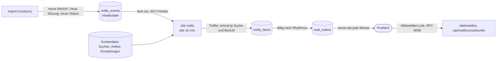

# Benachrichtigungen per E-Mail (Thema 2, Konzept und Umsetzung, 22.10.2026)

Ausgangslage: Die Seiten „Benachrichtigungen“ (Konto und Funktionsseite) versprechen E-Mails „sofort, täglich oder
wöchentlich“. Gespeicherte Suchen (`saved_searches.notify_mail`, `notify_freq`), gemerkte Artikel (`saved_articles.follow`)
und der Wochenbericht (`user_settings.weekly`, `weekly_day`) tragen die Felder, aber es gab keinen Job, keine Vorlage und
keinen Versand; alle Schalter waren mit „Folgt mit den E-Mail-Benachrichtigungen“ gesperrt. Das ist das Kernversprechen
„Früher wissen“ (Vorteile Rang 1 bis 7). Entscheidung: **bauen**, nicht streichen. Der Rahmen stand schon in
`requirements/konten-konzept.md`, Abschnitt 9 („Thema 2“); dieses Konzept füllt ihn aus.

## 1. Was der Nutzer bekommt

| Weg | Auslöser | Rhythmus | Grenze |
|---|---|---|---|
| Gespeicherte Suche mit Glocke | neuer Bericht, der die Suche trifft | sofort, täglich oder wöchentlich (je Suche) | zählt zu `notifications` der Stufe |
| Gemerkter Artikel mit Glocke | der Vorgang bekommt eine neue Sitzung oder einen neuen Status (vertagt, beschlossen …) | sofort | zählt zu `notifications` |
| Wochenbericht | neue Treffer aller aktiven gespeicherten Suchen ohne eigene Glocke | täglich oder an einem Wochentag | eine Mail, zählt nicht |
| Kalender (Plus) | in einem Kalendergebiet wird eine neue Sitzung angesetzt | sofort, täglich oder wöchentlich | Merkmal `calendar` |

- „Neu“ heißt **neu aufgenommen** (Zeitpunkt des Imports), nicht „neues Sitzungsdatum“ (konten-konzept.md 9).
- Eine Mail je Versandzeitpunkt und Konto, gegliedert nach Suche, Artikel und Kalender; je Abschnitt höchstens 10 Einträge,
  darunter „und N weitere“ mit Link auf die Suche.
- Täglich und wöchentlich: um 07:00 Uhr deutscher Zeit; wöchentlich am Wochentag des Wochenberichts (Standard Montag).
- Jeder Eintrag nennt Titel, Ort, Gremium, Sitzungstag, Status und verlinkt den Vorgang auf Plenara; dazu der Hinweis, dass
  die Originalunterlagen maßgeblich sind (to-do `fe-haftungshinweis`).
- Künftige Sitzungen zählen immer mit, auch wenn die Suche „Künftige Sitzungen zeigen“ aus hat: Gerade die angesetzten
  Vorgänge sind das „früher wissen“. Ein fester Zeitraum der Suche (von/bis, Monat) bleibt Bedingung; die Schnellauswahl
  („Letzte 7 Tage“ …) und das stillschweigende „bis heute“ entfallen für die Meldung.
- Weitere Empfänger (`emails` > 1, Enterprise) kommen **nicht** in diesem Schritt; sie brauchen ein Double-Opt-in je Adresse
  (`notification_recipients`, konten-konzept.md 9). Bis dahin geht jede Mail an die bestätigte Adresse des Kontos.

## 2. Ablauf



1. **Ereignisse beim Import** (`server/services/sync.ts`, neben `decisions`): Tabelle `notify_events` in der Inhaltsdatei
   (`drizzle/0046_notify_events.sql`). `new`: Bericht, den es vorher nicht gab, nur wenn das Gebiet schon Bestand hatte
   (`old.size>0`, sonst brächte der erste Import eines Gebiets die ganze Geschichte), nicht zusammengeführt, Sitzung höchstens
   30 Tage zurück (der Altbestand löst nichts aus). `change`: vorhandener Bericht mit neuem Status oder neuer Sitzung in der
   Beratungsfolge. Ohne Tabelle (nicht migriert, Cloudflare-Build) tut der Import, was er immer tat; Fehler beim Schreiben
   der Ereignisse stören den Import nie. Ereignisse älter als 14 Tage löscht der Import selbst.
2. **Job `notify`** (`scripts/accounts/notify.mjs`, Logik in `server/accounts/notify.mjs`, Zeitplaner alle 10 Minuten).
   Er öffnet die Inhaltsdatei nur lesend und die Kontendatei schreibend.
   - *Sammeln:* Ereignisse der letzten 48 Stunden. Je Suche nur Ereignisse nach dem Einschalten (`notify_since`, beim
     Wochenbericht `weekly_since`) und nach dem Anlegen. Das Fenster ist größer als der Takt, damit ein Bericht, dessen Thema
     oder Zusammenfassung erst die Verarbeitung in der Nacht liefert, noch trifft; doppelt gemeldet wird nie
     (`notify_items` hat den Schlüssel Konto, Suche, Bericht).
   - *Prüfen:* dieselbe Abfrage wie die Übersicht (`saved_searches.query`, `searchFilters` aus `monitor-search.mjs`), nur
     zusätzlich `id IN (neue Berichte)`. So trifft die Mail genau, was die gespeicherte Suche zeigt. Ohne gespeicherte
     Abfrage (`query` fehlt, Karte war beim Speichern nicht geladen) wird die Suche ausgelassen, bis die Seite „Meine Suchen“
     sie nachträgt.
   - *Versenden:* Jeder Treffer hat einen Fälligkeitszeitpunkt (`due_at`: sofort, nächster 07:00-Termin, nächster
     Wochentag). Fällige Treffer eines Kontos gehen in **eine** Mail an den Postausgang (`sendMail`, Kontingent `notify`);
     im selben Schritt werden sie mit der Mail-ID markiert. Vor dem Versand wird erneut geprüft: Konto aktiv, Stufe mit
     Benachrichtigungen, Suche oder Artikel noch aktiv und mit Glocke; sonst verfällt der Treffer.
3. **Abbestellen:** Jede Mail trägt `List-Unsubscribe` (nur als Link, ohne `mailto`) und `List-Unsubscribe-Post:
   List-Unsubscribe=One-Click` (RFC 8058) sowie Links je Abschnitt („Diese Suche nicht mehr melden“) und „Alle
   Benachrichtigungen abbestellen“. Die Tokens sind zufällig, gespeichert nur als SHA-256 (`notify_tokens`, 180 Tage).
   `/abbestellen#t=…` zeigt nur eine Seite mit Knopf (das Token steht im Fragment wie beim Anmeldelink und erreicht kein
   Server-Protokoll; GET schreibt nie); der Knopf und der Ein-Klick-POST des
   Mailprogramms gehen an `POST /api/notify/unsubscribe`. Die Route braucht keine Sitzung und keine gleiche Herkunft,
   das Token ist die Berechtigung; sie ist in der Zugangssperre frei.

## 3. Datenmodell

Inhaltsdatei, `drizzle/0046_notify_events.sql`:

```sql
CREATE TABLE notify_events (seq INTEGER PRIMARY KEY AUTOINCREMENT, at TEXT NOT NULL, topic_id TEXT NOT NULL,
  region_id TEXT NOT NULL, kind TEXT NOT NULL, date TEXT, status TEXT, prev_status TEXT, detail TEXT);
CREATE INDEX idx_notify_events_at ON notify_events(at);
```

Kontendatei, `drizzle-accounts/0005_notifications.sql`:

- `saved_searches.notify_since`, `saved_articles.follow_since`, `user_settings.weekly_since`, `calendar_mail`,
  `calendar_freq`, `calendar_since`: ab wann gemeldet wird (gesetzt beim Einschalten, beim Ausschalten gelöscht).
- `notify_items (user_id, ref, key, event_seq, created_at, due_at, card, mail_id, dropped)`, Schlüssel `(user_id, ref, key)`:
  `ref` = `s:<Such-ID>` (Glocke oder Wochenbericht: ein Bezug, damit ein Treffer nach dem Umschalten nicht doppelt kommt),
  `a:<Vorgang>` oder `c` (Kalender); `key` = Bericht, Ereignis bzw. Gebiet, Tag und Gremium der Sitzung.
  `card` hält Titel, Ort, Gremium, Datum, Status (öffentliche Daten aus der Suchkarte), damit die Mail ohne zweiten Blick in
  die Inhaltsdatei entsteht. Verschickte und verfallene Treffer löscht der Pflegejob nach 30 Tagen.
- `notify_tokens (id = SHA-256, user_id, ref, created_at)`: `ref` wie oben oder `*` für alles.

Keine Adressen außer `users.email`; die Adresse steht wie bei allen Kontomails nur bis zum Versand im Postausgang.

## 4. Grenzen und Last

- Kontingent `notify`: 1.000 Mails je Stunde (`QUOTA_PER_HOUR`). Der Postausgang verschickt 20 Mails je Minute; reicht das
  nicht mehr, wird `limit` in `processOutbox` erhöht.
- Last: je Suche eine Abfrage über höchstens die neuen Berichte von 48 Stunden (bei rund 5.000 neuen Berichten am Tag
  wenige Millisekunden je Suche). Der Job endet nach 8 Minuten und setzt beim nächsten Lauf fort.
- Der Job läuft nur mit Kontendatei (`ACCOUNTS_FILE`) und `SITE_URL`; ohne Ereignistabelle meldet er „nichts zu tun“.

## 5. Oberfläche

- Glocke und Häufigkeit an jeder gespeicherten Suche, Glocke an Artikeln (Artikelseite, Gespeicherte Artikel),
  Wochenbericht mit Schalter und Rhythmus (neu: „Täglich“), Kalender mit Schalter und Häufigkeit: alle schaltbar, die
  Grenze der Stufe öffnet wie bisher den Hinweis.
- Kontoseite „Benachrichtigungen“: alles an einem Ort, mit Schaltern; der Satz „Folgt mit …“ entfällt.
- Funktionsseite „Benachrichtigungen“: Versprechen bleibt, jetzt mit Funktion; Absatz zum Abbestellen.
- Datenschutzerklärung: Abschnitt zu Benachrichtigungs-Mails (Zweck, Inhalt, Abbestellen, keine Öffnungsverfolgung).

## 6. Web-Push (D5)

Empfehlung: **entfernen.** Der Push-Weg (`components/notifications.tsx` ohne Importeure, `public/sw.js`, `app/api/push/*`,
`server/services/push.ts`, `dispatchDecisionPush`, `push_subscriptions`, `VAPID_*`) hat keinen Client in der Oberfläche,
0 Abonnenten und verschickt nur für Münster. E-Mail deckt das Versprechen ab, ohne Einwilligung im Browser, ohne zweiten
Kanal mit eigener Abmeldung und eigener Datenschutzprüfung. Kommt Push später (etwa für eine App), setzt es auf dieselben
`notify_items` auf: ein weiterer Versandweg neben dem Postausgang. Das Entfernen ist ein eigener Schritt (Paket 5, D5) und
wartet auf die Entscheidung.

## 7. Offen

- Bounces und Beschwerden (`email_suppressions`, Webhook des Mailanbieters): erst mit der Wahl des Anbieters
  (konten-konzept.md 10). Bis dahin: gescheiterte Zustellung landet im Postausgang als `failed`, der Pflegejob warnt.
- Weitere Empfänger mit Double-Opt-in (Enterprise, `emails` bis 5).
- Messung: Anteil der Mails mit Abbestellen, Treffer je Mail; erst mit echten Nutzern.

## 8. Tests

`tests/notify.test.mjs`: Ereignisse im Import (neu, Statuswechsel, neue Sitzung; erster Import und Altbestand ohne
Ereignis), Treffer genau wie die Suche (Begriff, Gebiet, Thema, Status, Formalien), keine Doppelmeldung bei zwei Läufen,
Fälligkeit (sofort, 07:00, Wochentag, Sommerzeit), Stufe ohne Benachrichtigungen und ausgeschaltete Glocke verfallen,
Wochenbericht nur für Suchen ohne Glocke, Kalender, Mail mit Maskierung und Abbestellen-Kopfzeilen, Abbestellen per Token
(einzeln und alles, falsches Token, GET schreibt nicht), Pflegefristen.
