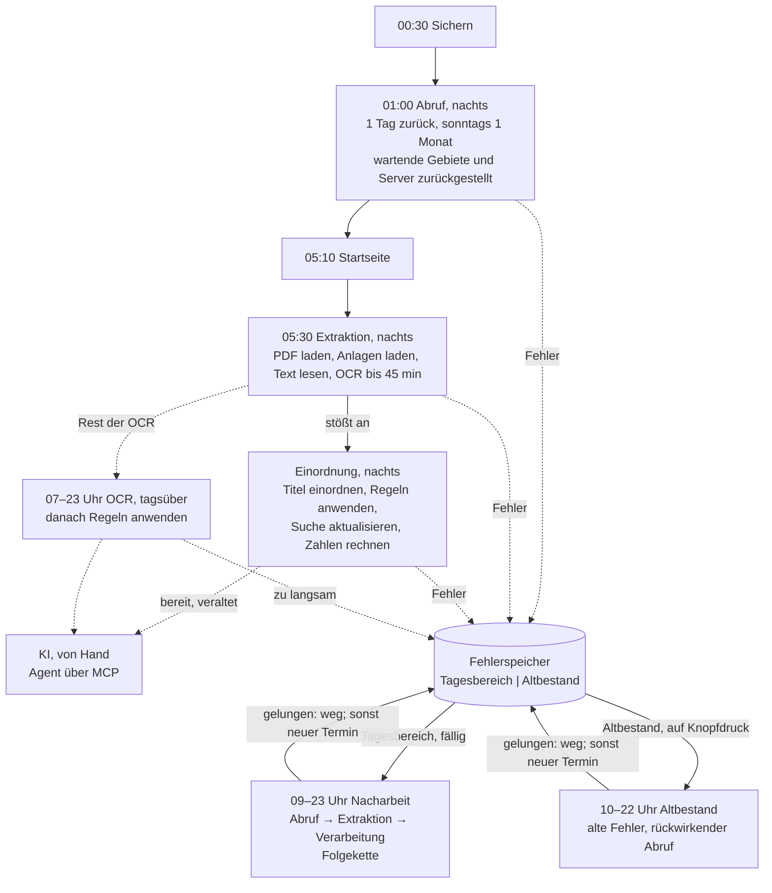
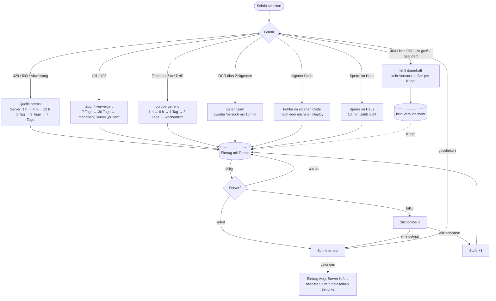
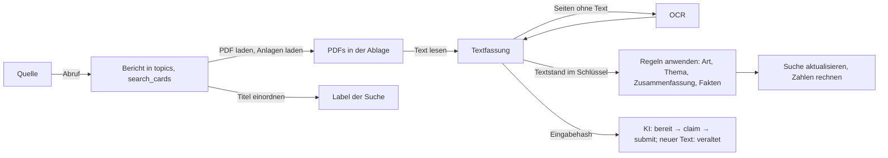

# Betriebsplan Server: Tagespipeline, Nacharbeit, Altbestand

Stand: 15. Oktober 2026. Beschreibt den umgesetzten Stand auf dem Branch `betriebsplan` (noch nicht ausgerollt). Interaktives
Ablaufbild: `requirements/betriebsplan-ablauf.html`. Einrichtung auf dem Server: `docs/betrieb/node-server.md`, Abschnitt
„Betriebsplan“. Alle Namen von Abläufen, Stufen und Schritten stehen in `shared/pipeline-terms.mjs` und sind in Code, Admin, diesem
Konzept und dem Ablaufbild gleich.

**Ziel:** Jede Nacht wird geholt und verarbeitet, was neu ist. Was scheitert, wird mit seinem Grund vermerkt und so lange erneut
versucht, wie der Grund es zulässt, ohne blockende Quellen zu überlasten. Kein Bericht bleibt dauerhaft liegen, nur weil ein Versuch
scheiterte. Den Altbestand bearbeitet ein eigener Ablauf auf Knopfdruck.

## 1. Begriffe

### Drei Abläufe

| Ablauf | Aufgabe | Wann |
|---|---|---|
| **Tagespipeline** | holt und verarbeitet, was neu ist; was scheitert, kommt in den Fehlerspeicher, die Pipeline wartet nicht | jede Nacht, feste Reihenfolge |
| **Nacharbeit** | versucht erneut, was in der Tagespipeline gescheitert ist, Stufe für Stufe, mit Folgekette | tagsüber automatisch, nur Tagesbereich |
| **Altbestand** | Älteres rückwirkend abrufen, extrahieren und verarbeiten, alte Fehler aufarbeiten | nur auf Knopfdruck, 10 bis 22 Uhr |

**Tagesbereich:** Einträge zu Sitzungen der letzten 7 Tage (und künftige), frühestens 12.10.2026 (`DAILY_SINCE`), die nicht vor dem
12.10. gescheitert sind. Ohne Sitzungstag (Abruf eines Gebiets) zählt der erste Fehlschlag. **Altbestand** ist alles andere, auch alle
übertragenen Altfehler (Herkunft `backlog`). Ein Eintrag des Tagesbereichs wandert nach 7 Tagen von selbst in den Altbestand
(`dailyBoundary`, `inDailyRange` in `server/integrations/work-failures.mjs`).

### Drei Stufen je Bericht und ihre Schritte

| Stufe | Schritt | was er tut | Skript |
|---|---|---|---|
| – | Sichern | Datenbank, Index und Texte der PDF-Ablage sichern | `deploy/node/backup.sh` |
| **Abruf** | Abruf | Sitzungen und Berichte eines Gebiets von seiner Quelle holen | `import-worker.mjs` → `runSync` |
| **Extraktion** | PDF laden | Hauptdokument eines Berichts in die Ablage laden | `scripts/pdf-store/fetch.mjs` |
| | Anlagen laden | übrige PDFs eines Berichts laden | `fetch.mjs --others` |
| | Text lesen | Textebene der PDFs lesen | `text.mjs` |
| | OCR | Seiten ohne Text (Scans) per Texterkennung lesen | `text.mjs --ocr` |
| | OCR-Nachladen | für die OCR ein schon gelöschtes PDF kurz neu laden | in `text.mjs --ocr` |
| | Dokumentart | Art aus dem Textanfang nachtragen | `budget.mjs --backfill` |
| | Grenze halten | PDFs über der Grenze der Ablage löschen, Text bleibt | `budget.mjs --apply` |
| – | Stand zählen | Zahlen des Reiters PDF-Import | `stats.mjs` |
| **Verarbeitung** | Titel einordnen | Sachgebiet nach der Titelregel (Label der Suche) | `reclassify-rules.mjs` |
| | Regeln anwenden | Art des Punkts, Thema, Regel-Zusammenfassung, Fakten | `read-reports.mjs` |
| | Suche aktualisieren | Wortliste der Suche nachführen | `refresh-search-words.mjs` |
| | Zahlen rechnen | Zahlen für plenara.X | `plenara-x/build-x-cases.mjs` |
| | KI | Kurz- und Langfassung, KI-Einordnung (Agent über MCP, von Hand) | `scripts/mcp-internal.mjs` |
| – | Wege zählen | welchen Weg die Berichte genommen haben (Pipeline-Debug) | `scripts/pipeline-trace.mjs` |

## 2. Jobs und Zeitplan

Alle Jobs starten über den Zeitplaner (`scripts/schedule.mjs`, Einstellungen im Reiter „Jobs & Zeitpläne“, Uhrzeiten deutsche Zeit).
Jeder Lauf steht im Laufbuch `schedule-log` (Seite Pipeline-Debug). Jobs werden nur über „Anhalten“ (Dienst) oder den Schalter im
Zeitplaner gestoppt, nie mit `systemctl stop …timer`: ein gestoppter Timer startet den Job nie wieder (16.10.2026: OCR 17 Stunden
aus). Der Zeitplaner vermerkt alle 9 Minuten den Zustand aller Timer und Pfade (`systemd-units`); Debug-Seite und Nachtbericht warnen
bei inaktiven Einheiten. Seine Laufeinträge schreibt er mit Geduld (bis 6 Anläufe à 10 s), weil die Verarbeitung die Schreibsperre
länger als die 30 s `busy_timeout` halten kann. Die Zählschritte am Ende der Verarbeitung („Wege zählen“) sind nicht fatal: ein Fehler
dort steht im Ergebnis (`warnings`), beendet den Job aber mit Exit 0, damit der Rückfall um 08:50 nicht grundlos läuft.

| Job (`id`) | Name | Ablauf | Zeit | Grenze |
|---|---|---|---|---|
| `backup` | Sichern | Tagespipeline | 00:30 | Platz 1,5 × Datenbank |
| `import-nightly` | Abruf, nachts | Tagespipeline | 01:00 | 4 h |
| `startseite-trends` | Startseite: Karte und Trends | Tagespipeline | 05:10 | 10 min |
| `pdf-nightly` | Extraktion, nachts | Tagespipeline | 05:30 | 2 h |
| `rule-texts` | Einordnung, nachts | Tagespipeline | direkt danach (Rückfall 08:50 nur, wenn heute noch kein Lauf war; `fallback`) | meist unter 1 h |
| `nacharbeit` | Nacharbeit | Nacharbeit | alle 30 min, 09:00 bis 23:00 | 20 min, 500 Einträge je Lauf |
| `ocr` | OCR, tagsüber | Nacharbeit | alle 10 min, 07:00 bis 23:00 | 3 h je Lauf |
| `altbestand` | Altbestand | Altbestand | alle 10 min, 10:00 bis 22:00, nur mit Anforderung | 2 h je Lauf |
| `import` | Abrufaufträge | Altbestand | alle 10 min, nur mit Auftrag | 4 h |
| `pdf-job` | PDF-Aufträge und Messungen | Altbestand | alle 10 min; Aufträge 10:00 bis 22:00 | 3 h je Auftrag |

Reihenfolge der Nacht: Sichern vor dem Abruf (ein Stand vor den Änderungen des Tages); Abruf vor der Extraktion (neue Berichte bringen
neue PDFs); Text und OCR vor der Verarbeitung (die Regeln haben morgens den ganzen Text); Regeln vor Suche und Zahlen
(Zusammenfassungen ändern den Suchtext).

## 3. Tagespipeline

**Abruf, nachts** (`import-worker.mjs --create sources --window 1d --weekly-window 1m --weekly-day 0`): alle angebundenen Quellen,
1 Tag zurück und die schon angesetzten künftigen Sitzungen, soweit die Quelle sie listet; **sonntags einen Monat zurück**, damit
Niederschriften und Beschlüsse, die Wochen nach der Sitzung erscheinen, ankommen. Gebiete mit einem Eintrag im Fehlerspeicher, dessen
Termin noch nicht erreicht ist, und Gebiete auf Servern, die warten, stehen im Auftrag als „Zurückgestellt“ (`deferredRegions`); die
Nacharbeit holt sie. Ein Eintrag ohne Termin hält den Nachtabruf nicht auf. 24 Bahnen, je Server höchstens 2. Jeder Ausgang geht in den
Fehlerspeicher (`noteImport` in `pipeline-jobs.mjs`): Erfolg löscht den Eintrag und setzt den Server auf „liefert“. Ein teilweiser
Abruf, bei dem ein Teil am Netz scheiterte (fetch failed, Zeitüberschreitung, 5xx; `partialCause`), steht als vorübergehend mit Grund
„teilweise: …“ im Fehlerspeicher, ohne Server (keine Bremse) und ohne den Nachtlauf zurückzustellen; die Nacharbeit holt den Rest
(seit 17.10.2026; vorher galt er als Erfolg und wurde nie wiederholt). Teilweise ohne Netzfehler (gesperrter Monat, nicht öffentlich,
Grenze des Lesers) gilt weiter als Erfolg. Der Nachtauftrag
trägt `owner: nightly`; der Job „Abrufaufträge“ lässt ihn aus, solange er sich bewegt (`nightlyBusy`, 10 Minuten ohne Stand), sonst
arbeiteten zwei Prozesse mit je 24 Bahnen daran und die Grenze je Server verdoppelte sich (Befund 16.10.2026). Bleibt der Nachtlauf
stehen, übernimmt der Job.

**Extraktion, nachts** (`nightly.mjs --daily`):
1. PDF laden: Hauptdokumente aller Berichte, die seit dem letzten Lauf (`pdf-daily-last`) geschrieben wurden, und aller Berichte mit
   Sitzung im Tagesbereich (`--since-updated`, `--event-from`; bei OParl ist `updated_at` das Änderungsdatum der Quelle). Zwei
   Abfragen, beide über einen Index. Höchstens 29 Minuten.
2. Anlagen laden: übrige PDFs derselben Berichte (die KI liest alle PDFs eines Berichts), höchstens 19 Minuten. In der 80-GB-Grenze
   stehen Anlagen unter allen Hauptdokumenten; was nicht passt, bleibt als Text.
3. Text lesen.
4. OCR der Dateien, deren Text in diesem Lauf entstand und Seiten ohne Text hat, Hauptdokumente zuerst, höchstens 45 Minuten. Der Rest
   kommt im Job „OCR, tagsüber“ dran.
5. Dokumentart, Stand zählen, `pdf-daily-last` setzen, Verarbeitung anstoßen.

Fehlgeschlagene Adressen lädt die Extraktion nicht erneut (das macht die Nacharbeit); wartende Server lässt sie aus.

**Einordnung, nachts** (`rule-texts.mjs`): Titel einordnen (nur fehlende oder veraltete Einordnungen), Regeln anwenden (nur Berichte
mit neuen Eingaben; der Schlüssel in `report_rules` enthält den Textstand des Hauptdokuments), Suche aktualisieren, Zahlen rechnen,
dann KI-Stand zählen (`ai-counts`) und Wege zählen (`pipeline-trace`). Stürzt eine Regel bei einem Bericht ab, wird er als „Fehler im
eigenen Code“ vermerkt und der Lauf geht weiter.

## 4. Fehlerspeicher

### 4.1 Tabellen (Migration `0040`)

`work_failures`, ein Eintrag je Schritt und Gegenstand; ein neuer Fehlschlag ersetzt den alten (`tries+1`):

| Spalte | Inhalt |
|---|---|
| `step` | `import` (Gebiet), `pdf` (Adresse), `text`, `ocr`, `ocr-fetch` (Prüfsumme), `rules` (Bericht); Stufe über `PHASES` |
| `key`, `host` | Gegenstand; Server der Quelle (für die Serverstufe) |
| `class`, `reason`, `http` | Grund (4.2), Meldung, HTTP-Code |
| `tries`, `first_at`, `last_at`, `next_try_at` | Versuche, erster und letzter Fehlschlag, nächster Termin (leer: kein automatischer Versuch) |
| `event_date`, `origin` | Sitzungstag; Herkunft `daily` oder `backlog` (übertragene Altfehler, Läufe des Altbestands) |
| `release` | Programmstand bei „Fehler im eigenen Code“ |

`source_hosts`, je Server: Stufe (`ok` liefert, `bremsen`, `gesperrt`, `pruefen`), Fehler in Folge, Wartestufe, nächste Prüfung.

Jeder Schritt schreibt Fehlschläge mit `recordFailure` und löscht bei Erfolg mit `clearFailure` (Skripte der Ablage über
`scripts/pdf-store/failures.mjs`). Beim ersten Lauf werden die alten Fehler der Ablage übertragen (`seedFromStore`: `pdfs.status`,
`ocr_refetch`, `ocr_slow`, alte 90-%-Serversperre), alle als Altbestand; `ocr_refetch` und `ocr_slow` werden danach nicht mehr
geschrieben. Ohne Migration tun alle Funktionen nichts.

### 4.2 Gründe und Wiedervorlage

| Grund (`class`) | Erkennung | nächster Versuch | zählt für den Server |
|---|---|---|---|
| Quelle bremst (`blocked`) | 429, 503, Retry-After, Abweisungsseite | wenn der Server wieder dran ist | ja, sofort |
| Zugriff verweigert (`denied`) | 401, 403, 451 | 7 Tage, 30 Tage, dann monatlich | ja, ab 3 in Folge |
| vorübergehend (`transient`) | Zeitüberschreitung, keine Antwort, DNS, 5xx | 1 h, 6 h, 1 Tag, 3 Tage, dann wöchentlich | ja, ab 3 in Folge |
| fehlt dauerhaft (`gone`) | 404, 410, „kein PDF“, über 30 MB, Datei geändert | kein Versuch; wieder offen per Knopf oder bei neuer Adresse | nein |
| zu langsam (`slow`) | OCR über 90 s je Seite oder 5 min je Datei | ein zweiter Versuch mit 15 min je Datei, danach bleibt die Textebene | nein |
| Sperre im Haus (`busy`) | 409, Datenbank gesperrt | 10 Minuten, zählt nicht als Versuch | nein |
| Fehler im eigenen Code (`internal`) | Ausnahme in Parser, Regel oder Leser, defektes PDF | nach dem nächsten Deploy | nein |

Kein Fehler im Sinn des Speichers: ein Abruf über der Zeitgrenze (die nächste Nacht setzt hinter dem Cursor fort) und „Quelle reicht
nicht“ bei der KI (neuer Versuch bei geänderten Quelldaten, `ai_work_items`).

**Nichts wird dauerhaft vergessen:** Endgültig ist nur, was die Quelle nicht mehr hat (`gone`) und eine OCR, die auch beim zweiten
Versuch zu langsam ist. Alles andere läuft nach seiner Leiter regelmäßig weiter. Die Seiten zeigen je Grund, wie viele Einträge
„jetzt fällig“, „wartet“ und „kein Versuch mehr“ sind.

### 4.3 Serverstufe und Stichprobe

- Ein Server geht in die Wartezeit, wenn er bremst (sofort) oder 3 zählende Fehler in Folge hat.
- **bremsen:** 1 h, 4 h, 12 h, 1 Tag, 3 Tage, 7 Tage; ein längeres Retry-After der Quelle geht vor.
- **gesperrt** (Zugriff verweigert): 7 Tage, 30 Tage, dann **prüfen**. Die Seiten heben solche Server hervor, eine Stichprobe gibt es
  trotzdem alle 30 Tage.
- In der Wartezeit lassen alle Abrufer den Server aus (Abruf, PDF laden, OCR-Nachladen); seine Einträge bleiben offen und zählen
  keine Versuche.
- Ist der Server fällig, bekommt er eine **Stichprobe** von 3 Einträgen. Gelingt einer, liefert er wieder; die übrigen folgen (beim
  PDF laden im selben Lauf, in der Nacharbeit im nächsten). Scheitern drei (oder bremst er), steigt die Stufe. Ein toter Server kostet je Prüfung 3 Abrufe statt aller seiner
  Dokumente (`ris.komuna.net/fuessen`: 2.642).
- „Freigeben“ (Seiten Pipeline-Debug und Altbestand) zieht die Prüfung vor.

## 5. Nacharbeit

Job `nacharbeit` (`scripts/nacharbeit.mjs --range daily`), alle 30 Minuten zwischen 09:00 und 23:00, höchstens 20 Minuten je Lauf.

- **Auswahl** (`dueEntries`): fällige Einträge des Tagesbereichs (Termin erreicht, bei „Fehler im eigenen Code“ ein neuer
  Programmstand), Server nicht wartend. **Reihenfolge:** erst Abruf, dann Extraktion, dann Verarbeitung; darin neueste Sitzung zuerst;
  bei gleichem Tag die Einträge mit den wenigsten Versuchen zuerst (chronische Fehler blockieren keine frischen); dann der am längsten
  nicht versuchte. Je Lauf höchstens 500 Einträge, je Server 20 (ein fälliger Server erst 3).
- **Ausführen:** je Schritt dieselbe Funktion wie nachts, nur für die Schlüssel der Einträge:

  | Schritt | Befehl |
  |---|---|
  | Abruf | `import-worker.mjs --direct --regions … --window <seit dem ersten Fehlschlag, mindestens 1 Woche>` |
  | PDF laden | `fetch.mjs --urls …` (Hauptdokumente und Anlagen der Berichte, die Adresse entscheidet; die Rolle bleibt) |
  | Text lesen | `text.mjs --shas …` |
  | OCR, OCR-Nachladen | `text.mjs --ocr --include-slow --shas … --file-minutes 15` |
  | Regeln anwenden | `read-reports.mjs --ids …` |

- **Folgekette:** Gelingt ein Abruf, laufen für die Berichte, die er geschrieben hat, gleich PDF laden, Anlagen laden, Text lesen, OCR
  und Regeln anwenden (`followUp`). Gelingt PDF laden, folgen Text lesen und OCR der Datei, dann die Regeln der betroffenen Berichte;
  gelingt Text lesen oder OCR, folgen die Regeln. Das Protokoll nennt, wie viele Berichte damit für die KI bereitstehen.
- **Ausgang je Eintrag:** gelungen (Eintrag weg), neuer Termin (Grund und Leiter), kein Versuch mehr, nicht drangekommen (Server wartet,
  Zeitgrenze): eine Stunde weiter, damit er nicht jede halbe Stunde wiederkommt. OCR-Einträge, deren Dateien nur auf wartenden
  Servern liegen, ruhen bis zum Termin des ersten Servers (statt stündlich „nicht versucht“).
- **Zeitanteil je Schritt** (`stepShare`): die verbleibende Zeit gleichmäßig auf die noch offenen Schritte, mindestens 3 Minuten; der
  letzte Schritt bekommt den Rest. Sonst füllte ein großer erster Schritt (18.10.2026: 500 Abrufe) den ganzen Lauf.
- **Verlauf** `nacharbeit-log` (die letzten 96 Läufe mit fälligen Einträgen, je Schritt gelungen, verschoben, endgültig, nicht
  versucht); der Nachtbericht summiert ihn als „Wirkung im Zeitraum“.
- Belegt die Bahn „Laden“ der PDF-Ablage; hält sie ein Auftrag des Altbestands oder die Nacht, lässt der Lauf aus. Ergebnis:
  `nacharbeit-last`.

## 6. OCR

1. **Nachts:** die neuen Dateien der Extraktion, bis 45 Minuten.
2. **OCR, tagsüber** (Job `ocr`, `nightly.mjs --ocr-only --range daily`, 07:00 bis 23:00): was die Nacht nicht schaffte, im
   Tagesbereich. Danach, wenn auf der Seite Altbestand angefordert, die OCR des Altbestands (10:00 bis 22:00, 15 Minuten je Datei, auch
   zu langsame vom letzten Mal). Ist nichts zu lesen, endet der Job sofort.
3. **Reihenfolge** (`ocrQueue`): alle PDFs eines Berichts; Hauptdokumente vor Anlagen, abgelegte vor gelöschten (die werden kurz
   nachgeladen und gleich wieder gelöscht), darin neueste Sitzung zuerst, dann wenigste Seiten. Dateien mit wartendem Eintrag im
   Fehlerspeicher stehen nicht in der Reihe. Dateien ohne Sitzungstag zählen zum Tagesbereich, wenn sie seit dem Stichtag geladen
   wurden (`ocrRange` in `store-lib.mjs`); ältere ohne Datum gehören zum Altbestand (sonst standen 43.000 alte Anlagen im Tagesbereich).
4. **Grenzen:** je Seitengruppe 90 s (hängt eine Seite, endet das Paket sofort), je Datei 5 Minuten, Pakete zu 25 Dateien oder 2,5 GB
   als eigene Prozesse, 2 Worker. Ein **Wächter** beendet ein Paket ohne Lebenszeichen nach 3 Minuten; seine laufenden Dateien gelten
   als zu langsam. Verdrängte Dateien, deren Server alle warten, nimmt ein Paket gar nicht erst auf; ein Paket ohne Fortschritt
   (nichts gelesen, gescheitert oder zu langsam) beendet den Lauf (17.10.2026: 6.316 Pakete in 3 Stunden für 3 wartende Dateien).
5. **Folgekette:** Nach einem Lauf mit gelesenen Dateien folgen gleich Regeln anwenden für die Berichte mit neuem Text und Suche
   aktualisieren (nicht, solange „Einordnung, nachts“ läuft; dann kommt der Text dort an).
6. **Eigene Einheit** `ratsmonitor-ocr.service`: „Anhalten“ trifft nur die OCR; eine halb gelesene Datei bleibt in der Reihe.

## 7. Altbestand

Seite `/admin?seite=altbestand` (Debug-Bereich, `components/admin-altbestand.tsx`, `server/integrations/altbestand-admin.mjs`). Die Seite
legt nur Wünsche ab (`altbestand-requests`); ausgeführt wird zwischen 10 und 22 Uhr. Die Nacharbeit hat Vorrang: hat sie fällige
Einträge und lief sie seit 25 Minuten nicht, lässt der Job „Altbestand“ den Lauf aus.

| Bereich | Knopf | ausgeführt von |
|---|---|---|
| 1. Abruf | Gebiete rückwirkend abrufen: alle angebundenen Quellen oder eine Liste, 1, 3, 12 oder 24 Monate; je 8 Gebiete, für jedes gelungene gleich PDF laden, Anlagen laden, Text lesen, OCR, Regeln anwenden; fortsetzbar über Tage, anhaltbar | Job `altbestand` (`scripts/altbestand.mjs`) |
| 2. Extraktion | Ältere Monate laden, Anlagen laden, Text lesen | Job `pdf-job` (Aufträge der Ablage, `--until 22:00`) |
| | OCR des Altbestands (anfordern, anhalten) | Job `ocr` nach dem Tagesbereich |
| 3. Verarbeitung | Verarbeitung jetzt starten (Berichte mit neuen Eingaben), alle Berichte neu verarbeiten | Job `rule-texts` |
| Alte Fehler | alle oder je Stufe und Grund erneut versuchen (macht auch „kein Versuch mehr“ wieder fällig), Server freigeben | Job `altbestand` (Nacharbeit mit `range 'backlog'`) |

Der Knopf „Alte Fehler erneut versuchen“ im Reiter PDF-Import macht die wiederholbaren Abruffehler und wartenden Server fällig und
fordert dasselbe an.

## 8. KI

**Regeln und KI sind zwei getrennte Ergebnisse.** Keines ersetzt oder überschreibt das andere:

| | Regelbasiert (automatisch, „Einordnung, nachts“, Nacharbeit) | KI (von Hand über den Agenten) |
|---|---|---|
| Label | Titelregel (`classification`, Titel einordnen) und Thema mit Art des Punkts aus `readReport` (`payload.theme`, `itemKind`) | KI-Label |
| Zusammenfassung | Regel-Zusammenfassung (`payload.ruleSummary`), dazu Fakten (`topic_facts`) | Kurzfassung (ein Satz) und Langfassung, immer zusammen mit dem KI-Label |
| Wer schreibt | `reclassify-rules.mjs`, `read-reports.mjs`: lassen KI-Felder unberührt | `ai_submit`: lässt Regel-Zusammenfassung und Einordnungen von Hand stehen |

Beim Label zeigt Plenara das erste vorhandene in der Rangfolge Einordnung von Hand → KI-Label → Thema aus den Regeln → Titelregel
(`storedClassification`, View `topic_effective_labels`). Die Pipeline erzeugt nur die regelbasierten Ergebnisse; sie zählt, welche
Berichte für die KI bereitstehen, startet sie aber nie.

Die KI startet nicht von selbst (keine automatische Modell-API, `CLAUDE.md`). Ein Agent arbeitet über den internen MCP-Dienst
(`ai_list` → `claim` → `read` → `submit`) und liest alle PDFs eines Berichts aus der Ablage, Hauptdokument und Anlagen. Der Eingabehash
enthält die Textfassungen: kommt Text dazu (OCR, Nacharbeit, Altbestand), wird der Bericht „veraltet“ und erscheint wieder in der Liste.
„Einordnung, nachts“ zählt den Stand (`ai-counts`: Arbeitsstand je Zustand, KI-Fassungen mit neuem Text, Berichte mit
Regel-Zusammenfassung ohne KI-Fassung); Pipeline-Debug und Altbestand zeigen ihn.

## 9. Sicherung

`backup.sh` täglich 00:30: Datenbank (VACUUM INTO, geprüft, zstd), dazu `index.sqlite` der Ablage (`.backup`) und ihre Textfassungen
als `tar.zst` (sonntags voll, sonst nur seit der letzten Sicherung geänderte); je Art 2 Stände. Mit `BACKUP_REMOTE` (rclone-Ziel) und
installiertem rclone zusätzlich eine Kopie außer Haus. Die PDFs selbst werden nicht gesichert (sie lassen sich neu laden).

## 10. Admin-Seiten

| Seite | Was |
|---|---|
| Jobs & Zeitpläne | alle Jobs mit Name, Ablauf, Zeit oder Fenster, an/aus, letzter und nächster Lauf |
| PDF-Import | Stand der Ablage, Aufträge mit den Namen der Schritte, „Server, die nicht liefern“ nach Serverstufe |
| Themen & Texte | Ergebnis von „Einordnung, nachts“ je Schritt |
| **Pipeline-Debug** (vorübergehend) | Begriffe; wann lief was (24 h, nach Ablauf); was die Läufe getan haben (Abruf, Extraktion, Verarbeitung, Nacharbeit, OCR tagsüber, KI); Wege der Berichte (24 h, 7 Tage, nach Stufen); Fehlerspeicher des Tagesbereichs mit „erneut“ und „freigeben“; Fehler im eigenen Code; Laufbuch |
| **Altbestand** (Debug-Bereich) | Abschnitt 7 |

Alle Seiten lesen nur gespeicherte Stände (`system_state`, kleine Tabellen des Fehlerspeichers), nie alle Berichte.

## 11. Ablauf

### Tagespipeline, Fehlerspeicher, Nacharbeit, Altbestand

### Vom Abbruchgrund zum nächsten Versuch

### Weg eines Berichts

### Was jeder Schritt liest und schreibt

Drei Speicher: Hauptdatenbank (`ratsmonitor.sqlite`), PDF-Ablage (`index.sqlite` mit `pdfs`, `texts`; Dateien `files/<ab>/<sha>.pdf`
und `.txt`) und `system_state` für Aufträge, Stände und Zähler (Schlüssel in Anführungszeichen). Jede Änderung an `topics` schreibt per
Trigger `search_cards`, `data_revisions` und `region_revisions` mit.

| Schritt | liest | schreibt |
|---|---|---|
| Zeitplaner | `'schedules'`, `'schedule-now'`, `'schedule-runs'`, `'altbestand-requests'` | `'schedule-runs'`, `'schedule-log'` |
| Sichern | Datenbank, `index.sqlite`, `files/**/*.txt` | `backups/` |
| Abruf, nachts: Auftrag | `'admin-pipeline-job'`, `work_failures`, `source_hosts` | `'admin-pipeline-job'` (Posten, auch „Zurückgestellt“) |
| Abruf je Gebiet | `source_coverage`, `topics` des Gebiets, `'meeting-marks:…'`, `'meeting-list:…'`, Quelle | `topics`, `article_versions`, `source_coverage`, `import_runs`, Marken, `'import-debug:…'`; Suche und `region_stats`; `work_failures`, `source_hosts` |
| PDF laden, Anlagen laden | `topics` (Dokumente; seit `'pdf-daily-last'` oder Sitzung im Tagesbereich), `search_cards.formal`, `pdfs`, `source_hosts`, PDF-Server | `files/*.pdf`, `pdfs`, `texts` (Tausch an der Grenze), `work_failures`, `source_hosts` |
| Text lesen | `pdfs`, `texts`, `files/*.pdf` | `texts`, `files/*.txt`; defekte PDFs als `work_failures` (`text`) |
| OCR | `texts`, `pdfs`, `files/*.pdf`; gelöschte PDFs von der Quelle | `texts`, `files/*.txt`, `work_failures` (`ocr`, `ocr-fetch`) |
| Dokumentart, Stand zählen | `texts`, `pdfs`, `topics`, `source_hosts` | `texts.head_type`, `'pdf-store-stats'` |
| Extraktion, nachts (Kette) | `'pdf-daily-last'`, Sperre `nightly.lock` | `'pdf-store-runs'`, `'pdf-daily-last'`, Anstoß der Verarbeitung |
| Titel einordnen | `topics` | `topics.payload.classification`; per Trigger `search_cards.label` |
| Regeln anwenden | `topics`, `report_rules`, Text des Hauptdokuments | `topics.payload` (Art, Thema, Regel-Zusammenfassung), `topic_facts`, `report_rules`, `work_failures` (`rules`) |
| Suche aktualisieren, Zahlen rechnen | `search_cards`, `report_rules`, `topic_facts` | `search_words` u. a., `x_cases` |
| KI-Stand, Wege zählen | `ai_work_items`, `report_rules`; `topics`, Ablage, `work_failures`, `import_runs` | `'ai-counts'`, `'pipeline-trace'`, `'rule-texts-last'` |
| Nacharbeit | `work_failures`, `source_hosts`; dann wie der wiederholte Schritt | `work_failures`, `source_hosts`, `'nacharbeit-last'`; dazu der wiederholte Schritt |
| Altbestand | `'altbestand-requests'`, `work_failures` | Fortschritt in `'altbestand-requests'`, `'altbestand-last'`, `'altbestand-rework-last'`; dazu die Schritte |
| KI (Agent) | `ai_work_items`, `topics`, alle Textfassungen des Berichts | `ai_work_items`, `topics.payload` (Kurz-, Langfassung, KI-Einordnung), `article_analyses`, `ai_usage` |

## 12. Ausgangslage (Befund vom 14.10.2026)

Damit nachvollziehbar bleibt, warum es so gebaut ist:

- **Jobs:** Alle sieben Jobs standen auf „aus“, der letzte Import lief am 12.10. „PDF-Import, nachts“ lud Monat für Monat zurück bis
  2006 und vermischte Tagesarbeit mit Bestandsaufbau; die Einordnung nach der Titelregel lief nachts gar nicht.
- **Fehler** lagen an sieben Stellen mit je eigener Regel (`source_coverage.nextRetryAt` wurde berechnet, vom Importprozess aber nicht
  beachtet; `ocr_refetch` nie wieder; `ocr_slow` jede Nacht wieder; 429-Pausen nur innerhalb eines Auftrags). 699 Server wurden
  statisch ausgelassen; „Fehlgeschlagene erneut versuchen“ versuchte alles neu und erzeugte am 14.10. in 40 Minuten 21.989 neue Fehler
  bei 14.394 Treffern.
- **PDF-Ablage:** 383.144 Hauptdokumente als PDF (78 GB), 15.755 nur als Text, 372.466 Anlagen nur als Text; 84.489 Abruffehler:
  32.088 Zugriff verweigert, 22.385 nicht gefunden, 16.887 kein PDF, 10.715 Zeitüberschreitung, 1.727 zu groß, 270 Serverfehler,
  57 überlastet.
- **OCR:** 43.224 Dateien mit 282.099 Seiten warteten, 92 % davon gelöschte Anlagen. Die Reihe nach wenigsten Seiten ließ fast nur
  Anlagen drankommen, ein Lauf bestand zu 95 % aus Nachladen. Ein Paket stand 19 Minuten, SIGTERM wirkte nicht, systemd beendete den
  ganzen Dienst samt Ladeauftrag.
- **Sicherung:** nur die Datenbank, auf derselben Platte (65 GB frei; Sicherung braucht 73 GB), die Texte der Ablage gar nicht.

## 13. Umsetzung und Ausrollen

| Paket | Inhalt | Stand |
|---|---|---|
| P1 Fehlerspeicher | Migration `0040`, `work-failures.mjs` (Gründe, Leitern, Serverstufe, Stichprobe, Tagesbereich, Stufen) | umgesetzt |
| P2 PDF laden | `fetch.mjs` mit Fehlerspeicher, Serverstufe, Stichprobe, `--urls`, `--since-updated`, `--event-from` | umgesetzt |
| P3 Abruf | `noteImport`, Zurückstellung, `--direct`, wöchentliches Fenster | umgesetzt |
| P4 OCR | Grenzen je Seite und Datei, Wächter, Reihenfolge, Job `ocr` mit eigener Einheit, Folgekette | umgesetzt |
| P5 Tagespipeline | `nightly.mjs --daily`, Titel einordnen, KI-Stand | umgesetzt |
| P6 Nacharbeit | `nacharbeit.mjs` mit Stufen und Folgekette | umgesetzt |
| P7 Altbestand | Seite, Job `altbestand`, Fenster der PDF-Aufträge | umgesetzt |
| P8 Anzeige | Pipeline-Debug (vorübergehend), Altbestand | umgesetzt |
| P10 Sicherung | Index und Texte der Ablage, `BACKUP_REMOTE` | umgesetzt; Ziel außer Haus offen |
| P11 Doku | Betriebsdoku, `CLAUDE.md`, Konzept, Ablaufbild, Begriffe | umgesetzt |
| P0 Ausrollen | Migration, Einheiten, Jobs einschalten | offen (auf Freigabe) |
| P9 Vorblick messen | je Ratssystem messen, wie weit künftige Sitzungen kommen | offen |

**Ausrollen** (Befehle in `docs/betrieb/node-server.md`, „Betriebsplan“): Sicherung prüfen; Importprozess und Timer anhalten;
Migration `0040`; Deploy; Einheiten `ratsmonitor-ocr.*`, `ratsmonitor-nacharbeit.*`, `ratsmonitor-altbestand.*` und ihre Stop-Pfade
einrichten; Jobs im Reiter „Jobs & Zeitpläne“ einschalten. Der erste Lauf eines Ablage-Skripts überträgt die alten Fehler (Sekunden).
Danach eine Nacht beobachten (Pipeline-Debug: Laufbuch, Wege, Fehlerspeicher).

**Tests:** `tests/work-failures.test.mjs`, `pdf-fetch-failures.test.mjs`, `nacharbeit.test.mjs` (auch Folgekette und Altbestand),
`import-worker.test.mjs`, `pdf-store-ocr.test.mjs`, `pdf-store-driver.test.mjs`.

## 14. Offen

1. **Ausrollen** (P0) auf Freigabe.
2. **Vorblick** (P9): messen, wie weit jedes Ratssystem künftige Sitzungen liefert; nur Lücken schließen.
3. **Sicherung außer Haus:** Ziel festlegen (Object Storage oder zweiter Rechner), `BACKUP_REMOTE` setzen.
4. **Platz:** Ablage 84 GB bei Grenze 80; die Sicherung braucht 1,5 × Datenbank frei. Grenze auf 70 GB senken oder Programmstände und
   alte Sicherungen aufräumen.
5. **401/403-Server** (32.000 Dokumente, etwa `*.sitzung-online.de/…/do027.asp`, `ris.komuna.net`): einmal im Browser prüfen, ob die
   Dokumente öffentlich sind; wenn ja, fehlt beim Abruf etwas (Referer, Sitzungscookie). Die Stufe „prüfen“ macht sie sichtbar.
6. **Protokolle** `backups/*.log` ohne Rotation; Deploy-Fenster 10:00 bis 00:00 festlegen.
7. **Pipeline-Debug** entfernen, wenn der Betrieb läuft (Seite, Route, `pipeline-trace.mjs`, Schritt „Wege zählen“).
8. **Hessen (ekom21) sperrt die Server-IP** seit 16.10.2026 (vom VPS kein Verbindungsaufbau zu `rim.ekom21.de` und `ekom21.de`, vom Büro aus erreichbar; 42 Gebiete im Fehlerspeicher, 122 nachts zurückgestellt, 10.686 offene PDFs). Freigabe per Mail an ekom21 von `kontakt@plenara.de` erbitten (Vorlage im Verlauf vom 17.10.); bis dahin bremst der Fehlerspeicher von selbst.
9. **Ablage an der 80-GB-Grenze:** nachts werden tausende Anlagen nur als Text behalten (18.10.: 2.419). Grenze senken oder Platz schaffen (alte Programmstände rund 7 GB, alte Sicherungen); siehe auch Punkt 4.
10. **Bezahlung** (Freischalten nach Geldeingang, `requirements/konten-konzept.md` 9.1): erst, wenn es zahlende Kunden gibt.
